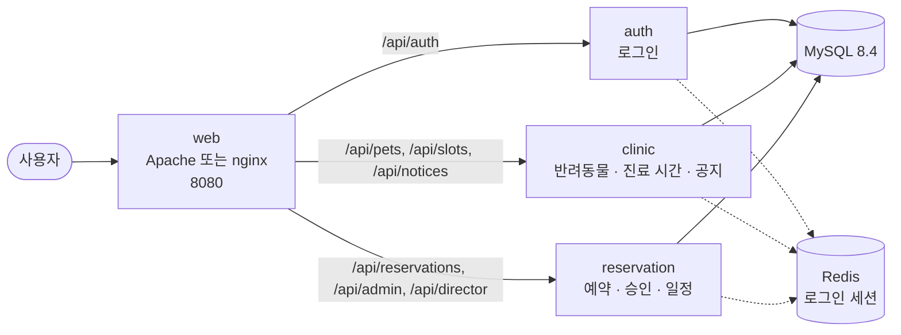

# ① ② 실행 안내 (WSL 2 Ubuntu)

과제의 ①(워크로드 테스트 환경)과 ②(이미지 빌드 · 컨테이너 테스트)를 WSL 2 Ubuntu 에서 처음부터 따라 하는 순서다. 명령은 모두 저장소의 맨 위 폴더에서 실행한다.

> 과제는 직접 실행한 결과만 인정한다. 이 문서의 "미리 확인한 결과"는 스크립트가 도는지를 2026년 11월 16일에 본 것이고, 제출할 증거는 각 단계의 명령을 직접 실행해 출력이나 화면을 남긴다. 단계마다 **남길 것**을 적어 두었다.

## 준비

| 필요한 것 | 확인 명령 | 미리 확인한 값 |
|---|---|---|
| WSL 2 Ubuntu | `cat /etc/os-release` | Ubuntu 26.04 LTS |
| JDK 21 | `javac -version` | 21.0.13 |
| Docker Engine, compose | `docker version`, `docker compose version` | 29.9 |
| curl, git | `curl --version`, `git --version` | |

JDK 가 없으면 `sudo apt update && sudo apt install -y openjdk-21-jdk` 로 설치한다. Node 는 필요 없다(화면은 이미지 안에서 빌드한다).

```bash
git clone https://github.com/9mkpark9/eks-rebuild-lab.git
cd eks-rebuild-lab
```

---

## ① 워크로드 테스트 환경

### 워크로드 분석

보듬 동물병원 예약 시스템이다. 보호자가 진료를 예약하고, 간호사가 승인하고, 원장이 일정을 본다. 중간프로젝트에서 AWS 3-Tier 로 배포했던 애플리케이션을 서비스 3개로 나눈 것이다.



| 항목 | 내용 |
|---|---|
| 구성 | APP 3개(auth, clinic, reservation) + 관계형 DB(MySQL) + 앞단 WEB. 로그인 세션은 Redis 에 둔다 |
| 언어 · 런타임 | Java 21, Spring Boot 4.1.1. Gradle 멀티 모듈(`msa/`)로 빌드해 서비스마다 실행 가능한 jar 하나가 나온다 |
| 포트 | 서비스는 8080(실행할 때 `--server.port` 로 바꿀 수 있다), MySQL 3306, Redis 6379, WEB 8080 |
| 데이터가 저장되는 곳 | **MySQL 에만 저장한다.** 서비스마다 스키마와 계정이 따로 있다(`vet_auth`, `vet_clinic`, `vet_reservation`). 파일 업로드는 없다 |
| Redis 의 역할 | 로그인 세션만 둔다(만료 30분). 업무 데이터가 아니다. Redis 가 비면 다시 로그인하면 되고 예약 데이터에는 영향이 없다. 서비스가 여러 개 떠도 로그인이 유지되게 하려고 서비스 밖에 둔 것이다 |
| 상태 | 서비스는 상태를 갖지 않는다. 어느 서비스의 어느 인스턴스가 받아도 같은 결과를 낸다 |

**외부에서 지정하는 설정 (환경 변수)**

| 환경 변수 | 뜻 | 예 |
|---|---|---|
| `SPRING_DATASOURCE_URL` | DB 주소와 스키마 | `jdbc:mysql://mysql:3306/vet_auth?connectionTimeZone=LOCAL&characterEncoding=UTF-8` |
| `SPRING_DATASOURCE_USERNAME` | DB 계정 (서비스마다 다르다) | `vet_auth` |
| `SPRING_DATASOURCE_PASSWORD` | DB 비밀번호 | (비밀) |
| `SPRING_DATA_REDIS_HOST`, `SPRING_DATA_REDIS_PORT` | Redis 주소 | `redis`, `6379` |
| `SPRING_DATA_REDIS_PASSWORD` | Redis 비밀번호 | (비밀) |
| `REDIS_TLS` | Redis 전송 암호화 | `false` (같은 네트워크 안일 때) |
| `DB_POOL_MAX` | 서비스 하나가 DB 에 여는 연결 수 | `5` |
| `APP_VERSION` | 화면과 `/api/status/…` 에 보이는 버전 | `1.0.0` |

주소와 계정이 코드나 jar 에 들어 있지 않다. 그래서 같은 jar, 같은 이미지를 ① ② ③ ④에서 설정만 바꿔 쓴다.

### 빌드

```bash
scripts/run-app.sh build
```

`msa/` 에서 `./gradlew build` 를 실행한다. 컴파일하고 자동 테스트(16개)를 돌린 뒤 jar 3개를 만든다.

미리 확인한 결과: `BUILD SUCCESSFUL in 1m 50s` (처음이라 Gradle 과 의존성을 받는 시간 포함).

```
jar: msa/auth-service/build/libs/vet-auth-1.0.0.jar (36M)
jar: msa/clinic-service/build/libs/vet-clinic-1.0.0.jar (36M)
jar: msa/reservation-service/build/libs/vet-reservation-1.0.0.jar (36M)
```

### 실행

```bash
scripts/run-app.sh up        # MySQL, Redis 를 컨테이너로 띄우고 서비스 3개를 jar 로 실행한다
scripts/run-app.sh status
```

스크립트가 하는 일은 아래와 같다. 서비스는 컨테이너가 아니라 이 PC 의 `java` 프로세스로 뜬다.

1. 비밀번호 5개를 무작위로 만들어 `build/app-run/secrets.env` 에 둔다(Git 에 올라가지 않는 폴더).
2. MySQL(`127.0.0.1:13306`)과 Redis(`127.0.0.1:16379`)를 컨테이너로 띄운다. DB 는 처음 뜰 때 스키마, 시드, 서비스별 계정을 만든다.
3. 서비스마다 위 표의 환경 변수를 주고 `java -jar … --server.port=1808N` 으로 실행한다.

DB 를 컨테이너로 띄우는 이유는, 이 단계에서 확인하려는 것이 "앱을 소스에서 빌드해 실행한다"이기 때문이다. DB 이미지(`vet-db`)가 없으면 스크립트가 먼저 만든다.

미리 확인한 결과:

```
DB 준비됨: 사용자 305명
auth         실행 중  PID 2209    포트 18081  /health 200
clinic       실행 중  PID 2236    포트 18082  /health 200
reservation  실행 중  PID 2252    포트 18083  /health 200
```

### 테스트 시나리오

항목과 기대 결과는 [테스트-시나리오.md](테스트-시나리오.md) 에 있다. 이후 모든 단계에서 같은 스크립트(`scripts/smoke.sh`)를 쓰고 주소만 바꾼다.

```bash
scripts/run-app.sh test
```

미리 확인한 결과: `결과: 통과 32, 실패 0`. 등록 · 조회 · 수정 부분은 아래처럼 나온다.

```
== 2. 보호자 예약 흐름 (조회 → 등록 → 조회 → 수정) ==
[통과] 2 반려동물 목록 — 200, 2마리, 처리 <PC 이름>
[통과] 2 예약 가능 시간 조회 → 예약 신청 — 2026-11-18 에 빈 시간 10개, 예약 번호 173, 처리 <PC 이름>
[통과] 2 내 예약 조회 — 200, 방금 신청한 예약 상태 REQUESTED
[통과] 2 예약 취소 — 204, 취소 뒤 상태 CANCELLED
```

### 데이터가 남는지 확인

앱을 다시 실행해도 데이터가 DB 에 남아 있는지 본다.

```bash
scripts/run-app.sh test --mark            # 지우지 않는 예약을 하나 만든다. 번호가 나온다
scripts/run-app.sh restart                # 서비스 3개만 끝내고 다시 실행한다 (DB 는 그대로)
scripts/run-app.sh test --verify <번호> --cleanup
```

미리 확인한 결과:

```
[통과] 표식 예약을 만들었다 — 번호 177, 날짜 2026-11-19, 보호자 owner002, 상태 REQUESTED
auth 를 끝냈다 (PID 2209) … auth 실행: PID 4343, 포트 18081
[통과] 표식 예약이 남아 있다 — 번호 177, 날짜 2026-11-19, 상태 REQUESTED
```

### 정리

```bash
scripts/run-app.sh logs auth     # 서비스 로그
scripts/run-app.sh down          # 서비스를 끝내고 MySQL, Redis 컨테이너를 지운다
```

### ① 에서 남길 것

| 과제의 완성 기준 | 남길 것 |
|---|---|
| 워크로드 분석 | 위의 구성도와 표 |
| WSL 2 Ubuntu 에서 소스를 빌드하고 실행했다 | `cat /etc/os-release`, `javac -version`, `scripts/run-app.sh build` 의 끝부분, `up` 과 `status` 의 출력 |
| 테스트 시나리오 | `테스트-시나리오.md` 의 표, `scripts/run-app.sh test` 의 출력 전체 |

출력의 "처리 …" 자리에는 PC 의 이름이 나온다(컨테이너에서는 컨테이너 ID, 쿠버네티스에서는 Pod 이름). 비밀 값은 아니지만 문서에 올릴 때 가릴지 정한다.

---

## ② 이미지 빌드 · 컨테이너 테스트

### 이미지 6개

| 이미지 | 내용 | Dockerfile |
|---|---|---|
| `vet-auth`, `vet-clinic`, `vet-reservation` | 서비스. JRE + jar | `msa/<이름>-service/Dockerfile` |
| `vet-web:…-apache`, `vet-web:…-nginx` | 화면(정적 파일)과 `/api` 를 서비스로 나눠 보내는 웹 서버. 둘 중 하나를 고른다 | `msa/web/Dockerfile.apache`, `Dockerfile.nginx` |
| `vet-db` | MySQL 8.4 + 스키마 · 시드 · 서비스별 계정을 만드는 초기화 | `msa/db/Dockerfile` |

Redis 는 공식 이미지(`redis:7-alpine`)를 그대로 쓴다.

### Dockerfile 의 각 명령 (서비스 이미지)

`msa/auth-service/Dockerfile` 기준이다. 나머지 두 서비스는 이름만 다르다. 빌드 단계와 실행 단계 둘로 나뉜다(멀티스테이지).

| 명령 | 역할 |
|---|---|
| `FROM eclipse-temurin:21-jdk-alpine AS build` | **빌드 단계.** 컴파일러(JDK)가 든 이미지에서 시작한다. 이 단계는 최종 이미지에 남지 않는다 |
| `WORKDIR /src` | 작업 폴더 |
| `COPY gradlew settings.gradle build.gradle ./` 와 `COPY …/build.gradle …` | 빌드 설정 파일만 먼저 복사한다. 소스는 아직 넣지 않는다 |
| `RUN … ./gradlew … dependencies` | 의존성(라이브러리)을 받는다. 위에서 설정 파일만 복사했기 때문에, 소스만 고쳤을 때는 이 층을 다시 만들지 않고 캐시를 쓴다 |
| `COPY common/src …`, `COPY auth-service/src …` | 이제 소스를 복사한다 |
| `ARG VERSION=dev` | 빌드할 때 받는 값. `--build-arg VERSION=1.0.0` |
| `RUN ./gradlew … bootJar …` 와 `java -Djarmode=tools … extract --layers` | jar 를 만들고, 자주 바뀌는 것과 안 바뀌는 것으로 나눠 푼다(라이브러리 / 내 코드) |
| `FROM eclipse-temurin:21-jre-alpine` | **실행 단계.** 실행에 필요한 JRE 만 든 작은 이미지에서 새로 시작한다. 컴파일러, Gradle, 소스는 여기에 없다 |
| `RUN addgroup … && adduser …` | 실행 전용 사용자(번호 10001)를 만든다 |
| `COPY --from=build /layers/dependencies/ ./` 등 4줄 | 빌드 단계에서 푼 것을 덜 바뀌는 것부터 복사한다. 코드만 고치면 마지막 층만 새로 올라간다 |
| `ENV APP_VERSION=… JAVA_TOOL_OPTIONS=…` | 버전과 JVM 옵션. 힙을 컨테이너 메모리의 50% 까지만 쓰게 한다 |
| `USER 10001:10001` | root 가 아닌 사용자로 실행한다 |
| `EXPOSE 8080` | 이 컨테이너가 쓰는 포트(문서 역할) |
| `ENTRYPOINT ["java", "-jar", "/app/app.jar"]` | 실행 명령. 셸을 거치지 않아 `java` 가 종료 신호를 직접 받고, 처리 중인 요청을 마친 뒤 끝난다 |

**빌드에서 뺀 파일**: `msa/.dockerignore`(서비스용)와 `.dockerignore`(web, db 용)에 적었다. 이전 빌드 결과(`build/`), Gradle 캐시(`.gradle/`), `node_modules`, `.git`, `.env`, 문서, 다른 이미지의 소스를 보내지 않는다. `.env` 를 빼는 것은 비밀번호가 이미지에 들어가지 않게 하기 위해서다.

### 빌드

```bash
scripts/new-env.sh           # .env 를 만든다. 비밀번호 5개를 무작위로 채우고 화면에 출력하지 않는다
docker compose build         # 이미지 5개 (web 은 Apache 판)
WEB_SERVER=nginx docker compose build web     # nginx 판도 만들려면
docker image ls | grep vet-
```

미리 확인한 결과: 새로 받은 저장소에서 5분 55초가 걸렸다(기반 이미지는 이미 받아 둔 상태였다).

```
ghcr.io/9mkpark9/vet-auth:1.0.0          357MB
ghcr.io/9mkpark9/vet-clinic:1.0.0        357MB
ghcr.io/9mkpark9/vet-reservation:1.0.0   357MB
ghcr.io/9mkpark9/vet-web:1.0.0-apache    115MB
ghcr.io/9mkpark9/vet-web:1.0.0-nginx     109MB
ghcr.io/9mkpark9/vet-db:1.0.0            1.27GB
```

### 컨테이너로 실행

```bash
docker compose up -d
docker compose ps
```

컨테이너 6개가 뜬다(`web`, `auth`, `clinic`, `reservation`, `mysql`, `redis`). 밖으로 여는 포트는 `web` 의 8088 하나다. 브라우저에서 `http://localhost:8088` 을 연다. 상태 쪽지는 `http://localhost:8088/status` 다.

설정은 `compose.yaml` 의 `environment` 에서 환경 변수로 준다. ①과 같은 변수이고 주소만 컨테이너 이름(`mysql`, `redis`)으로 바뀐다. 비밀번호는 `.env` 에서 읽는다.

```bash
scripts/smoke.sh                               # 테스트 시나리오 (①과 같은 스크립트)
```

미리 확인한 결과: `결과: 통과 54, 실패 0` (Apache 판).

**로그와 상태 확인**

```bash
docker compose ps                              # 상태 (healthy 인지)
docker compose logs --tail 20 auth             # 서비스 로그
docker compose logs -f web                     # 웹 서버 접근 로그를 계속 본다
docker stats --no-stream                       # CPU, 메모리 사용량
docker compose exec auth id                    # 컨테이너 안의 실행 사용자 (root 가 아니다)
curl -s http://localhost:8088/api/status/auth  # 버전과 응답한 컨테이너
```

미리 확인한 결과:

```
SERVICE       STATE     STATUS                     PORTS
auth          running   Up 16 seconds (healthy)    8080/tcp
clinic        running   Up 10 seconds (healthy)    8080/tcp
mysql         running   Up 29 seconds (healthy)    3306/tcp, 33060/tcp
redis         running   Up 30 seconds (healthy)    6379/tcp
web           running   Up 30 seconds (healthy)    0.0.0.0:8088->8080/tcp

$ docker run --rm --entrypoint id ghcr.io/9mkpark9/vet-auth:1.0.0
uid=10001(app) gid=10001(app) groups=10001(app)
$ docker run --rm --entrypoint id ghcr.io/9mkpark9/vet-web:1.0.0-apache
uid=82(www-data) gid=82(www-data) groups=82(www-data)
$ docker run --rm --entrypoint id ghcr.io/9mkpark9/vet-web:1.0.0-nginx
uid=101(nginx) gid=101(nginx) groups=101(nginx)
```

auth 컨테이너에 들어간 환경 변수의 이름은 `APP_VERSION`, `DB_POOL_MAX`, `REDIS_TLS`, `SPRING_DATASOURCE_URL`, `SPRING_DATASOURCE_USERNAME`, `SPRING_DATASOURCE_PASSWORD`, `SPRING_DATA_REDIS_HOST`, `SPRING_DATA_REDIS_PASSWORD` 였다(값은 출력하지 않았다).

웹 서버를 바꾸려면 `.env` 의 `WEB_SERVER` 를 `nginx` 로 고치고 `docker compose up -d web` 을 다시 실행한다. `scripts/smoke.sh` 의 결과는 같아야 한다.

### 이미지 배포 (push)

```bash
docker login                                          # 또는 docker login ghcr.io. 아이디와 토큰은 직접 입력한다
scripts/push-images.sh --registry docker.io/<내 아이디> --dry-run     # 무엇을 올릴지 본다
scripts/push-images.sh --registry docker.io/<내 아이디>
```

스크립트는 올리기 전에 이미지마다 `linux/amd64` 인지 확인하고, 아니면 멈춘다. EKS 의 노드가 `linux/amd64` 라서다. WSL 2 Ubuntu(x86-64)에서 빌드하면 `linux/amd64` 로 만들어진다.

레지스트리를 정하면 kubeadm 용 배포 파일의 이미지 주소도 같은 값으로 맞춘다(`gitops/apps/vet/overlays/kubeadm/kustomization.yaml` 의 `images`. 지금은 `ghcr.io/9mkpark9`).

④에서 ECR 로 옮길 때는 같은 스크립트에 `--ecr` 를 준다. ECR 저장소를 만들고 로그인하고 올린다.

```bash
scripts/push-images.sh --ecr
scripts/push-images.sh --ecr --list        # 올라간 것을 본다
```

미리 확인한 결과: 실제 레지스트리와 ECR 에는 올리지 않았다. 스크립트가 도는지만 보려고 WSL 안에 임시 레지스트리(`registry:2`, `localhost:5000`)를 띄워 올리고, 확인한 뒤 지웠다.

```
올릴 곳: localhost:5000/precheck   버전: 1.0.0
  vet-auth:1.0.0  linux/amd64  357MB
  vet-clinic:1.0.0  linux/amd64  357MB
  vet-reservation:1.0.0  linux/amd64  357MB
  vet-db:1.0.0  linux/amd64  1273MB
  vet-web:1.0.0-apache  linux/amd64  115MB
  vet-web:1.0.0-nginx  linux/amd64  109MB
[올림] localhost:5000/precheck/vet-auth:1.0.0  sha256:63c683d1352f…
…
[올림] localhost:5000/precheck/vet-web:1.0.0-nginx  sha256:d7e396428262…
끝.
```

`--ecr`, `--list`, `--delete` 는 실행하지 않았다.

### 정리

```bash
docker compose down
```

### ② 에서 남길 것

| 과제의 완성 기준 | 남길 것 |
|---|---|
| Dockerfile 을 작성하고 각 명령의 역할을 설명했다 | 위의 표와 Dockerfile |
| 불필요한 파일은 빌드에서 제외했다 | `.dockerignore` 두 개의 내용 |
| 설정을 환경 변수로 지정해 컨테이너로 실행했다 | `compose.yaml` 의 `environment` 부분, `docker compose ps` |
| 테스트 시나리오를 통과했다 | `scripts/smoke.sh` 의 출력 전체 |
| 로그 · 상태를 확인할 수 있다 | `docker compose logs`, `docker compose ps`, `docker stats --no-stream` 의 출력 |
| 태그를 붙여 레지스트리에 push 했다 | `scripts/push-images.sh` 의 출력, 레지스트리 화면 |
| `linux/amd64` 이미지를 포함했다 | 같은 출력의 `linux/amd64` 줄, 또는 `docker image inspect <이미지> --format '{{.Os}}/{{.Architecture}}'` |

### 선택 과제에 해당하는 것

| 선택 과제 | 이 저장소에서 | 남길 것 |
|---|---|---|
| root 가 아닌 사용자로 실행 | 서비스 10001, Apache 82, nginx 101. MySQL 이미지는 root 로 시작해 스스로 `mysql` 사용자로 내려가고, 쿠버네티스에서는 처음부터 999 로 띄운다 | `docker compose exec auth id` 등의 출력 |
| Compose 로 APP · DB 함께 실행 | `compose.yaml` | `compose.yaml` 과 `docker compose ps`, smoke 결과 |
| 빌드 최적화 | 멀티스테이지, 의존성 층 분리, jar 층 분리, `.dockerignore` | 소스 한 줄을 고친 뒤 다시 빌드해 `CACHED` 로 나오는 단계와 걸린 시간. 개선 전과의 비교는 아직 재지 않았다 |
