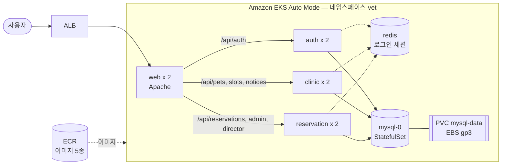
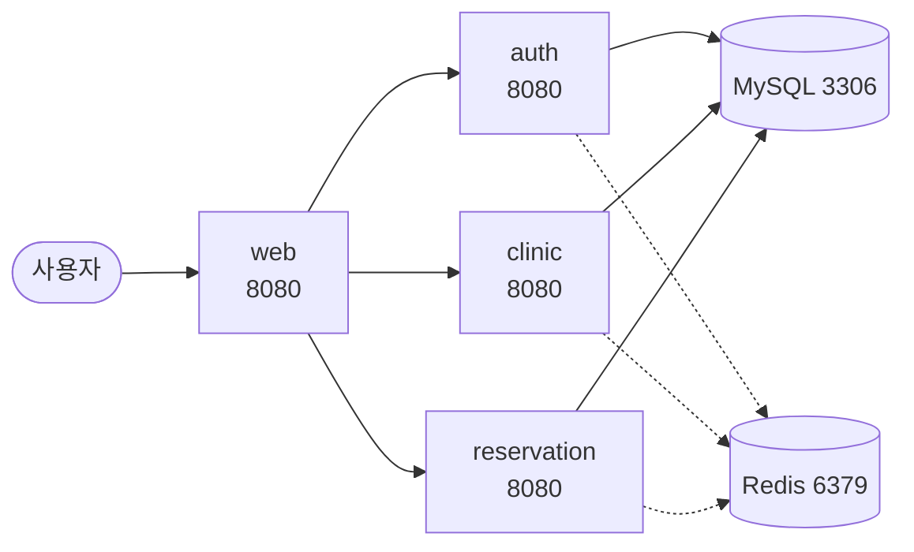

# 보듬 동물병원 예약 시스템 — 컨테이너 · Kubernetes 인프라 구축

> **작성 안내 (제출 전에 이 상자를 지운다)**
> - 이 문서는 과제의 최종 문서 목차 그대로다. Notion 으로 옮겨 제출한다.
> - 설명(무엇을, 왜)은 채워 두었다. **실행 결과는 비워 두었다.** `[실행 후]` 라고 적힌 칸에 그 환경에서 직접 실행한 출력이나 화면을 넣는다. 과제는 실행하지 않은 결과를 적으면 그 영역을 0점으로 한다.
> - 실행 순서는 `실행-안내-WSL.md`(① ②), `실행-안내-kubeadm.md`(③), `실행-안내-EKS.md`(④)에 있다.
> - 붙이기 전에 가릴 것: 비밀번호, 액세스 키, AWS 계정 번호(12자리 숫자). 스크립트는 계정 번호를 가려서 출력하지만 콘솔 화면은 직접 가린다.
> - 저장소: https://github.com/9mkpark9/eks-rebuild-lab

---

# 요약

## 워크로드 소개

보듬 동물병원 예약 시스템이다. 보호자가 진료를 예약하고, 간호사가 승인하고, 원장이 일정을 본다. 중간프로젝트에서 AWS 3-Tier(EC2 + RDS)로 배포했던 애플리케이션이고, 이번에 서비스 3개로 나눠 컨테이너로 만들었다.

| 항목 | 내용 |
|---|---|
| 구성 | APP 3개(auth, clinic, reservation) + 관계형 DB(MySQL 8.4) + 앞단 WEB(Apache 또는 nginx) + 로그인 세션 저장소(Redis) |
| 언어 · 런타임 | Java 21, Spring Boot. 화면은 React 와 정적 HTML |
| 데이터 | MySQL 에만 저장한다. 파일 업로드는 없다 |
| 설정 | DB 주소, 계정, 비밀번호를 모두 환경 변수로 받는다 |
| 빌드 | 소스에서 직접 이미지를 만든다 (이미지 6개) |

## 최종 아키텍처



- 밖에서 들어오는 길은 ALB → web 하나다. 서비스 3개, DB, Redis 는 클러스터 안에서만 보인다(ClusterIP).
- web 과 서비스 3개는 Pod 가 2개씩이고 서로 다른 노드에 놓인다.
- DB 는 Pod 하나이고 데이터는 볼륨(EBS)에 있다. Pod 가 바뀌어도 데이터가 남는다.

## 단계별로 바뀐 것 한눈에 보기

같은 애플리케이션을 실행 기반만 바꿔 세 번 옮겼다. 앱 코드와 테스트 시나리오는 그대로다.

| | ① 테스트 환경 | ② 컨테이너 | ③ 직접 만든 Kubernetes | ④ EKS |
|---|---|---|---|---|
| 어디서 | WSL 2 Ubuntu | WSL 2 Ubuntu, Docker Engine | EC2 3대, kubeadm | EKS Auto Mode |
| 앱이 뜨는 방식 | `java -jar` 프로세스 3개 | 컨테이너 (compose) | Pod, 서비스마다 2개 | 같다 |
| DB | MySQL 컨테이너 | MySQL 컨테이너 | MySQL Pod(StatefulSet) + 볼륨 | 같다 |
| DB 의 데이터가 있는 곳 | 컨테이너 안 | 컨테이너 안 | 워커 노드의 디스크 | EBS |
| 설정을 주는 방법 | 셸의 환경 변수 | `compose.yaml` 의 `environment`, `.env` | ConfigMap + Secret | 같다 |
| 밖에서 들어오는 길 | 서비스의 포트에 직접 | web 의 8088 포트 | NodePort 30080 | ALB (80) |
| 이미지가 있는 곳 | (이미지 없음) | 내 PC → 레지스트리 | 레지스트리 | ECR |
| 죽으면 누가 살리나 | 아무도 | Docker(재시작 정책) | 쿠버네티스 | 쿠버네티스, 노드는 AWS |
| 테스트 | `smoke.sh` 서비스 주소로 | `smoke.sh` | `smoke.sh` + `test-k8s-ops.sh` | 같다, 주소만 ALB |
| 결과 | `[실행 후]` | `[실행 후]` | `[실행 후]` | `[실행 후]` |

## 테스트 시나리오

①에서 정한 시나리오를 모든 단계에서 그대로 썼다. 스크립트 하나(`scripts/smoke.sh`)이고 단계마다 **주소만 바꾼다.** bash 와 curl 만 있으면 돈다.

| # | 종류 | 무엇을 하나 | 기대 결과 |
|---|---|---|---|
| 1 | 조회 | 보호자 로그인, 내 정보 | 200, 역할 `OWNER` |
| 2-1 | 조회 | 반려동물 목록 | 200, 1마리 이상 |
| 2-2 | **등록** | 빈 시간을 찾아 예약 신청 | 201, 예약 번호 |
| 2-3 | 조회 | 내 예약 | 방금 신청한 예약이 `REQUESTED` |
| 2-4 | **수정** | 예약 취소 | 204, 다시 조회하면 `CANCELLED` |
| 3-1 | 조회 | 간호사 로그인, 예약 현황 | 보호자가 신청한 예약이 `REQUESTED` |
| 3-2 | **수정** | 승인 | 200, `CONFIRMED` |
| 4 | 조회 | 원장 로그인, 내 일정 | 200, 진료 시간 1칸 이상 |
| 버전 | 조회 | 서비스별 버전과 응답한 서버 | 본문의 버전과 응답 헤더가 같다 |
| DB | 권한 | 서비스 계정이 남의 데이터를 못 건드린다 | 자기 것은 허용, 남의 것은 거부 |
| 5 | 격리 | 서비스 하나를 멈춘다 | 멈춘 경로만 JSON 503, 나머지는 200 |

로그인은 auth, 반려동물과 빈 시간은 clinic, 예약은 reservation 이 맡는다. 예약 하나를 등록하고 조회하고 수정하는 흐름이 서비스 3개와 DB, 세션 저장소를 모두 지난다.

데이터가 남는지는 따로 본다. 지우지 않는 예약을 하나 만들고(`--mark`), 앱이나 DB 를 다시 띄운 뒤, 그 예약이 남아 있는지 확인한다(`--verify`).

---

# ① 워크로드 테스트 환경

## 워크로드 분석



| 항목 | 내용 |
|---|---|
| 실행 조건 | Java 21. 서비스마다 실행 가능한 jar 하나(`java -jar`). 포트는 8080 이고 실행할 때 바꿀 수 있다 |
| 서비스가 맡은 일 | auth: 로그인. clinic: 반려동물, 진료 시간, 공지. reservation: 예약, 승인, 일정 |
| 데이터가 저장되는 곳 | MySQL. 서비스마다 스키마와 계정이 따로 있다(`vet_auth`, `vet_clinic`, `vet_reservation`). 남의 데이터는 뷰로 읽기만 한다 |
| Redis | 로그인 세션만 둔다(만료 30분). 업무 데이터가 아니다. 서비스가 여러 개 떠도 로그인이 유지되게 하려고 서비스 밖에 뒀다. 비어도 다시 로그인하면 되고 예약에는 영향이 없다 |
| 상태 | 서비스는 상태를 갖지 않는다. 어느 인스턴스가 받아도 결과가 같다. 그래서 Pod 를 여러 개 띄울 수 있다 |

**외부에서 지정하는 설정**

| 환경 변수 | 뜻 |
|---|---|
| `SPRING_DATASOURCE_URL` | DB 주소와 스키마 |
| `SPRING_DATASOURCE_USERNAME`, `SPRING_DATASOURCE_PASSWORD` | DB 계정과 비밀번호 (서비스마다 다르다) |
| `SPRING_DATA_REDIS_HOST`, `SPRING_DATA_REDIS_PASSWORD` | Redis 주소와 비밀번호 |
| `REDIS_TLS` | Redis 전송 암호화 여부 |
| `DB_POOL_MAX` | 서비스 하나가 DB 에 여는 연결 수 |
| `APP_VERSION` | 화면과 `/api/status/…` 에 보이는 버전 |

주소와 계정이 코드나 jar 에 들어 있지 않다. 같은 jar 와 같은 이미지를 네 단계에서 설정만 바꿔 썼다.

## 테스트 환경

| 필요한 것 | 버전 |
|---|---|
| WSL 2 Ubuntu | `[실행 후]` `cat /etc/os-release` |
| JDK | `[실행 후]` `javac -version` |
| Docker Engine | `[실행 후]` `docker version` |

같은 환경을 만드는 순서:

```bash
sudo apt update && sudo apt install -y openjdk-21-jdk     # JDK 가 없을 때
git clone https://github.com/9mkpark9/eks-rebuild-lab.git && cd eks-rebuild-lab
scripts/run-app.sh build      # 소스를 빌드한다 (./gradlew build, 자동 테스트 16개 포함)
scripts/run-app.sh up         # MySQL, Redis 를 컨테이너로 띄우고 서비스 3개를 jar 로 실행한다
scripts/run-app.sh status
```

서비스는 컨테이너가 아니라 이 PC 의 `java` 프로세스로 뜬다(포트 18081 ~ 18083). 설정은 위 표의 환경 변수로 준다. DB 와 Redis 만 컨테이너로 띄웠다. 이 단계에서 보려는 것이 "앱을 소스에서 빌드해 실행한다"이기 때문이다.

## 확인 결과

```bash
scripts/run-app.sh test                                  # 테스트 시나리오
scripts/run-app.sh test --mark                           # 데이터 유지: 예약을 하나 남긴다
scripts/run-app.sh restart                               # 서비스 3개만 다시 실행한다
scripts/run-app.sh test --verify <번호> --cleanup
```

| 완성 기준 | 결과 |
|---|---|
| 소스를 빌드했다 | `[실행 후]` `run-app.sh build` 의 끝부분 (`BUILD SUCCESSFUL`, jar 3개) |
| 실행했다 | `[실행 후]` `run-app.sh up`, `status` 의 출력 |
| 테스트 시나리오 통과 | `[실행 후]` `run-app.sh test` 의 출력 전체 (`결과: 통과 32, 실패 0`) |
| 데이터가 남는다 | `[실행 후]` `--mark` → `restart` → `--verify` 의 출력 |

---

# ② 이미지 빌드 · 컨테이너 테스트

## 이미지 빌드

| 이미지 | 내용 | Dockerfile |
|---|---|---|
| `vet-auth`, `vet-clinic`, `vet-reservation` | 서비스 (JRE + jar) | `msa/<이름>-service/Dockerfile` |
| `vet-web` | 화면과, `/api` 를 서비스로 나눠 보내는 웹 서버. Apache 판과 nginx 판 | `msa/web/Dockerfile.apache`, `Dockerfile.nginx` |
| `vet-db` | MySQL 8.4 + 스키마, 시드, 서비스별 계정을 만드는 초기화 | `msa/db/Dockerfile` |

**Dockerfile 의 각 명령** (서비스 이미지. 세 서비스가 이름만 다르다)

| 명령 | 역할 |
|---|---|
| `FROM eclipse-temurin:21-jdk-alpine AS build` | 빌드 단계. 컴파일러(JDK)가 든 이미지에서 시작한다. 이 단계는 최종 이미지에 남지 않는다 |
| `WORKDIR /src` | 작업 폴더 |
| `COPY gradlew settings.gradle build.gradle ./` 등 | 빌드 설정 파일만 먼저 복사한다 |
| `RUN ./gradlew … dependencies` | 의존성을 받는다. 설정 파일만 복사한 상태라, 소스만 고쳤을 때는 이 층을 캐시에서 쓴다 |
| `COPY common/src …`, `COPY auth-service/src …` | 소스를 복사한다 |
| `ARG VERSION=dev` | 빌드할 때 받는 버전 |
| `RUN ./gradlew … bootJar` 와 `java -Djarmode=tools … extract --layers` | jar 를 만들고, 라이브러리와 내 코드로 나눠 푼다 |
| `FROM eclipse-temurin:21-jre-alpine` | 실행 단계. JRE 만 든 이미지에서 새로 시작한다. 컴파일러, Gradle, 소스가 없다 |
| `RUN addgroup … && adduser …` | 실행 전용 사용자(10001)를 만든다 |
| `COPY --from=build /layers/…` 4줄 | 덜 바뀌는 것부터 복사한다. 코드만 고치면 마지막 층만 새로 올라간다 |
| `ENV APP_VERSION=… JAVA_TOOL_OPTIONS=…` | 버전과 JVM 옵션(힙은 컨테이너 메모리의 50% 까지) |
| `USER 10001:10001` | root 가 아닌 사용자로 실행한다 |
| `EXPOSE 8080` | 쓰는 포트 |
| `ENTRYPOINT ["java", "-jar", "/app/app.jar"]` | 실행 명령. 셸을 거치지 않아 `java` 가 종료 신호를 직접 받는다 |

**빌드에서 뺀 파일** (`.dockerignore`, `msa/.dockerignore`): 이전 빌드 결과, Gradle 캐시, `node_modules`, `.git`, 문서, 다른 이미지의 소스, 그리고 `.env`. `.env` 를 빼서 비밀번호가 이미지에 들어가지 않는다.

```bash
scripts/new-env.sh            # .env 를 만든다. 비밀번호는 무작위이고 화면에 나오지 않는다
docker compose build
docker image ls | grep vet-
```

## 컨테이너 실행

```bash
docker compose up -d
docker compose ps
scripts/smoke.sh
```

컨테이너 6개가 뜬다(`web`, `auth`, `clinic`, `reservation`, `mysql`, `redis`). 설정은 `compose.yaml` 의 `environment` 에서 환경 변수로 준다. ①과 같은 변수이고, 주소가 컨테이너 이름(`mysql`, `redis`)으로 바뀐다. 밖으로 여는 포트는 web 하나다.

로그와 상태는 `docker compose logs`, `docker compose ps`, `docker stats` 로 본다.

## 이미지 배포

```bash
docker login
scripts/push-images.sh --registry <레지스트리 주소>
```

스크립트가 올리기 전에 이미지마다 `linux/amd64` 인지 확인한다. EKS 의 노드가 `linux/amd64` 이기 때문이다.

## 확인 결과

| 완성 기준 | 결과 |
|---|---|
| 이미지를 빌드했다 | `[실행 후]` `docker compose build` 의 끝부분, `docker image ls` |
| 설정을 환경 변수로 지정해 실행했다 | `[실행 후]` `docker compose ps` |
| 테스트 시나리오 통과 | `[실행 후]` `scripts/smoke.sh` 의 출력 전체 (`결과: 통과 54, 실패 0`) |
| 로그 · 상태를 확인할 수 있다 | `[실행 후]` `docker compose logs --tail 20 auth`, `docker stats --no-stream` |
| 태그를 붙여 push 했다 | `[실행 후]` `push-images.sh` 의 출력, 레지스트리 화면 |
| `linux/amd64` | `[실행 후]` 같은 출력의 `linux/amd64` 줄 |

---

# ③ Kubernetes 전환

## 클러스터 구축

EC2 3대에 kubeadm 으로 만들었다. 컨트롤 플레인 1대와 워커 2대다.

| 노드 | 역할 | 크기 | `[실행 후]` 상태 |
|---|---|---|---|
| | 컨트롤 플레인 | | |
| | 워커 | | |
| | 워커 | | |

`[실행 후]` `kubectl get nodes -o wide`

**보안 그룹 — 필요한 포트만**

| 포트 | 프로토콜 | 출처 | 쓰는 곳 |
|---|---|---|---|
| 22 | TCP | 내 IP | SSH |
| 30080 | TCP | 내 IP | web 의 NodePort. 밖에서 들어오는 유일한 길 |
| 6443 | TCP | 같은 보안 그룹 | API 서버 |
| 10250 | TCP | 같은 보안 그룹 | kubelet (로그, exec, 프로브) |
| 2379-2380, 10257, 10259 | TCP | 같은 보안 그룹 | etcd, 컨트롤러 매니저, 스케줄러 |
| `[실행 후: 수업의 CNI 방식에 맞게]` | | 같은 보안 그룹 | 다른 노드의 Pod 와 통신 |

열지 않은 것: 3306, 6379, 8080, NodePort 범위 전체. `[실행 후]` 보안 그룹 인바운드 규칙 화면

## 배포와 운영

배포 파일은 Kustomize 로 만들었다. 바탕(`base`)에 공통 내용이 있고, 클러스터마다 다른 것만 `overlays/kubeadm`, `overlays/eks` 에 있다.

```bash
kubectl label node <워커 이름> vet-db=true        # DB 를 둘 워커
kubectl apply -f gitops/cluster/kubeadm/          # 볼륨 등록
scripts/new-k8s-secrets.sh -n vet                 # Secret
kubectl apply -k gitops/apps/vet/overlays/kubeadm
```

| 과제 | 어떻게 했나 |
|---|---|
| 여러 Pod | web 과 서비스 3개가 `replicas: 2`. 분산 규칙(`topologySpreadConstraints`)으로 두 Pod 가 서로 다른 노드에 놓인다 |
| Probe | 서비스: `startupProbe`(뜨는 동안 최대 120초 기다림), `readinessProbe`(준비된 Pod 만 요청을 받음), `livenessProbe`(멈추면 재시작). 모두 `/health` |
| 롤링 업데이트 | `maxSurge: 1`, `maxUnavailable: 0`. 새 Pod 가 준비된 뒤에 옛 Pod 를 내린다. 내려갈 때는 5초 기다린 뒤 처리 중인 요청을 마치고 끝난다 |
| 롤백 | `kubectl rollout undo`. 이전 리비전의 설정으로 다시 롤링 업데이트한다 |
| 자동 복구 | Deployment 가 Pod 수를 2개로 유지한다. 하나를 지우면 새로 만든다 |
| 정비 중 보호 | PodDisruptionBudget 으로 서비스마다 최소 1개를 남긴다 |

## 노출

NodePort 30080 으로 열었다.

- kubeadm 으로 만든 클러스터에는 `LoadBalancer` Service 에 주소를 주는 장치가 없다. 수업의 MetalLB(L2)는 AWS 의 VPC 에서 동작하지 않는다.
- NodePort 는 추가 설치 없이 모든 노드의 같은 포트로 들어올 수 있다.
- 밖에서 들어오는 길을 web 하나로 좁혔다. 서비스 3개, DB, Redis 는 `ClusterIP` 라 클러스터 안에서만 보인다.
- 잃는 것: 주소가 노드의 IP 다. 그 노드가 죽으면 다른 노드의 IP 로 바꿔야 하고 포트가 80 이 아니다. ④에서 ALB 가 해결한다.

## 데이터와 설정

| 과제 | 어떻게 했나 |
|---|---|
| DB 데이터를 볼륨에 | PVC `mysql-data`. kubeadm 에는 볼륨을 만들어 주는 장치가 없어서 워커 한 대의 폴더를 PersistentVolume 으로 직접 등록했다 |
| DB 는 한 번에 하나만 | MySQL 을 StatefulSet 으로 띄웠다. 옛 Pod 가 완전히 끝난 뒤에 새 Pod 를 띄운다 (회고 1) |
| 설정은 ConfigMap | `vet-config` 에 DB 주소, 연결 수, Redis 주소. 서비스 3개가 `envFrom` 으로 받는다 |
| 비밀번호는 Secret | `vet-db`(DB 계정 4개), `vet-redis`. Git 에 넣지 않고 클러스터에서 스크립트로 만든다. 값은 무작위이고 화면에 나오지 않는다 |

## 확인 결과

```bash
# 내 PC 에서 (클러스터 밖)
scripts/smoke.sh --base-url http://<노드 공인 IP>:30080 --isolation none
# 컨트롤 플레인에서
scripts/smoke.sh --base-url http://localhost:30080 --isolation k8s -n vet
scripts/test-k8s-ops.sh --base-url http://localhost:30080 -n vet --compare
```

| 완성 기준 | 결과 |
|---|---|
| 노드가 모두 `Ready` | `[실행 후]` `kubectl get nodes -o wide` |
| 여러 Pod 로 배포 | `[실행 후]` `kubectl -n vet get deploy,sts`, `kubectl -n vet get pods -o wide` (두 Pod 의 NODE 가 다르다) |
| Probe | `[실행 후]` `kubectl -n vet describe deploy auth` 의 Liveness, Readiness, Startup |
| 롤링 업데이트 · 롤백 | `[실행 후]` `test-k8s-ops.sh` 의 1, 2번 (버전 `1.0.0` → `rollback-test` → `1.0.0`) |
| Pod 삭제 후 자동 복구 | `[실행 후]` `test-k8s-ops.sh` 의 3번 |
| 클러스터 밖에서 시나리오 통과 | `[실행 후]` PC 에서 돌린 `smoke.sh` 의 출력, 브라우저 화면 |
| DB 는 클러스터 안에서만 | `[실행 후]` `kubectl -n vet get svc`, PC 에서 `nc -zv -w 3 <노드 IP> 3306` 이 실패하는 화면 |
| DB Pod 교체 후 데이터 유지 | `[실행 후]` `test-k8s-ops.sh` 의 4번, `kubectl -n vet get pvc,pv` |
| ConfigMap 과 Secret | `[실행 후]` `kubectl -n vet get configmap vet-config -o yaml`, `kubectl -n vet describe secret vet-db` (값은 나오지 않는다) |

---

# ④ EKS 전환

## ECR · EKS 준비

```bash
scripts/push-images.sh --ecr          # ECR 저장소를 만들고 이미지를 올린다
```

`[실행 후]` 클러스터를 만든 방법과 명령, `kubectl get nodes -o wide -L topology.kubernetes.io/zone`

**직접 만든 클러스터와 비교 — EKS 가 대신하는 일**

| 일 | kubeadm (③) | EKS Auto Mode (④) |
|---|---|---|
| 컨트롤 플레인 | EC2 한 대에 직접 설치. 그 한 대가 죽으면 `kubectl` 과 배포가 멈춘다 | AWS 가 여러 가용 영역에 두고 관리한다 |
| 노드 만들기 | EC2 생성, 컨테이너 런타임과 kubelet 설치, `kubeadm join` | Pod 가 생기면 맞는 크기의 노드를 만들고, 비면 없앤다 |
| 노드의 OS 와 패치 | 직접 | AWS 가 관리하는 이미지 |
| Pod 네트워크 | Calico 를 설치하고 보안 그룹에 포트를 연다 | 들어 있다. Pod 가 VPC 의 IP 를 받는다 |
| 밖으로 여는 법 | NodePort | Ingress 를 만들면 ALB 를 만들어 준다 |
| 볼륨 | 노드의 폴더를 직접 등록 | PVC 를 만들면 EBS 를 만들어 붙인다 |
| 보안 그룹 | 포트를 하나씩 직접 | 클러스터와 노드의 것은 만들어 준다 |
| 이미지 받기 | 공개 레지스트리 | 노드의 IAM 역할로 ECR 에서 |
| 버전 올리기 | `kubeadm upgrade` 를 노드마다 | 컨트롤 플레인은 명령 하나, 노드는 자동 교체 |

**그래도 직접 한 것**: StorageClass 와 IngressClass 만들기, 배포 파일, Secret, 자원 삭제.

## 배포와 노출

```bash
kubectl apply -f gitops/cluster/eks/      # StorageClass(EBS), IngressClass(ALB)
scripts/new-k8s-secrets.sh -n vet
scripts/eks-apply.sh                      # ECR 주소를 넣어 적용한다
kubectl -n vet get ingress web            # ALB 주소
```

ECR 주소에는 AWS 계정 번호가 들어 있어 Git 에 적지 않았다. 배포 파일에는 자리 표시만 있고, `scripts/eks-apply.sh` 가 적용하는 순간에 지금 로그인한 계정의 주소로 바꾼다.

**③에서 바꾼 값과 그 이유**

바탕(`base`)은 한 글자도 다르지 않다. 다른 것은 두 overlay 폴더의 차이가 전부다.

| 항목 | kubeadm (③) | EKS (④) | 바꾼 이유 |
|---|---|---|---|
| 밖으로 여는 법 | NodePort 30080 | Ingress → ALB | EKS 는 Ingress 를 보고 ALB 를 만들어 준다. 주소가 노드에 묶이지 않고 포트가 80 이다 |
| DB 의 볼륨 | 노드 한 대의 디스크, 직접 등록 | EBS, 자동 생성 | 노드가 바뀌어도 볼륨이 따라간다 |
| 이미지를 받는 곳 | 공개 레지스트리 | ECR | 노드가 IAM 역할로 받는다 |
| redis 이미지 | Docker Hub | ECR Public 의 같은 이미지 | Docker Hub 의 익명 내려받기 제한을 피한다 |
| web 의 종료 대기 | 5초 | 15초 | ALB 가 내려가는 Pod 를 대상에서 빼는 데 더 오래 걸린다 |
| mysql, redis | 표시 없음 | 노드 정리 대상에서 제외 | Auto Mode 는 덜 찬 노드를 스스로 정리한다. Pod 가 하나뿐인 둘은 옮기지 않게 한다 |
| 클러스터 준비 | StorageClass + PersistentVolume, 노드 라벨 | StorageClass + IngressClass | 볼륨을 직접 등록할 필요가 없다 |
| 보안 그룹 | 포트를 직접 열었다 | 손대지 않았다 | 클러스터가 만들어 준다 |

`[실행 후: 실제로 더 바꾼 값이 있으면 이 표에 더한다]`

## 데이터 유지

EKS Auto Mode 는 StorageClass 를 만들어 두지 않는다. `ebs.csi.eks.amazonaws.com` 을 쓰는 StorageClass(`vet-ebs`)를 직접 만들었다. PVC 가 생기면 Pod 가 놓인 가용 영역에 EBS 볼륨이 만들어져 붙는다.

## 비용과 정리

| 자원 | 과금 단위 | 누가 만드나 | 지우는 법 |
|---|---|---|---|
| EKS 컨트롤 플레인 | 클러스터 x 시간 | 클러스터 생성 | 클러스터 삭제 |
| 노드 (EC2) | 인스턴스 x 시간 + Auto Mode 관리 요금 | Auto Mode | 클러스터 삭제 |
| ALB | 시간 + 처리량 | Ingress | Ingress 삭제 |
| EBS 볼륨 | GB x 월 | PVC | PVC 삭제 |
| NAT 게이트웨이, 탄력적 IP | 시간 + 처리량 | 클러스터용 VPC | VPC 와 함께 |
| ECR | 저장한 GB x 월 | 이미지 push | 저장소 삭제 |
| ③의 EC2 3대 | 인스턴스 x 시간, 정지해도 디스크 요금 | 직접 | 종료 |

`[실행 후: 실제로 쓴 기간과 요금표의 금액]`

**삭제 순서.** 클러스터를 먼저 지우면 ALB 와 EBS 가 남아 요금이 계속 나오고 VPC 도 지워지지 않는다.

```bash
scripts/eks-apply.sh --delete              # 1) 앱. ALB 와 EBS 볼륨이 함께 지워진다
kubectl delete -f gitops/cluster/eks/      # 2) StorageClass, IngressClass
#                                            3) 클러스터 삭제
scripts/push-images.sh --ecr --delete      # 4) ECR 저장소
#                                            5) ③의 EC2 3대 종료
scripts/aws-leftovers.sh                   # 6) 남은 것이 없는지 확인
```

## 확인 결과

```bash
scripts/smoke.sh --base-url http://<ALB 주소> --isolation k8s -n vet
scripts/test-k8s-ops.sh --base-url http://<ALB 주소> -n vet --compare
```

| 완성 기준 | 결과 |
|---|---|
| 이미지를 ECR 로 옮겼다 | `[실행 후]` `push-images.sh --ecr --list`, Pod 의 Events 에서 `Pulled … dkr.ecr …` |
| 클러스터를 생성했다 | `[실행 후]` `kubectl get nodes -o wide` |
| ALB 주소로 시나리오 통과 | `[실행 후]` `kubectl -n vet get ingress web`, `smoke.sh` 의 출력 전체, 브라우저 화면 |
| StorageClass 를 직접 생성 | `[실행 후]` `kubectl get sc vet-ebs`, `kubectl -n vet get pvc,pv` |
| APP · DB Pod 교체 후 데이터 유지 | `[실행 후]` `test-k8s-ops.sh` 의 3, 4번 |
| 발표 후 삭제, 남은 자원 없음 | `[실행 후]` `scripts/aws-leftovers.sh` 의 출력 (`결과: 남은 자원이 없다.`) |

---

# 선택 과제

| 영역 | 과제 | 한 것 | 결과 |
|---|---|---|---|
| 이미지 | root 가 아닌 사용자로 실행 | 서비스 10001, Apache 82, nginx 101 | `[실행 후]` `docker run --rm --entrypoint id <이미지>` |
| 로컬 | Compose 로 APP · DB 함께 실행 | `compose.yaml` (컨테이너 6개) | ②의 확인 결과 |
| Kubernetes | 무중단 롤링 업데이트 | readiness 프로브, `maxUnavailable: 0`, 종료 전 대기, 처리 중인 요청을 마치고 종료 | `[실행 후]` `test-k8s-ops.sh --compare`: 무중단 설정일 때와 Recreate 일 때의 전체 요청 수와 실패 수 |
| Kubernetes | Kustomize | `base` 하나 + `overlays/kubeadm`, `overlays/eks` | 폴더 구조, ④의 "바꾼 값" 표, `[실행 후]` `kubectl apply -k` 의 출력 |
| Kubernetes | 리소스 요청 · 분산 배치 · PDB | 모든 Pod 에 요청과 한도, 노드와 가용 영역 분산, PodDisruptionBudget 4개 | `[실행 후]` `kubectl -n vet get pdb`, Pod 배치 |
| EKS | 가용 영역 분산 | 바탕의 분산 규칙 | `[실행 후]` Pod 가 놓인 노드와 그 노드의 영역 |
| EKS | RDS 로 DB 전환 | `[했다면]` DB 조각을 `db-external` 로 바꾼다. 초기화 Job 이 스키마와 계정을 만든다 | `[실행 후]` |
| EKS | 자동 확장 | `[했다면]` `autoscale` 조각을 켠다 | `[실행 후]` |

Helm 은 쓰지 않았다. 환경 간 차이가 작아서(노출 방법, 볼륨, 이미지 주소) 바탕에 차이만 덧씌우는 Kustomize 로 충분했다. 여러 사람에게 값을 바꿔 배포하게 할 패키지라면 Helm 이 맞다.

---

# 회고

## 겪은 문제와 해결

> 아래 둘은 EC2 에 올리기 전에 내 PC 의 클러스터에서 찾은 것이다. `[실행 후: EC2 나 EKS 에서 실제로 겪은 문제가 있으면 그것으로 바꾸거나 더한다]`

### 1. MySQL Pod 를 지우자 새 Pod 가 데이터 파일을 잠그지 못했다

- **증상**: MySQL 에 볼륨을 붙이고 Pod 를 지우는 시험을 했다. 데이터는 남았고 테스트도 통과했는데, 새 Pod 의 로그에 오류가 있었다.

```
[ERROR] [MY-012574] [InnoDB] Unable to lock ./ibdata1 error: 11
[ERROR] [MY-012574] [InnoDB] Unable to lock ./ibdata1 error: 11
[System] [MY-010931] [Server] /usr/sbin/mysqld: ready for connections.
```

- **원인을 찾은 과정**: `error: 11` 은 다른 프로세스가 파일을 잡고 있다는 뜻이다. 그 시각에 누가 잡고 있었는지를 봤다. Pod 를 지우면 옛 Pod 는 종료 처리를 하는 동안 남아 있는데, Deployment 는 그것을 기다리지 않고 새 Pod 를 바로 만든다. 두 MySQL 이 잠깐 같은 데이터 폴더를 본 것이다.
- **원인**: Deployment 는 "한 번에 하나만 뜬다"를 보장하지 않는다. 볼륨이 없던 때는 Pod 마다 빈 폴더를 받아 드러나지 않았다.
- **해결**: MySQL 을 StatefulSet 으로 바꿨다. 옛 Pod 가 완전히 끝난 뒤에 같은 이름으로 다시 띄운다.
- **확인**: 같은 시험에서 그 오류가 0줄이고 데이터는 남는다.
- **배운 점**: 이번에는 InnoDB 의 파일 잠금이 막아 줘서 데이터가 상하지 않았다. 테스트가 통과해도 로그를 봐야 한다. 디스크를 가진 프로그램은 처음부터 한 번에 하나만 뜨는 방식으로 띄운다.

### 2. 워커가 2대면 롤링 업데이트의 새 Pod 가 자리를 못 찾는다

- **증상**: "워커 2대에 복제본 2개, 배포 중에는 3개"를 손으로 따져 보다가 분산 규칙이 걸린다는 것을 알았다. 내 PC 는 노드가 1개라 드러나지 않아서, Pod 를 놓을 수 없는 노드를 하나 더 등록해 재현했다.

```
auth-74fb756cd-dmkzc   0/1   Pending
Warning  FailedScheduling  0/2 nodes are available: 1 node(s) didn't match pod topology spread constraints, 1 node(s) had untolerated taint(s).
```

- **원인**: 분산 규칙은 "노드마다 놓인 Pod 수의 차이가 1 이하"인데, 기본값은 컨트롤 플레인처럼 Pod 를 놓을 수 없는 노드도 "0개인 노드"로 센다. 2개, 1개, 0개가 되어 차이가 2 다.
- **해결**: 분산 규칙에 `nodeTaintsPolicy: Honor` 를 넣어 그런 노드를 계산에서 뺐다.
- **확인**: 같은 상태에서 네 개의 배포가 모두 끝났다. `[실행 후: EC2 에서 kubectl -n vet rollout restart deployment/auth 가 끝난 출력]`
- **배운 점**: 노드가 1개인 곳에서 통과한 것은 노드가 여러 대인 곳의 동작을 보장하지 않는다. 올리기 전에 그 클러스터의 노드 구성에서 Pod 가 어디에 몇 개 놓이는지를 따져 본다.

## 직접 구축과 관리형의 차이

- **직접 구축(kubeadm)에서 한 일**: 노드 3대의 설치, 네트워크 플러그인, 보안 그룹의 포트, 볼륨 등록, 노출 방법을 모두 직접 정했다. 무엇이 어디서 도는지 다 보이는 대신, 컨트롤 플레인 한 대가 죽으면 관리가 멈추고, 볼륨은 노드 한 대에 묶이고, 접속 주소는 노드의 IP 다.
- **관리형(EKS)에서 달라진 것**: 컨트롤 플레인과 노드를 만들고 고치는 일이 없어졌다. Ingress 와 PVC 를 만들면 ALB 와 EBS 가 따라 만들어진다. 대신 무엇이 요금을 내는지, 어떤 순서로 지워야 남지 않는지를 알아야 한다.
- **바뀌지 않은 것**: 앱의 배포 파일이다. 바탕은 그대로이고 overlay 몇 줄만 달랐다. 쿠버네티스의 API 가 같기 때문에 가능했다.
- `[실행 후: 실제로 해 보고 느낀 것. 예: 걸린 시간, 막혔던 곳, 어느 쪽이 무엇에 맞다고 느꼈는지]`

## 한계와 다음에 할 것

- MySQL 과 Redis 는 Pod 가 하나다. MySQL Pod 가 바뀌는 몇 초 동안 DB 를 쓰는 요청은 실패하고, Redis 가 바뀌면 모두 로그아웃된다. 실무라면 RDS 와 관리형 캐시를 쓴다.
- HTTP 만 쓴다. 도메인과 인증서를 붙이지 않았다.
- Secret 을 스크립트로 직접 만든다. 실무라면 비밀 저장소(AWS Secrets Manager)에서 받아 온다.
- 배포를 사람이 `kubectl` 로 한다. 다음에는 Git 에 올리면 자동으로 반영되게 하고(Argo CD), 클러스터와 네트워크도 코드로 만든다(Terraform).
