# ① 워크로드 테스트 환경

이미지로 만들기 전에, 소스를 빌드해 직접 실행하고 기능이 되는지 확인한 기록이다.
**환경은 WSL 2 Ubuntu 다.** 여기 실린 화면은 모두 2026-11-24 에 WSL 2 에서 직접 실행하고 실제 터미널을 캡처한 것이다 (`v2/tests/shot.ps1`: 새 콘솔 창에서 명령을 실행하고 창을 그대로 찍는다. 첫 줄은 bash 가 찍은 명령 줄이다).
처음(2026-11-23)에는 Windows 의 Git Bash 에서 했다. 9장의 W-1 ~ W-3 은 그때 겪은 문제라 그때의 출력을 글로 남겼다 (캡처 없음).

## 0. 완성 기준과 근거

| 과제 | 완성 기준 (명세) | 결과 | 근거 |
|---|---|---|---|
| 워크로드 분석 | 구성도, 실행 조건(언어·런타임·포트), 데이터가 저장되는 곳, 외부에서 지정하는 설정 | 구성 요소 6개, Java 21 / Spring Boot, 포트, MySQL·Redis, 환경 변수 10개 | 3장 |
| 테스트 환경 | WSL 2 Ubuntu 에서 소스를 빌드하고 실행, 문서만 보고 같은 환경을 만들 수 있다 | Ubuntu 26.04 · JDK 21 · Docker Engine 29.9. 빌드 성공, 서비스 3개 `/health 200` | 2, 4, 5장, 11장 |
| 테스트 시나리오 | 기능 확인 항목과 기대 결과, 이후 모든 단계에서 같은 시나리오 | 11묶음 60 ~ 65항목, 등록·조회·수정 포함. 통과 60 / 60. ②③④ 에서도 같은 파일 | 6장 |

## 1. 결과

| 점검 기준 | 결과 | 근거 |
|---|---|---|
| 빌드와 자동 테스트 통과 | **통과** — `BUILD SUCCESSFUL in 41s`, jar 3개 | 4장 |
| 서비스 3개가 각자 떠서 `/health` 응답 | **통과** — 세 서비스 모두 200 | 5장 |
| 시나리오 테스트 전부 통과 | **통과 60 / 60** | 6장 |
| 구성 요소 하나가 멈췄을 때의 동작 | 확인함 (Redis 는 W-3) | 7장 |

만난 문제는 4건이다. 3건은 해결했고 1건은 고치지 않고 한계로 남겼다 (9장).

| 번호 | 문제 | 상태 |
|---|---|---|
| W-1 | 서비스가 8080 포트를 못 잡아 뜨지 않는다 (Windows) | 해결 |
| W-2 | MySQL 을 띄운 직후에 초기화하면 실패한다 | 해결 |
| W-3 | Redis 가 멈추면 로그인한 사용자의 요청이 8초 뒤 500 으로 끝난다 | **한계** (소스의 동작) |
| W-4 | JDK 가 업데이트된 뒤 빌드가 실패한다 (`Failed to exec spawn helper`) | 해결 |

## 2. 실행 환경

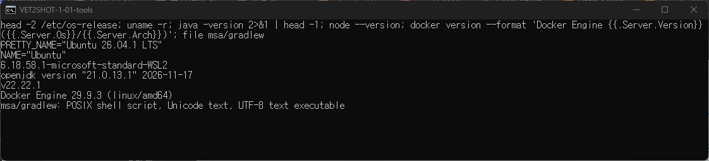

| 항목 | 값 |
|---|---|
| OS | WSL 2, Ubuntu 26.04.1 LTS |
| JDK | OpenJDK 21.0.13.1 |
| Node | 22.22.1 (시드 생성기와 시나리오 테스트) |
| Docker | Docker Engine 29.9.3 (Ubuntu 안의 서비스. MySQL, Redis 컨테이너용) |
| MySQL / Redis | 공식 이미지 `mysql:8.4`, `redis:7-alpine` |

서비스는 컨테이너가 아니라 WSL 의 JDK 로 직접 실행했다. MySQL 과 Redis 만 컨테이너로 띄웠다.
소스는 `git clone` 으로 받는다. Windows 에서 받은 파일을 그대로 쓰면 `gradlew` 의 줄 끝이 CRLF 라 실행되지 않는다 (② C-1). 위 그림의 마지막 줄이 git 으로 받은 `gradlew` 가 LF 라는 확인이다.

## 3. 워크로드 정의

소스를 읽고 정리한 것이다. ②③④에서 컨테이너와 배포 파일을 쓸 때 이 장이 기준이 된다.

### 3.1 구성 요소

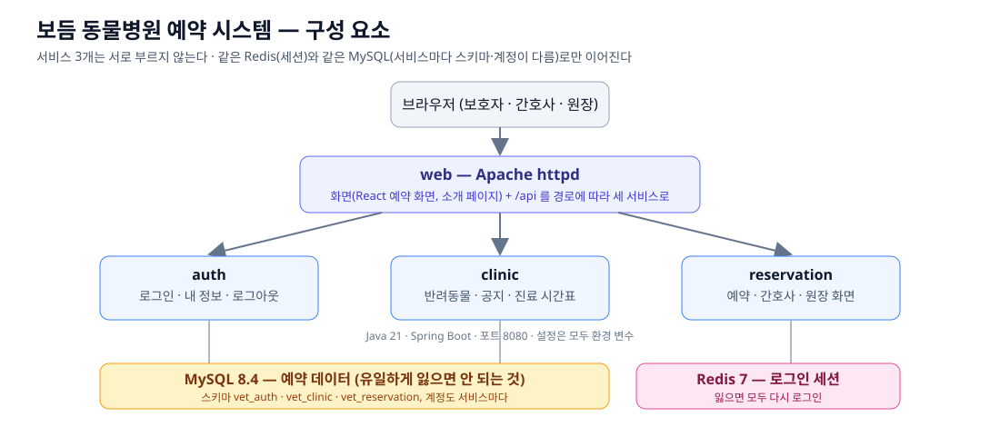

| 구성 요소 | 하는 일 | 언어·런타임 | 포트 | 소스 | 상태 저장 |
|---|---|---|---|---|---|
| auth | 로그인, 로그아웃, 내 정보 | Java 21, Spring Boot | 8080 | `msa/auth-service` | 없음 |
| clinic | 반려동물, 공지, 예약 가능 시간, 슬롯 자동 생성 | Java 21, Spring Boot | 8080 | `msa/clinic-service` | 없음 |
| reservation | 예약 신청·변경·취소, 간호사·원장 화면 | Java 21, Spring Boot | 8080 | `msa/reservation-service` | 없음 |
| web | 예약 화면(React), 소개 페이지, `/api` 를 세 서비스로 분기 | Apache httpd (② 에서 만든다) | 8080 | `web/` | 없음 |
| MySQL | 예약 데이터 | MySQL 8.4 | 3306 | `db/`, `msa/db/*.sql` | **있음** (잃으면 안 됨) |
| Redis | 로그인 세션 | Redis 7 | 6379 | - | 있음 (잃으면 모두 로그아웃) |

서비스 3개는 서로를 호출하지 않는다. 같은 Redis 의 세션과 같은 MySQL 을 통해서만 이어진다. ①에서는 포트가 겹치지 않게 28081 ~ 28083 으로 띄운다 (W-1).

### 3.2 서비스가 맡은 경로

web 이 `/api` 요청을 나눠 보낼 때 이 표를 따라야 한다. 컨트롤러의 경로를 옮긴 것이다.

| 경로 | 서비스 |
|---|---|
| `/api/auth/**`, `/api/status/auth` | auth |
| `/api/pets/**`, `/api/notices/**`, `/api/slots`, `/api/admin/notices/**`, `/api/status/clinic` | clinic |
| `/api/reservations/**`, `/api/admin/reservations/**`, `/api/admin/slots`, `/api/director/**`, `/api/status/reservation` | reservation |
| `/health` | 세 서비스 모두 (DB 와 Redis 를 보지 않고 `ok` 만 돌려준다) |

주의할 점: `/api/admin` 아래가 두 서비스로 갈린다. `/api/admin/notices` 만 clinic 이고 나머지는 reservation 이다.

### 3.3 서비스가 읽는 설정 (외부에서 지정)

설정은 전부 환경 변수로 받는다. ②의 compose 와 ③의 ConfigMap·Secret 에 그대로 옮긴다.

| 환경 변수 | 뜻 | 없을 때 | 비밀 |
|---|---|---|---|
| `SERVER_PORT` | 듣는 포트 | 8080 | |
| `SPRING_DATASOURCE_URL` | DB 주소와 스키마 | `localhost:3306/vet` | |
| `SPRING_DATASOURCE_USERNAME` | DB 계정 | 없음 | |
| `SPRING_DATASOURCE_PASSWORD` | DB 비밀번호 | 없음 | 예 |
| `SPRING_DATA_REDIS_HOST` | Redis 주소 | 없음 | |
| `SPRING_DATA_REDIS_PORT` | Redis 포트 | 6379 | |
| `SPRING_DATA_REDIS_PASSWORD` | Redis 비밀번호 | 없음 | 예 |
| `REDIS_TLS` | Redis 연결 암호화 | **true** (같은 망의 Redis 는 `false` 로 줘야 한다) | |
| `DB_POOL_MAX` | 서비스 하나가 여는 DB 연결 수 | 10 | |
| `APP_VERSION` | 응답에 실리는 버전 | `dev` | |

### 3.4 데이터가 저장되는 곳

데이터는 MySQL 에만 저장한다 (파일 업로드 같은 별도 저장소 없음). Redis 의 세션은 잃어도 다시 로그인하면 된다. 스키마와 계정은 `msa/db/split.sql`, `msa/db/grants.sql` 이 정한다.

| 스키마 | 테이블 | 계정 | 할 수 있는 것 |
|---|---|---|---|
| `vet_auth` | users | `vet_auth` | 읽기 |
| `vet_clinic` | pets, notices, vets, slots | `vet_clinic` | pets 읽기·추가·수정, notices 읽기·추가·삭제, vets 읽기, slots 읽기·추가 |
| `vet_reservation` | reservations + 뷰 4개(pets, vets, users, slots) | `vet_reservation` | reservations 읽기·추가·수정, 뷰는 읽기, slots 뷰는 두 열(`reservation_id`, `is_open`)만 수정 |

reservation 은 남의 데이터를 뷰로만 본다. 그래서 서비스를 호출하지 않고도 예약 화면에 반려동물 이름과 수의사 이름을 보여 준다.

## 4. 빌드와 자동 테스트

```bash
cd msa && ./gradlew clean build --console=plain
```

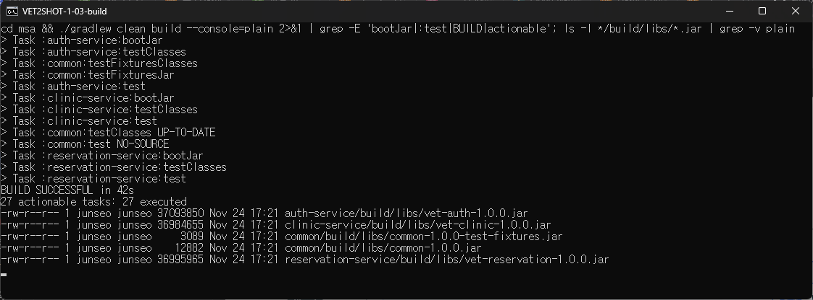

세 서비스 모두 `test` 단계를 거쳐 `BUILD SUCCESSFUL in 41s`, jar 3개(각 37MB)가 만들어졌다. 자동 테스트는 DB 와 Redis 없이 서비스를 띄워 맡은 경로, `/health`, 로그인 전 401, 남의 경로 404 를 본다. 예약 흐름처럼 DB 가 필요한 동작은 6장의 시나리오 테스트가 맡는다.

처음에는 이 빌드가 실패했다 (W-4).

화면(`web/`)은 ①에서 빌드하지 않는다. ②의 web 이미지가 빌드 단계에서 만든다 (②).

## 5. 직접 실행

실행에 쓴 스크립트는 [v2/workload/](../workload/) 에 있다.

### 5.1 MySQL 과 Redis

```bash
v2/workload/stores.sh up
```

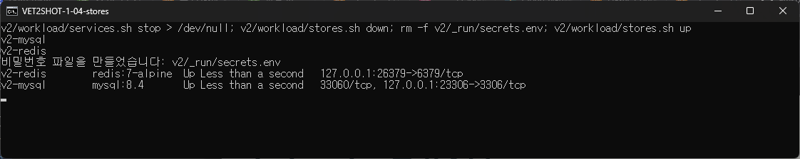

비밀번호 5개는 처음 실행할 때 무작위로 만들어 `v2/_run/secrets.env` 에 둔다. 이 폴더는 Git 에 올라가지 않고, 화면에도 내지 않는다.

### 5.2 DB 초기화

공식 MySQL 이미지는 비어 있다. 소스에 있는 SQL 로 앱이 요구하는 상태를 만든다.

```bash
v2/workload/db-init.sh
```

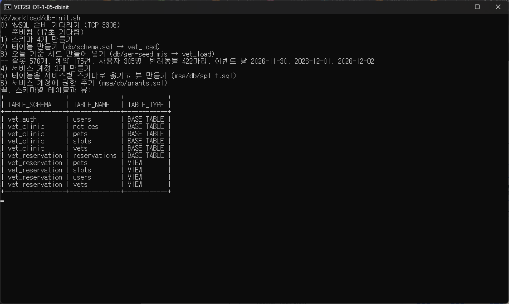

순서가 중요하다. `schema.sql` 과 시드는 스키마 하나에 테이블 6개를 만들도록 쓰여 있고, `split.sql` 이 그것을 서비스별 스키마로 옮긴다. 그래서 임시 스키마 `vet_load` 에 먼저 넣은 뒤 옮긴다.
시드는 "실행한 날"을 기준으로 14일 치 슬롯을 만든다. 미리 만들어 둔 파일을 쓰면 날짜가 지나 예약할 시간이 없으므로 띄울 때마다 새로 만든다. MySQL 이 준비되기까지 23초를 기다렸다 (W-2).

### 5.3 서비스 3개

```bash
v2/workload/services.sh start
v2/workload/services.sh status
```

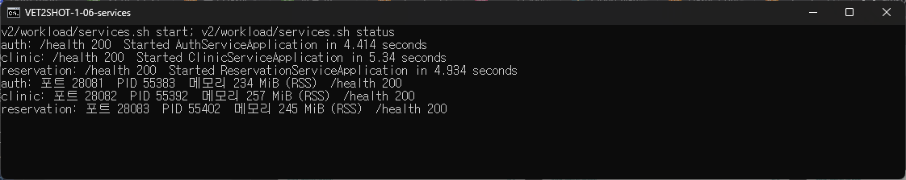

포트는 auth 28081, clinic 28082, reservation 28083 이다. 서비스마다 3.3 의 환경 변수를 준다. 세 서비스의 차이는 포트, DB 스키마, DB 계정뿐이다. 각각 4 ~ 5초에 떠서 메모리(RSS) 234 ~ 257MiB 를 쓴다.

## 6. 시나리오 테스트

### 6.1 설계

[v2/tests/scenario.mjs](../tests/scenario.mjs) 는 화면이 쓰는 API 를 실제로 부른다. **모든 단계(①~④)에서 같은 파일을 쓴다.** ①에서는 서비스 3개의 주소를 따로 주고, ②부터는 웹 서버 주소 하나만 준다(그래서 화면 묶음 0 이 더해져 65항목).

| 묶음 | 확인하는 것 | 기대 결과 | 개수 |
|---|---|---|---|
| 0. 화면 (②부터) | 소개 페이지, 예약 화면, 정적 파일, 없는 페이지 | 200, `text/html`, 없는 페이지 404 | 8 |
| 1. 상태 | `/health`, `/api/status/*`, 응답 헤더 | 200, 버전과 응답한 Pod 이름 | 6 |
| 2. 로그인 없이 조회 | 공지 목록·상세, 예약 가능 시간, 잘못된 날짜 | 200, 잘못된 날짜 400 | 4 |
| 3. 로그인과 세션 | 401, 틀린 비밀번호, auth 에서 받은 세션을 clinic·reservation 이 읽는가 | 로그인 전 401, 로그인 뒤 세 서비스 모두 200 | 6 |
| 4. 예약 (등록·조회·수정) | 반려동물 등록·수정, 예약 신청, 조회, 중복 신청, 남의 예약, 시간 변경 | 신청 201, 조회에 보임, 중복 409, 남의 것 404, 변경 200 | 12 |
| 5. 직원 | 간호사 조회·승인, 공지 등록·삭제, 원장 일정·현황·시간 닫기, 역할 간 접근 | 200·201·204, 남의 역할 403 | 13 |
| 6. 취소 | 취소, 취소한 시간이 다시 열림, 이중 취소 | 204, 시간 다시 열림, 이중 취소 409 | 4 |
| 7. 동시 신청 | 보호자 10명이 같은 시간을 동시에 신청 | 1명만 201, 나머지 409 | 2 |
| 8. 로그인 시도 제한 | 틀린 비밀번호 5번 | 여섯 번째 429 | 1 |
| 9. 로그아웃 | 로그아웃한 쿠키 | 세 서비스 모두 401 | 2 |
| 10. 서비스 경계 (①에서만) | 남이 맡은 경로 | 404 | 1 |
| 11. DB 계정 경계 | 서비스 계정이 남의 데이터를 읽거나 고칠 수 있는가 | 자기 것은 됨, 남의 것은 권한 오류 (로그인 실패는 실패로 센다) | 9 |

만든 예약은 끝에서 취소하므로 여러 번 돌려도 된다.

### 6.2 결과

```bash
v2/tests/with-secrets.sh node v2/tests/scenario.mjs --auth-url http://127.0.0.1:28081 \
     --clinic-url http://127.0.0.1:28082 --reservation-url http://127.0.0.1:28083 --db-container v2-mysql
```

`with-secrets.sh` 는 비밀번호 파일을 화면에 내지 않고 환경 변수로만 넘긴다. 화면에는 묶음 제목, 실패, DB 계정 경계, 결과 줄만 골라 보였다 (명령 끝의 `grep`).

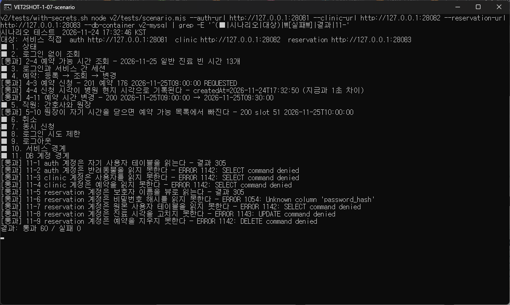

**통과 60 / 실패 0.** 예약 신청(4-3), 신청 시각(4-4), 시간 변경(4-11)이 등록·조회·수정을, 11 묶음이 서비스 계정의 권한 경계를 보인다.

### 6.3 이 테스트의 한계

- 8-1 은 1분 안에 다시 돌리면 첫 요청부터 429 가 나온다 (계정 잠금이 1분 유지된다).
- 7-1 의 동시 신청은 10명이다. 수백 명이 몰리는 부하는 보지 않았다.
- 화면(브라우저)은 거치지 않는다. API 만 부른다. 화면은 앱 화면 캡처(③)와 시연 영상으로 보인다.

## 7. 하나가 멈췄을 때

구성 요소를 하나씩 멈추고 나머지의 응답을 봤다 ([v2/workload/fault-check.sh](../workload/fault-check.sh)). 로그인한 쿠키를 가진 상태에서 요청했다. 출력이 한 화면보다 길어 파일로 받은 뒤 두 장으로 나눠 보였다.

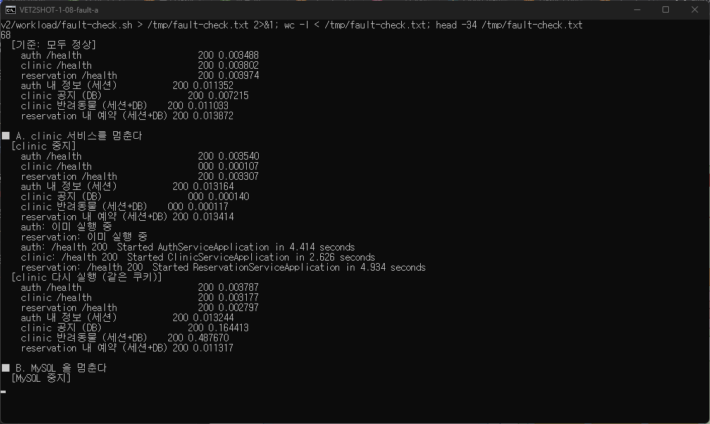

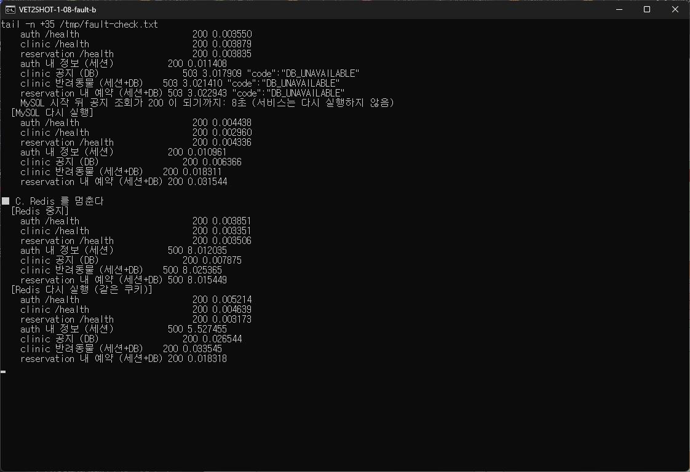

| 멈춘 것 | auth 내 정보 | clinic 공지 | clinic 반려동물 | reservation 내 예약 | `/health` |
|---|---|---|---|---|---|
| 없음 (기준) | 200 | 200 | 200 | 200 | 모두 200 |
| clinic | 200 | 응답 없음 | 응답 없음 | **200** | clinic 만 실패 |
| MySQL | 200 | 503 (3.0초) | 503 (3.0초) | 503 (3.0초) | **모두 200** |
| Redis | **500 (8.0초)** | 200 | **500 (8.0초)** | **500 (8.0초)** | 모두 200 |

다시 띄운 뒤: clinic 은 2.6초 만에 떠서 같은 쿠키로 바로 정상, MySQL 은 시작 뒤 6초에 정상(서비스는 다시 실행하지 않았다). Redis 는 다시 띄운 3초 뒤에도 auth 의 내 정보가 500 (5.7초) 이었고 나머지는 200 이었다.

읽을 수 있는 것:

- **서비스 하나가 죽어도 나머지는 답한다.** clinic 이 없어도 reservation 은 예약 목록을 돌려준다. 서비스끼리 호출하지 않기 때문이다.
- **`/health` 는 DB 와 Redis 가 죽어도 200 이다.** 그래서 DB 장애 때 서비스가 "죽은 것"으로 판정되어 재시작되지 않는다. ③에서 probe 를 정할 때 이 성질을 쓴다.
- **MySQL 이 죽으면 3초 안에 503 과 `DB_UNAVAILABLE` 로 답하고, 살아나면 스스로 다시 붙는다.**
- **Redis 가 죽으면 답이 늦고 형식도 깨진다.** 이것이 문제 W-3 이다.

## 8. 다음 단계에 넘기는 것

| 넘기는 것 | 근거 | 쓰는 곳 |
|---|---|---|
| 힙 상한을 정해 줘야 한다. JVM 은 기본으로 머신 메모리의 25% 를 힙 상한으로 잡는다 | 동작 | ② C-6 |
| 서비스 하나의 메모리는 약 230 ~ 260MiB | 5.3 캡처 | ② 메모리 한도, ③ 요청량 |
| DB 연결 수 = 서비스 3개 × 복제본 수 × `DB_POOL_MAX`. MySQL 기본 한도는 151 | 동작 | ③ 5장, ⑥ R-3 |
| `/health` 는 DB·Redis 를 보지 않는다 | 7장 | ③ probe |
| Redis 가 멈추면 로그인한 요청이 8초씩 걸려 실패한다 | 7장 | ②③ 의 전제 (W-3) |

## 9. 문제와 해결

각 문제는 **판단 기준**을 먼저 세우고, 후보마다 그 기준을 넘는지 적었다. 표의 ○ 는 기준을 넘음, △ 는 일부만, × 는 미달이다.
근거 표시: **측정** 은 이번 작업에서 직접 실행해 얻은 값, **동작** 은 그 도구의 공식 동작(문서에 적힌 성질), **추론** 은 실행해 보지 않고 따져 본 것이다.

W-1 ~ W-3 은 2026-11-23 Windows(Git Bash)에서 처음 실행할 때 겪은 문제라, 그때의 출력을 글로 남겼다 (캡처 없음). W-3 의 동작은 7장의 WSL 2 캡처에서도 같다. W-4 는 WSL 2 에서 다시 하며 겪은 것이라 캡처가 있다.

### W-1. 서비스가 8080 포트를 못 잡아 뜨지 않는다 (Windows)

**증상.** 설정 없이 jar 를 실행하자 뜨지 못하고 바로 끝났다.

```
$ java -jar msa/auth-service/build/libs/vet-auth-1.0.0.jar
***************************
APPLICATION FAILED TO START
***************************
Description:
Web server failed to start. Port 8080 was already in use.
```

**원인.** 세 서비스 모두 8080 을 듣도록 되어 있다 (`vet-common.yml` 의 `server.port: 8080`). 이 PC 에서는 다른 프로그램(`httpd.exe`)이 이미 8080 을 쓰고 있었다. 그 프로그램이 없더라도 한 PC 에서 셋을 띄우면 둘째부터 같은 오류가 난다.

**판단 기준.**

1. 한 PC 에서 서비스 3개가 **동시에** 뜬다.
2. **소스를 고치지 않는다** (이 작업은 개발이 아니다).
3. ②③에서 컨테이너로 옮길 때 같은 방법을 그대로 쓸 수 있다 (환경마다 다른 포트를 소스에 박지 않는다).

**후보와 탈락 이유.**

| 후보 | 1. 셋이 동시에 | 2. 소스 그대로 | 3. 컨테이너로 이어짐 | 판정 | 근거 |
|---|---|---|---|---|---|
| 8080 을 쓰는 다른 프로그램(`httpd.exe`)을 끈다 | × 첫 서비스만 뜬다. 둘째부터 서로 충돌한다 | ○ | △ PC 의 다른 프로그램을 멈춰야 하는 절차가 남는다 | 탈락 | 추론 (셋이 같은 포트를 쓰는 것은 `vet-common.yml` 에서 확인) |
| 소스의 `server.port` 를 서비스마다 다르게 고친다 | ○ | × 소스 수정 | × 컨테이너에서는 셋 다 8080 인 편이 단순한데, 소스에 다른 값이 박힌다 | 탈락 | 추론 |
| 실행 인자 `--server.port=28081` | ○ | ○ | △ 이미지의 실행 명령에 넣어야 해서, 포트를 바꾸려면 명령을 통째로 다시 써야 한다 | 탈락 | 동작 (스프링 부트의 명령줄 속성) |
| 환경 변수 `SERVER_PORT` | ○ | ○ | ○ compose 의 `environment`, 쿠버네티스의 `env` 로 그대로 옮겨진다 | **채택** | 동작 + 측정 (아래) |

**고른 방법.** `SERVER_PORT` 환경 변수. 스프링 부트는 `server.port` 를 이 이름의 환경 변수로 덮어쓸 수 있다. 3.3 의 다른 설정도 모두 환경 변수라서 설정을 넣는 길이 하나로 모인다.

**확인.**

```
$ SERVER_PORT=28081 java -jar msa/auth-service/build/libs/vet-auth-1.0.0.jar
Started AuthServiceApplication in 2.331 seconds
$ curl http://127.0.0.1:28081/health
ok
```

덧붙여 알게 된 것: 이때는 DB 와 Redis 를 주지 않았는데도 서비스가 떴다. `/health` 는 200, 로그인은 503 `DB_UNAVAILABLE` 이었다. **서비스는 저장소 없이도 뜨고, 저장소가 필요한 요청만 실패한다.** 컨테이너가 뜨는 순서를 맞출 필요가 없다는 뜻이라 ②③에서 중요하다.

컨테이너는 저마다 네트워크가 따로라서 이 문제가 생기지 않는다. ②부터는 세 서비스 모두 8080 그대로 쓴다.

### W-2. MySQL 을 띄운 직후에 초기화하면 실패한다

**증상.** 컨테이너를 띄우고 바로 초기화를 실행하자 실패했다.

```
$ v2/workload/stores.sh up && v2/workload/db-init.sh
1) 스키마 4개 만들기
ERROR 2002 (HY000): Can't connect to local MySQL server through socket '/var/run/mysqld/mysqld.sock' (2)
```

처음 실행했을 때는 이 오류가 없었다. 이미지 내려받기에 35초가 걸려 그사이 MySQL 이 준비됐기 때문이다. 이미지가 PC 에 있는 두 번째 실행에서 드러났다.

**원인.** `docker run` 은 컨테이너를 시작시키고 바로 돌아온다. MySQL 이 요청을 받을 수 있게 되는 것은 그 뒤다.

**첫 번째 시도 — 소켓으로 `mysqladmin ping` 이 될 때까지 기다린다. 실패.**

```
ping 성공까지 7초
1) 스키마 4개 만들기
ERROR 1045 (28000): Access denied for user 'root'@'localhost' (using password: YES)
```

기다렸는데도 실패했고, 오류가 "접속 불가"에서 "비밀번호 틀림"으로 바뀌었다. 컨테이너 로그에 이유가 있다.

```
[Entrypoint]: Initializing database files
[Entrypoint]: Database files initialized
[Entrypoint]: Starting temporary server
[Server] /usr/sbin/mysqld: ready for connections. ... socket: '/var/run/mysqld/mysqld.sock'  port: 0
[Entrypoint]: Temporary server started.
```

공식 이미지는 처음 뜰 때 **임시 서버**를 먼저 띄운다. 임시 서버는 소켓으로만 열리고(`port: 0`) 아직 root 비밀번호가 설정되지 않았다. 비밀번호를 설정한 뒤 임시 서버를 끄고 진짜 서버를 다시 띄운다. 소켓 ping 은 이 임시 서버에 닿아서 "준비됐다"고 잘못 답한 것이다.

**판단 기준.**

1. **진짜 서버**가 준비된 뒤에만 초기화를 시작한다 (임시 서버에 속지 않는다).
2. 이미지가 이미 있든 없든, PC 가 빠르든 느리든 같은 결과가 나온다.
3. 준비되지 않으면 그 사실이 드러나며 멈춘다 (실패 원인이 가려지지 않는다).
4. ②의 healthcheck, ③의 probe 에 같은 방법을 옮겨 쓸 수 있다.

**후보와 탈락 이유.**

| 후보 | 1. 진짜 서버만 | 2. 환경과 무관 | 3. 실패가 드러남 | 4. 옮겨 씀 | 판정 | 근거 |
|---|---|---|---|---|---|---|
| 정해진 시간(예: 30초) 기다린다 | △ 시간 안에 끝났다면 맞다 | × 첫 실행은 내려받기 35초 덕에 됐고, 두 번째는 즉시 실패했다. 시간은 환경마다 다르다 | × 모자라면 위와 같은 엉뚱한 오류로 실패한다 | × probe 는 "준비됐는가"를 물어야 한다 | 탈락 | 측정 (35초, 두 번째 실행의 ERROR 2002) |
| 소켓으로 `mysqladmin ping` | × 임시 서버(`port: 0`)가 답한다 | ○ | × 7초에 "준비됨" 뒤 ERROR 1045 | × 같은 함정이 그대로 옮겨진다 | 탈락 | 측정 (위의 첫 번째 시도) |
| 컨테이너 로그에서 마지막 `ready for connections` 를 기다린다 | ○ 진짜 서버가 두 번째로 이 줄을 남긴다 | △ 로그 문구와 줄 수에 기댄다 (이미지 버전이 바뀌면 깨질 수 있다) | ○ | × probe 는 로그를 읽지 않는다 | 탈락 | 추론 (로그는 위에서 확인) |
| TCP 3306 으로 `SELECT 1` | ○ 임시 서버는 TCP 를 열지 않는다 | ○ | ○ 120초 안에 안 되면 멈춘다 | ○ 같은 명령을 healthcheck·probe 에 쓴다 | **채택** | 동작 + 측정 (아래) |

**고른 방법.** TCP 로 `SELECT 1` 이 될 때까지 1초마다 묻는다 (최대 120초).

```bash
until docker exec -e MYSQL_PWD="$DB_ROOT_PASSWORD" v2-mysql \
        mysql -h127.0.0.1 -P3306 --protocol=tcp -uroot -e 'SELECT 1' > /dev/null 2>&1; do
    sleep 1
done
```

**확인.** 컨테이너를 지우고 처음부터 다시 실행했다.

```
0) MySQL 준비 기다리기 (TCP 3306)
   준비됨 (11초 기다림)
1) 스키마 4개 만들기
...
6) 서비스 계정에 권한 주기 (msa/db/grants.sql)
```

같은 함정이 ②의 healthcheck 와 ③의 probe 에도 있다. **MySQL 의 준비 여부는 TCP 로 물어야 한다.**

### W-3. Redis 가 멈추면 로그인한 사용자의 요청이 8초 뒤 500 으로 끝난다 (미해결)

**증상.** Redis 를 멈추고 로그인한 쿠키로 요청했다.

| 요청 | 응답 | 걸린 시간 |
|---|---|---|
| 쿠키와 함께 `GET /api/auth/me` | 500, 본문이 JSON 이 아니라 톰캣 기본 오류 페이지(HTML) | 8.04초 |
| 쿠키 없이 `GET /api/auth/me` | 401 `UNAUTHORIZED` (정상) | 0.002초 |
| 로그인 시도 | 500 `INTERNAL` | 12.1초 |
| 쿠키 없이 공지 조회 | 200 (정상) | 0.006초 |

Redis 를 다시 띄운 뒤에도 요청 2건이 500 이었고(8.0초, 3.6초), 14초 뒤부터 200 이 됐다. 7장의 실행에서는 7초 뒤였다.

같은 조건에서 MySQL 이 멈췄을 때는 3초 만에 503 과 `{"code":"DB_UNAVAILABLE"}` 로 답했다. Redis 쪽만 느리고 형식이 깨진다.

**원인.** auth 의 로그에 남은 것:

```
Caused by: io.lettuce.core.RedisCommandTimeoutException: Command timed out after 2 second(s)
WARN  ExceptionHandlerExceptionResolver : Failure in @ExceptionHandler kr.bodeum.vet.support.ApiExceptionHandler#unexpected(Exception)
ERROR [Tomcat].[localhost] : Exception Processing [ErrorPage[errorCode=0, location=/error]]
```

- Redis 명령 하나의 제한 시간이 2초다 (`vet-common.yml` 의 `spring.data.redis.timeout: 2s`). 응답까지 8초가 걸린 것으로 보아 한 요청 안에서 Redis 를 여러 번 부른 것으로 보인다. 정확히 몇 번인지는 세지 않았다.
- 오류를 JSON 으로 바꿔 주는 처리(`ApiExceptionHandler`) 자체가 실패했고, 그 뒤의 기본 오류 페이지 처리도 실패했다. 그래서 톰캣의 HTML 이 그대로 나갔다.
- 쿠키가 없는 요청은 세션을 읽지 않으므로 Redis 를 거치지 않고 정상으로 끝난다.

**판단 기준.**

1. Redis 가 멈췄을 때 **빨리**(MySQL 처럼 3초 안에) 실패한다.
2. 실패해도 **형식이 맞다** (JSON 의 오류 코드. 화면이 오류를 알아본다).
3. **소스를 고치지 않는다.**
4. 구성을 크게 늘리지 않는다 (Redis 는 세션 저장소 하나다).

**후보와 탈락 이유.** 아래는 검토만 했고 실행하지 않았다. 그래서 근거는 모두 추론이다.

| 후보 | 1. 빨리 | 2. 형식 | 3. 소스 그대로 | 4. 구성 | 판정 |
|---|---|---|---|---|---|
| 소스를 고쳐 Redis 오류도 503 JSON 으로 빨리 답하게 한다 | ○ | ○ | × 소스 수정 | ○ | 범위 밖 (사용자 결정 필요) |
| Redis 명령 제한 시간(`spring.data.redis.timeout`)을 환경 변수로 줄인다 | △ 8초가 줄어든다 | × 500 과 HTML 은 그대로일 것이다 | ○ | ○ | 탈락 |
| Redis 를 이중화해 멈추지 않게 한다 (Sentinel 등) | △ 멈추는 일이 줄 뿐, 멈췄을 때의 동작은 그대로다 | × | ○ | × 구성 요소가 늘고, 앱이 Sentinel 을 쓰게 하려면 설정이 바뀐다 | 탈락 |
| 고치지 않고 한계로 기록한다 | × | × | ○ | ○ | **채택** (한계로) |

넷 중 기준 1, 2 를 모두 넘는 것은 소스를 고치는 길뿐이다. 소스 수정은 이 작업의 범위 밖이므로, 넘지 못한 기준을 드러내 두고 한계로 남겼다. Redis 가 멈춘 동안만 생기는 일이고, MySQL 이 멈춘 동안에도 어차피 예약은 할 수 없다는 점도 고려했다.

**결정.** 이 단계에서는 고치지 않았다. 이 문서의 목적은 소스를 확인하는 것이고, 소스를 고칠지는 정해 주셔야 한다.
②③에서는 "Redis 는 한 개뿐이고, 멈추면 로그인한 사용자의 요청이 약 8초씩 걸려 실패한다"를 전제로 두고, Redis 를 다시 띄우는 시간을 잰다.

### W-4. JDK 가 업데이트된 뒤 빌드가 실패한다

**증상.** WSL 2 에서 같은 빌드 명령이 한 번은 성공했는데, 몇 시간 뒤 다시 하자 실패했다. auth 의 jar 만 만들어지고 clinic, reservation 은 만들어지지 않았다.

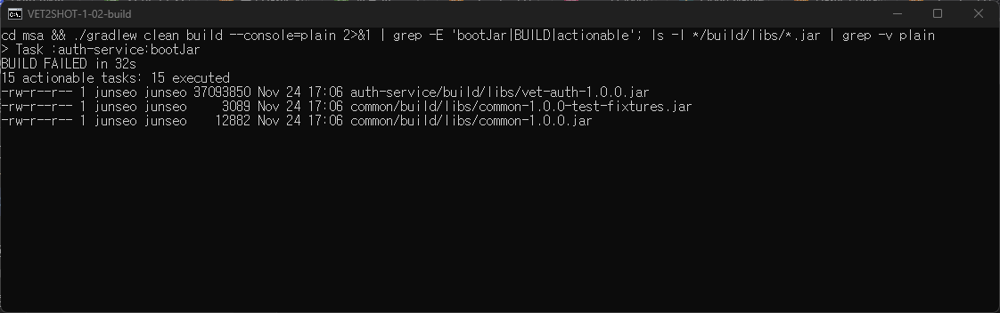

`--stacktrace` 로 본 원인 줄:

```
Caused by: java.io.IOException: Cannot run program "/usr/lib/jvm/java-21-openjdk-amd64/bin/java" ...:
Failed to exec spawn helper: pid: 49544, exit code: 1, error: 0 (none)
```

**원인.** 그 사이 Ubuntu 의 JDK 가 21.0.13.0.3 에서 21.0.13.1 로 업데이트됐다 (`/usr/lib/jvm` 이 그날 16:17 에 바뀌었다). 먼저 띄워 둔 Gradle 데몬은 옛 JDK 의 파일을 쥔 채 떠 있었고, 테스트용 Java 프로세스를 띄울 때 새로 바뀐 JDK 의 보조 실행 파일(spawn helper)과 맞지 않아 실패했다. 업데이트가 Ubuntu 의 자동 업데이트였는지, Node 를 설치할 때 함께 올라간 것인지는 확인하지 않았다.

**판단 기준.** ① 빌드가 다시 된다 ② 소스와 빌드 설정을 고치지 않는다 ③ 다음에도 같은 일이 생기면 바로 알 수 있다.

| 후보 | ① | ② | ③ | 판정 |
|---|---|---|---|---|
| JDK 를 옛 버전으로 되돌린다 | ○ | ○ | × 업데이트될 때마다 되풀이한다 (추론) | 탈락 |
| 빌드에서 데몬을 쓰지 않는다 (`--no-daemon`) | ○ (동작) | ○ | ○ | 탈락 — 빌드마다 데몬을 새로 띄워 느려진다 (동작). ②의 이미지 빌드는 이미 `--no-daemon` 이다 |
| **Gradle 데몬을 멈추고 다시 빌드 (`./gradlew --stop`)** | ○ | ○ | ○ 오류 문구로 알아본다 | **채택** |

**확인.** 데몬을 멈춘 뒤 `BUILD SUCCESSFUL in 41s` (4장).

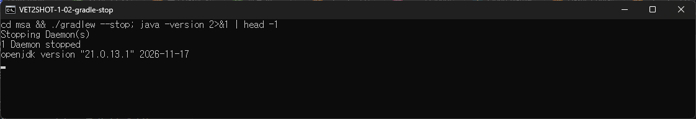

## 10. 확인하지 못한 것

| 항목 | 이유 | 확인할 단계 |
|---|---|---|
| 화면이 실제로 보이는가 | ①에는 웹 서버가 없다 | ② (시나리오 0 묶음), ③ 앱 화면 캡처 |
| 종료 신호를 받으면 처리 중인 요청을 마치고 내려가는가 | ①은 jar 를 직접 띄워서 보지 않았다 | ② C-4 |
| 날짜가 바뀔 때 슬롯이 자동으로 채워지는가 | 매일 00:05 에 도는 작업이라 기다리지 않았다 | 확인 계획 없음 |
| 수백 명이 동시에 쓸 때의 동작 | 범위 밖 (부하 테스트가 아니다) | 확인 계획 없음 |

## 11. 다시 실행하는 순서 (WSL 2 Ubuntu)

필요한 것: WSL 2 Ubuntu, OpenJDK 21, Node 22, Docker Engine (`sudo apt install openjdk-21-jdk nodejs docker.io`, 사용자를 `docker` 그룹에).

```bash
git clone <저장소> vet2-lab && cd vet2-lab

# 빌드 (실패하면 W-4: ./gradlew --stop 뒤 다시)
(cd msa && ./gradlew clean build)

# 실행
v2/workload/stores.sh up            # MySQL 127.0.0.1:23306, Redis 127.0.0.1:26379. 비밀번호는 v2/_run/secrets.env
v2/workload/db-init.sh
v2/workload/services.sh start       # auth 28081, clinic 28082, reservation 28083

# 테스트
v2/tests/with-secrets.sh node v2/tests/scenario.mjs --auth-url http://127.0.0.1:28081      --clinic-url http://127.0.0.1:28082 --reservation-url http://127.0.0.1:28083 --db-container v2-mysql
v2/workload/fault-check.sh

# 정리
v2/workload/services.sh stop
v2/workload/stores.sh down
```
