# ② 이미지 빌드·컨테이너 테스트

①에서 확인한 워크로드를 컨테이너 이미지로 만들고, 컨테이너 6개로 실행해 점검한 기록이다.
가장 단순한 형태(v0)로 먼저 만들어 돌리고, 점검 기준에 걸린 것을 하나씩 고쳤다.

**환경은 WSL 2 Ubuntu 의 Docker Engine 이다.** 그림은 모두 2026-11-24 에 WSL 2 에서 실행하고 실제 터미널을 캡처한 것이다.
처음(2026-11-23)에는 Windows 의 Docker Desktop 에서 했다. 그때 잰 것 가운데 다시 재지 않은 것은 "Windows 기록, 캡처 없음" 이라고 밝혀 두었다.

웹 서버는 **Apache httpd** 다 (사용자 지시. 처음에는 nginx 로 만들었다. 차이는 4.3).

## 0. 완성 기준과 근거

| 과제 | 완성 기준 (명세) | 결과 | 근거 |
|---|---|---|---|
| 이미지 빌드 | Dockerfile 을 쓰고 각 명령의 역할을 설명 | 서비스·web·db Dockerfile, 명령별 역할 표 | 3.2 |
| | 불필요한 파일은 빌드에서 제외 | `.dockerignore` 로 보내는 컨텍스트 112.66MB → 6.88kB | 3.1, C-7 |
| 컨테이너 실행 | 설정을 환경 변수로 지정해 실행 | compose 의 `environment` + `--env-file` (비밀번호) | 6.1, 6.6 |
| | 테스트 시나리오 통과 | **통과 65 / 65** (웹 서버 경유) | 6.1 |
| | 로그·상태 확인 | `docker compose ps` 6개 모두 healthy, `docker compose logs` | 6.1, 6.6 |
| 이미지 배포 | 태그를 붙여 레지스트리에 push | ECR 에 `1.0.0`, `1.0.0-wsl` 태그 | 6.7 |
| | `linux/amd64` 이미지 포함 | x86_64 에서 빌드해 `linux/amd64`. x86_64 노드에서 실행됨 (③④) | 2장, 6.7 |

## 1. 결과

| 점검 기준 | v0 (단순한 형태) | 최종 | 근거 |
|---|---|---|---|
| 시나리오 테스트 전부 통과 | 64 / 65 (DB 를 손으로 초기화한 뒤) | **통과 65 / 65** | C-2, 6.1 |
| 뜨는 순서와 무관하게 정상이 됨 | DB 를 손으로 초기화해야 함 | 통과 | C-8, 6.2 |
| 종료 신호에 처리 중인 요청을 마치고 내려감 | **실패** — 강제 종료(137) | 끊긴 요청 1 ~ 2건 (강제 종료는 20건) | C-4, 6.3 |
| 메모리 한도 안에서 동작 | 한도 없음, 힙 상한 1.88GiB | 한도 384MiB 의 약 50% 사용 | C-6, 6.4 |
| root 가 아닌 사용자로 실행 | **실패** — 서비스와 web 이 root | 6개 모두 root 아님 | C-5 |
| 다시 띄워도 정상 | **실패** — DB 가 빈 채로 뜸 | 통과 | C-8, 6.5 |
| 이미지 크기와 재빌드 시간 | 1.52GB, 소스 한 줄 수정 뒤 54.8초 | 366MB, 12.1초 | C-7 |
| 비밀번호가 이미지와 Git 에 없음 | 통과 | 통과 | 6.8 |

만난 문제는 11건이다.

| 번호 | 문제 | 상태 |
|---|---|---|
| C-1 | 빌드 중 `./gradlew: not found` | 해결 |
| C-2 | 예약 화면이 읽는 응답 헤더가 없다 | 해결 |
| C-3 | 폴더 안의 파일 목록이 그대로 보인다 | 해결 |
| C-4 | 종료 신호가 자바에 전달되지 않아 처리 중인 요청이 끊긴다 | 해결 (1 ~ 2건 남음) |
| C-5 | 컨테이너가 root 로 돈다 | 해결 |
| C-6 | 메모리 한도가 없어 힙 상한이 1.88GiB 로 잡힌다 | 해결 |
| C-7 | 이미지가 크고 한 줄을 고쳐도 다시 빌드가 오래 걸린다 | 해결 (1.52GB → 366MB, 54.8초 → 12.1초) |
| C-8 | DB 가 빈 채로 뜨고, 초기화가 실패해도 "끝"이라고 나온다 | 해결 |
| C-9 | 멈춘 서비스로 가는 요청이 64초 매달린다 | 해결 |
| C-10 | 오래전에 만든 DB 이미지로 띄우면 예약할 시간이 하나도 없다 | 해결 |
| C-11 | (nginx 일 때) 새로 띄운 직후 동시 요청 일부가 응답을 못 받았다 | Apache 에서는 재현되지 않음. 원인 미확정 |

①에서 넘어온 W-3(Redis 가 멈추면 8초 뒤 500)은 소스의 동작이라 여기서도 그대로다.

WSL 2 에서 다시 하며 겪은 일 하나: ①을 다시 하며 시험용 비밀번호를 새로 만들었는데, compose 의 MySQL 볼륨은 옛 비밀번호로 초기화되어 있어 서비스가 DB 에 접속하지 못했다 (시나리오에서 공지 목록 503). 볼륨까지 지우고(`down -v`) 다시 올려 해결했다. **비밀번호를 바꾸면 그 비밀번호로 초기화된 DB 볼륨도 다시 만들어야 한다** (C-8 의 "처음 뜰 때 한 번만 초기화" 의 대가).

## 2. 실행 환경

| 항목 | 값 |
|---|---|
| OS | WSL 2, Ubuntu 26.04.1 LTS (① 과 같다) |
| Docker | Docker Engine 29.9.3 (Ubuntu 안의 서비스, BuildKit) |
| 기반 이미지 | `eclipse-temurin:21-jdk` (빌드), `eclipse-temurin:21-jre-alpine`, `httpd:2.4-alpine`, `mysql:8.4`, `redis:7-alpine`, `node:22-alpine` · `node:22-slim` (빌드용) |

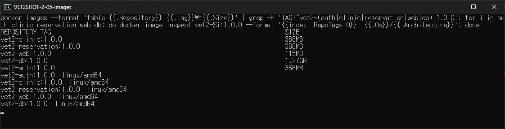

만든 이미지 5개 모두 `linux/amd64` 다. EKS 노드(c5a.large)와 EC2(t3.medium)가 amd64 라 그대로 실행된다.

## 3. 만든 것

```
v2/docker/
├── service.Dockerfile            서비스 3개 공용 (SERVICE 인자로 고른다)
├── web.Dockerfile                화면 + Apache httpd
├── web/httpd.conf                Apache 설정 (경로 분기)
├── db.Dockerfile                 MySQL + 스스로 초기화
├── db/10-init.sh                 초기화 스크립트 (RDS 초기화 Job 에도 쓴다, ⑥)
├── compose.yaml                  컨테이너 6개
├── env.example                   비밀번호 항목 (값 없음)
├── *.Dockerfile.dockerignore     Dockerfile 마다 무엇을 빼고 보낼지
├── bench/                        빌드 최적화를 방법별로 재려고 만든 A ~ E (C-7)
└── v0/                           가장 단순한 형태 (비교용으로 남김)
```

| 이미지 | 크기 | 들어 있는 것 | 실행 사용자 |
|---|---|---|---|
| `vet2-auth`, `vet2-clinic`, `vet2-reservation` | 각 366MB | JRE 21 (alpine) + jar 37MB | 10001 |
| `vet2-web` | 115MB | Apache httpd + 화면 파일 | 82 (www-data) |
| `vet2-db` | 1.27GB | MySQL 8.4 + SQL + 시드 생성기 + Node 실행 파일 | 999 |
| `redis:7-alpine` | 공식 이미지 그대로 | | 999 |

```
PC ── 28090 ──▶ web (Apache) ─┬──▶ auth        ──┐
                              ├──▶ clinic      ──┼──▶ mysql (볼륨 mysql-data)
                              └──▶ reservation ──┘──▶ redis
```

밖으로 열린 포트는 web 하나다. 나머지 5개는 compose 가 만든 네트워크 안에서만 보인다. WSL 2 에서는 28090 으로 열었다 (아래).

**포트를 28090 으로 바꾼 이유.** WSL 의 배포판들은 네트워크를 함께 쓴다. 처음 실행 때 Docker Desktop 의 로컬 쿠버네티스(③ 미리 돌려 보기)가 28080 을 쓰고 있어 web 이 `failed to bind host port 0.0.0.0:28080/tcp: address already in use` 로 뜨지 못했고, 나머지 5개도 함께 멈췄다. 그 상태에서 시나리오를 돌리자 Windows 쪽 클러스터가 대신 답해 56개가 "통과"로 나왔다 — 다른 환경을 시험한 것이라 버렸다. compose 가 원래 지원하는 `WEB_PORT` 로 28090 을 썼다. 이 장면은 나중에 다시 일으키려 했으나 Docker Desktop 이 꺼져 있어 재현되지 않았다 (캡처 없음).

### 3.1 빌드에서 빼는 파일

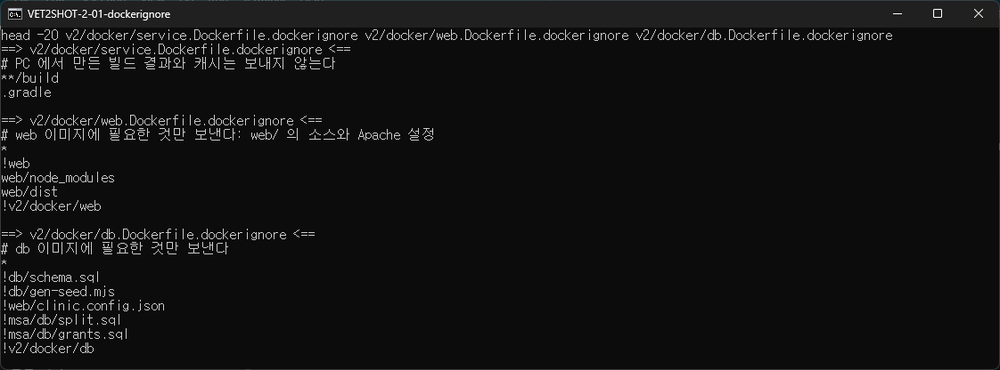

Dockerfile 마다 옆에 `<이름>.Dockerfile.dockerignore` 를 둔다. 서비스는 PC 에서 만든 `build/` 와 `.gradle` 을, web 은 `node_modules` 와 `dist` 를 뺀다. 효과는 C-7 (서비스: 112.66MB → 6.88kB).

### 3.2 Dockerfile 각 명령의 역할 (서비스)

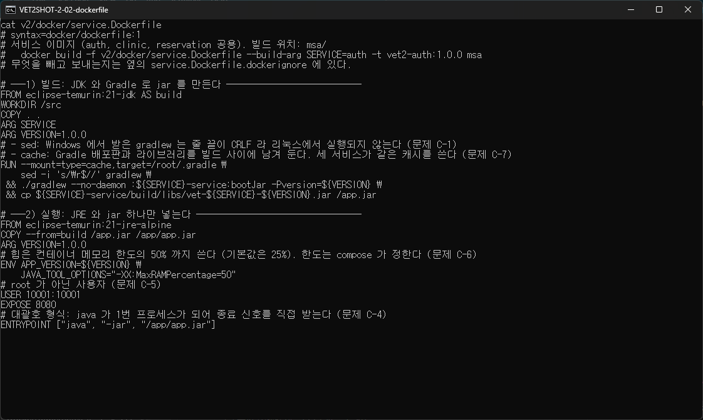

| 명령 | 역할 | 왜 |
|---|---|---|
| `# syntax=docker/dockerfile:1` | BuildKit 의 최신 문법 사용 | `RUN --mount=type=cache` 를 쓰려고 |
| `FROM eclipse-temurin:21-jdk AS build` | 1단계: JDK 가 있는 빌드용 이미지 | 컴파일에는 JDK 가 필요하다. 이 단계는 최종 이미지에 들어가지 않는다 (C-7) |
| `WORKDIR /src` | 작업 폴더 | 이후 명령의 기준 경로 |
| `COPY . .` | 소스(`msa/`)를 복사 | `.dockerignore` 로 빌드 결과물은 빼고 보낸다 |
| `ARG SERVICE`, `ARG VERSION` | 빌드할 서비스와 버전을 인자로 받는다 | Dockerfile 하나로 서비스 3개를 만든다 |
| `RUN --mount=type=cache,target=/root/.gradle ... ./gradlew --no-daemon :${SERVICE}-service:bootJar` | jar 를 만든다. Gradle 캐시는 빌드 사이에 남긴다 | 소스만 바뀌면 라이브러리를 다시 받지 않는다 (C-7). `sed` 는 Windows 에서 받은 `gradlew` 의 CRLF 를 고친다 (C-1) |
| `FROM eclipse-temurin:21-jre-alpine` | 2단계: 실행용, JRE 만 | 크기 (C-7) |
| `COPY --from=build /app.jar /app/app.jar` | 1단계에서 만든 jar 하나만 가져온다 | 소스·Gradle·JDK 는 버린다 |
| `ENV APP_VERSION=... JAVA_TOOL_OPTIONS="-XX:MaxRAMPercentage=50"` | 버전 표시, 힙을 컨테이너 한도의 50% 로 | C-6 |
| `USER 10001:10001` | root 가 아닌 사용자 (번호로) | C-5. 쿠버네티스가 `runAsNonRoot` 로 확인할 수 있다 |
| `EXPOSE 8080` | 듣는 포트를 알린다 (문서 역할) | |
| `ENTRYPOINT ["java", "-jar", "/app/app.jar"]` | 대괄호 형식: 자바가 1번 프로세스 | 종료 신호를 자바가 직접 받는다 (C-4) |

web 과 db 의 Dockerfile 도 파일 안의 주석에 줄마다 이유를 적었다 ([web.Dockerfile](../docker/web.Dockerfile), [db.Dockerfile](../docker/db.Dockerfile)).

## 4. 진행 방식

### 4.1 가장 단순한 형태 (v0)

서비스 이미지는 일곱 줄이다 ([v0/service.Dockerfile](../docker/v0/service.Dockerfile)).

```dockerfile
FROM eclipse-temurin:21-jdk
WORKDIR /src
COPY . .
ARG SERVICE
ENV SERVICE=${SERVICE}
RUN ./gradlew :${SERVICE}-service:bootJar
CMD java -jar ${SERVICE}-service/build/libs/vet-${SERVICE}-1.0.0.jar
```

web 은 공식 `httpd:2.4-alpine` 의 기본 설정에서 꺼져 있는 모듈 세 개(proxy, proxy_http, rewrite)만 켜고, 경로 분기를 적은 파일 하나를 끝에 붙였다 ([v0/web.Dockerfile](../docker/v0/web.Dockerfile), [v0/vet.conf](../docker/v0/vet.conf)).

```apache
ProxyPass /api/auth/  http://auth:8080/api/auth/
...
ProxyPass /api/       http://reservation:8080/api/
```

DB 는 공식 `mysql:8.4` 를 그대로 띄우고 ①의 `db-init.sh` 를 손으로 실행했다. compose 에는 healthcheck 도 한도도 없다.

### 4.2 v0 를 기준으로 쟀을 때

> Windows · Docker Desktop 에서 2026-11-23 에 잰 기록이다 (캡처 없음). v0 의 빌드 시간과 크기는 C-7 에서 WSL 2 로 다시 재 캡처했다.

| 측정 | 결과 |
|---|---|
| 첫 빌드 | **실패** — `./gradlew: not found` (C-1) |
| 고친 뒤 빌드 (서비스 하나) | 109초 |
| 전체 빌드 (`docker compose build`) | 321초 |
| 이미지 크기 | 서비스 1.53GB × 3, web 115MB |
| 빌드할 때 보낸 파일 | 서비스 115MB, web 86MB |
| web 만 먼저 띄움 | 뜬다. 화면은 200, 아직 없는 서비스로 가는 요청은 500 (4.0초) |
| DB 를 손으로 초기화한 뒤 시나리오 | 64 / 65 — 응답 헤더 항목 실패 (C-2) |
| `/assets/css/` 요청 | 200, 파일 목록이 보임 (C-3) |
| 1번 프로세스 | 서비스는 `/bin/sh -c java ...`, 서비스와 web 모두 root (C-4, C-5) |
| `docker stop` (서비스) | 3.5초 뒤 종료 코드 137 (C-4) |
| 서비스의 IP 가 바뀐 뒤 (옛 IP 를 다른 컨테이너가 차지) | web 경유 200. 스스로 새 IP 를 찾는다 |
| 서비스 하나를 멈춘 직후 그 서비스로 가는 요청 | 503 까지 **64초**, 그다음부터 6.9초 (C-9) |
| 힙 상한 | 2,019,557,376바이트 = 1.88GiB (C-6) |

기능은 거의 된다. "종료", "사용자", "다시 띄우기", "죽은 서비스의 응답 시간"에서 걸렸다.

서비스와 DB 의 v0 측정은 web 이 nginx 이던 때 한 것이다. web 과 무관한 항목이라 다시 재지 않았다.

### 4.3 nginx 와 Apache 의 차이

> Windows · Docker Desktop 기록 (캡처 없음).

같은 실험을 두 서버의 "단순한 설정"으로 모두 해 봤다. 둘 다 실제로 잰 값이다.

| 실험 | nginx (단순한 설정) | Apache (단순한 설정) |
|---|---|---|
| 서비스보다 먼저 뜸 | **죽는다** — `host not found in upstream "auth"` | 뜬다 |
| 서비스의 IP 가 바뀜 | **502 가 계속된다.** web 을 다시 시작해야 한다 | 200. 접속이 실패하면 이름을 다시 찾는다 |
| 멈춘 서비스로 가는 첫 요청 | 14초 뒤 502 | **64초 뒤 503** |
| 주 프로세스의 사용자 | root | root |

nginx 는 뜰 때 서비스 이름을 IP 로 바꿔 기억하기 때문에 위의 두 문제가 생겼고, 이름을 요청할 때마다 찾도록 설정을 바꿔야 했다. Apache 는 요청이 올 때 이름을 찾으므로 그 두 문제가 없다. 대신 접속 제한 시간의 기본값이 60초라 죽은 서비스로 가는 요청이 훨씬 오래 매달린다.

**웹 서버를 Apache 로 정한 것은 사용자의 지시다** ("nginx 말고 아파치로"). 이 작업이 기준으로 비교해 고른 것이 아니다. 위 표는 바꾼 뒤 무엇이 달라졌는지 잰 기록이다. 단순한 설정끼리 놓고 ② 의 기준(순서 없이 떠야 한다, IP 가 바뀌어도 이어진다, 죽은 서비스에 빨리 답한다)에 대면, nginx 는 앞의 둘이 ×, Apache 는 마지막 하나가 × 였다 (측정). Apache 의 × 는 C-9 에서 설정으로 넘겼다.

## 5. 최종 구성

파일에 이유를 주석으로 적어 두었다. 여기에는 요점만 적는다.

**서비스** ([service.Dockerfile](../docker/service.Dockerfile))

- 두 단계로 나눈다. JDK 와 Gradle 은 빌드 단계에만 있고, 실행 이미지에는 JRE 와 jar 하나만 들어간다.
- Gradle 캐시를 빌드 사이에 남긴다 (`--mount=type=cache`). 세 서비스가 함께 쓴다.
- `USER 10001:10001`, `ENTRYPOINT ["java", "-jar", "/app/app.jar"]` (대괄호 형식).
- 힙은 컨테이너 메모리 한도의 50% (`-XX:MaxRAMPercentage=50`).
- 자동 테스트는 이미지 빌드에서 돌리지 않는다. ①에서 `gradlew build` 로 돌렸다.

**web** ([web.Dockerfile](../docker/web.Dockerfile), [httpd.conf](../docker/web/httpd.conf))

- 화면은 Node 단계에서 빌드하고, 실행 이미지는 `httpd:2.4-alpine`.
- 기본 설정을 고치지 않고, 필요한 것만 적은 `httpd.conf` 로 통째로 바꾼다. 켜는 모듈은 11개다.
- `USER 82:82`, 포트 8080, PID 파일은 `/tmp`.
- `/api` 는 `ProxyPass` 8줄로 나눈다. 좁은 경로를 먼저 적는다. 줄마다 `connectiontimeout=2 retry=0`.
- `/about` → `about.html` 은 `RewriteRule`, 예약 화면의 안쪽 주소는 `FallbackResource /app/index.html`.
- 응답에 `X-Web-Node`, `X-Web-Version` 을 싣는다.
- 폴더 목록은 보여 주지 않는다.

**DB** ([db.Dockerfile](../docker/db.Dockerfile), [10-init.sh](../docker/db/10-init.sh))

- 데이터 폴더가 비어 있을 때 한 번, 스키마·시드·서비스 계정을 스스로 만든다.
- 시드는 이미지를 만든 날이 아니라 DB 가 처음 뜨는 날을 기준으로 만든다.
- 초기화가 한 줄이라도 실패하면 거기서 멈춘다.

**compose** ([compose.yaml](../docker/compose.yaml))

| 설정 | 값 | 이유 |
|---|---|---|
| `depends_on` | 쓰지 않음 | 순서 없이도 정상이 되어야 한다 (③에는 순서가 없다) |
| `mem_limit` | 서비스 384m, MySQL 1g, web·Redis 64m | 6.4 의 실험 |
| `DB_POOL_MAX` | 5 | 서비스 3개 × 5 = 15 (MySQL 한도 151) |
| `restart` | `unless-stopped` | 프로세스가 죽으면 다시 띄운다 |
| `stop_grace_period` | 서비스 40s | 처리 중인 요청을 마칠 시간 |
| `healthcheck` | 서비스·web 은 `/health`, MySQL 은 TCP 로 시드 조회, Redis 는 ping | `up --wait` 가 준비를 기다린다 |
| web 의 `dns_opt` | `timeout:1`, `attempts:1` | 멈춘 서비스의 이름을 찾느라 오래 기다리지 않는다 (C-9) |
| MySQL 볼륨 | `mysql-data` | 컨테이너를 지워도 데이터가 남는다 |
| 비밀번호 | `--env-file` 로 받는다 | 이미지와 Git 에 넣지 않는다 |

`depends_on` 을 쓰지 않은 이유. 기준은 "③ 쿠버네티스에서도 같은 결과가 나온다" 와 "하나를 다시 띄워도 정상이다" 두 가지다.

| 후보 | ③ 에서도 같다 | 하나만 다시 띄워도 정상 | 판정 | 근거 |
|---|---|---|---|---|
| `depends_on` (+ `condition: service_healthy`) 로 순서를 정한다 | × 쿠버네티스에는 뜨는 순서가 없다. compose 에서만 숨어 있던 순서 의존(C-10)이 ③ 에서 처음 드러난다 | △ 처음 `up` 할 때만 순서를 지킨다. 뒤에 하나를 다시 띄울 때는 소용없다 | 탈락 | 동작 |
| 순서를 두지 않고, 각자 준비되면 붙게 한다 | ○ | ○ 서비스는 저장소 없이도 뜨고 나중에 붙는다 (① W-1) | **채택** | 측정 (4.2, 6.2) |

비밀번호를 `--env-file` 로 받는 것도 같은 식으로 골랐다. 기준은 "이미지와 Git 에 값이 없다" 다. compose 파일에 값을 적는 것은 Git 에 올라가므로 ×, 이미지에 `ENV` 로 넣는 것은 이미지를 받는 누구나 읽으므로 × 다 (동작). 남는 것이 실행할 때 파일로 주는 방법이다 (6.7 에서 확인).

## 6. 기준별 측정 (최종 구성)

### 6.1 실행, 상태, 시나리오 테스트

```bash
WEB_PORT=28090 docker compose -f v2/docker/compose.yaml --env-file v2/_run/secrets.env up -d --build --wait
```

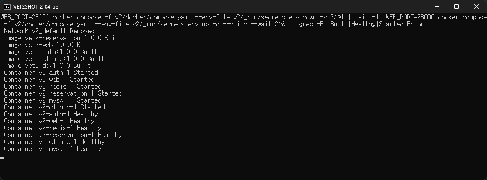

`--wait` 는 6개의 healthcheck 가 모두 통과할 때까지 기다린다. 상태:

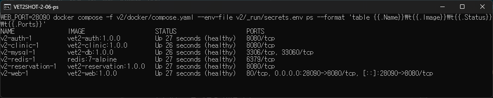

6개 모두 `(healthy)`. 밖으로 열린 것은 web 의 28090 하나다.

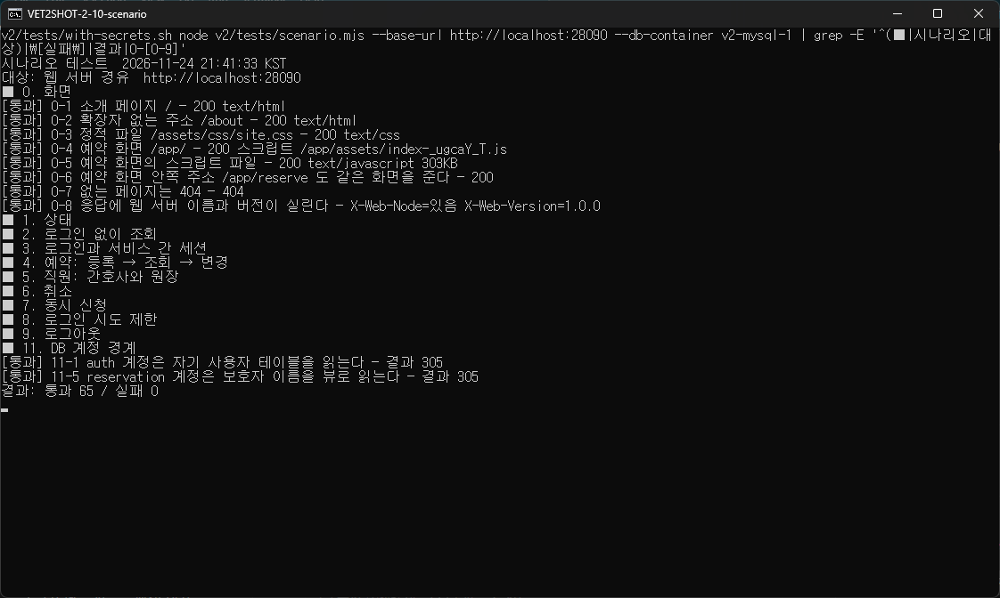

**통과 65 / 65.** ①의 60개에서 달라진 것: 3개가 빠지고(`/health` 를 서비스 3개가 아니라 web 하나에만 묻고, 서비스 경계 10-1 은 ①에서만 본다) 화면 항목 8개(0-1 ~ 0-8)가 들어왔다.

### 6.2 뜨는 순서

> Windows · Docker Desktop 기록 (캡처 없음).

일부러 거꾸로 띄웠다: web → 서비스와 Redis → MySQL.

```
■ 1. 뜨는 순서: web 만 먼저
  web 상태: running 재시작=0  /health 200  / 200  /api/status/auth 500 5.02s
■ 2. 서비스 3개와 Redis (MySQL 없음)
  /api/status/auth 200  /api/notices 503 {"code":"DB_UNAVAILABLE", ...
■ 3. 마지막에 MySQL
  MySQL 준비까지 16초
  /api/notices 200 까지 1번째 시도
  시나리오: 결과: 통과 65 / 실패 0
  web 재시작=0  auth 재시작=0  clinic 재시작=0  reservation 재시작=0  mysql 재시작=0  redis 재시작=0
```

아무것도 다시 시작하지 않고 정상이 됐다. 없는 것이 있는 동안에는 그 부분만 500 이나 503 으로 답한다.
1번의 5.02초는 DNS 설정(`dns_opt`)을 넣기 전에 잰 값이다. 넣은 뒤에는 이름을 못 찾을 때 1.0초에 답한다 (6.6).

### 6.3 종료

요청을 계속 보내는 동안(동시 20개) auth 를 내렸다 ([shutdown-check.mjs](../tests/shutdown-check.mjs)). 측정기는 같은 도커 네트워크 안의 컨테이너에서 돈다. 두 번씩 쟀다.

| 내리는 방법 | 처리 중 끊긴 요청 (1회 / 2회) | 그동안 응답 200 (1회 / 2회) |
|---|---|---|
| `docker stop` (SIGTERM, 정상 종료) | **2건 / 1건** | 635건 / 392건 |
| `docker kill` (SIGKILL, 비교용) | **20건 / 20건** | 486건 / 253건 |

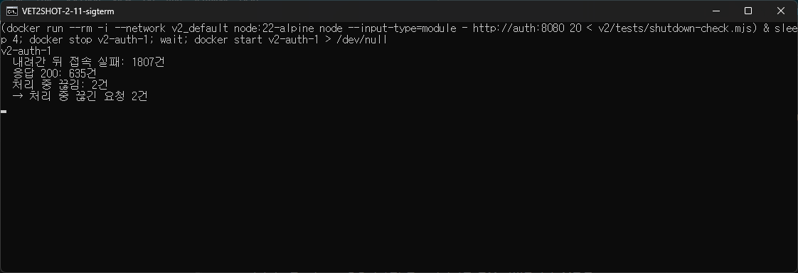


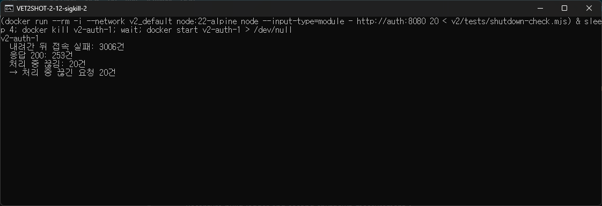

강제 종료는 그때 처리 중이던 요청(동시 20개)을 전부 끊는다. 정상 종료는 처리 중인 요청을 마치고 내려가서 1 ~ 2건만 끊겼다. 처음 Windows · Docker Desktop 에서 잰 때는 0건이었다 (캡처 없음). 남은 1 ~ 2건이 무엇인지는 확인하지 못했다 — 종료 신호와 거의 같은 순간에 도착해 새 연결을 받지 않게 된 요청으로 보인다 (추론). "내려간 뒤 접속 실패"는 auth 가 없는 동안 들어온 요청이라 처리 중 끊긴 것과 다르다.

### 6.4 메모리

> Windows · Docker Desktop 기록 (캡처 없음). 한도 384m 를 정한 근거다.

서비스의 한도를 바꿔 가며 시나리오 테스트를 3번씩 돌린 뒤의 사용량이다.

| 한도 | 뜨는 시간 | 테스트 3회 뒤 사용량 | 한도 대비 | 시나리오 | 재시작 |
|---|---|---|---|---|---|
| 128m | 3.9 ~ 5.4초 | 122 ~ 124MiB | 96% | 통과 | 0 |
| 192m | 3.7 ~ 3.8초 | 180 ~ 186MiB | 94 ~ 97% | 통과 | 0 |
| 256m | 3.3 ~ 3.5초 | 183 ~ 195MiB | 71 ~ 76% | 통과 | 0 |
| **384m** | 3.4초 | 185 ~ 196MiB | 48 ~ 51% | 통과 | 0 |

- 여유가 있을 때 서비스는 185 ~ 196MiB 를 쓴다. 192m 이하에서는 한도에 눌려서 덜 쓰는 것이다.
- 128m 와 192m 는 통과는 하지만 한도의 95% 로 버틴다. 조금만 더 쓰면 죽는다.
- **384m 로 정했다.** 평소 사용량의 두 배다. 한도는 "넘으면 죽는 선"이라 넉넉히 둔다.
- 이 표를 얻기 전의 실행에서 128m 일 때 reservation 이 한 번 재시작된 적이 있다. 그때는 Redis 가 죽어 있던 잘못된 실행이라(C-5) 표에서 뺐고, 재시작의 원인은 확인하지 않았다.

384m 에서 힙 상한은 192MiB 다 (`MaxHeapSize = 201326592`).

| 컨테이너 | 사용량 / 한도 |
|---|---|
| auth | 185MiB / 384MiB |
| clinic | 181MiB / 384MiB |
| reservation | 189MiB / 384MiB |
| mysql | 446MiB / 1GiB |
| redis | 9MiB / 64MiB |
| web (Apache) | 11MiB / 64MiB |

①에서 Windows 로 쟀을 때(231 ~ 244MB)보다 적다. DB 연결 수가 10에서 5로 줄었고 힙 상한이 작아졌기 때문으로 보인다. 따로 나눠서 재지는 않았다.

### 6.5 다시 띄우기

> Windows · Docker Desktop 기록 (캡처 없음).

| 상황 | 결과 |
|---|---|
| 서비스의 IP 가 바뀜, 옛 IP 를 다른 컨테이너가 차지 | 172.22.0.6 → 172.22.0.8. web 을 건드리지 않고 **첫 요청부터 200** |
| 서비스의 IP 가 바뀜, 옛 IP 가 비어 있음 | 172.22.0.9 → 172.22.0.10. **실패 없이 200.** 다만 요청 4건이 2.0초씩 걸렸다 (아래) |
| 프로세스가 스스로 죽음 (컨테이너 안에서 1번 프로세스에 종료 신호) | 재시작 횟수 1, **7초 뒤 다시 정상** |
| `docker kill` 로 밖에서 죽임 | 다시 뜨지 않는다. 사람이 멈춘 것으로 취급된다 |
| `docker compose down` 뒤 `up` (컨테이너를 모두 지우고 다시 만듦) | 7초. 초기화는 다시 돌지 않고, **만들어 둔 예약 185번이 그대로 있다** |
| 그때 로그인 | 사라진다 (옛 쿠키 401). Redis 컨테이너가 새로 만들어졌기 때문이다 |
| `down -v` 뒤 `up` (데이터까지 지움) | 16 ~ 22초. 초기화가 다시 돌고 오늘 기준 시드로 시작한다 |

옛 IP 가 비어 있을 때의 요청별 시간:

```
 1: 200 2.046s     4: 200 0.005s     7: 200 0.005s
 2: 200 2.008s     5: 200 0.005s     8: 200 0.026s
 3: 200 2.007s     6: 200 2.028s     9: 200 0.005s  (이후 계속 빠름)
```

Apache 는 요청을 처리하는 프로세스를 여러 개 띄우고(이때 4개), 프로세스마다 서비스의 IP 를 따로 기억한다. 각 프로세스가 옛 IP 로 한 번 접속을 시도하고 2초(`connectiontimeout`) 뒤 포기한 다음 이름을 다시 찾아 성공한다. 그래서 프로세스 수만큼 2초짜리 요청이 나오고 그 뒤로는 빠르다.

아래 세 줄(프로세스 재시작, `docker kill`, `down` 뒤 `up`)은 web 이 nginx 이던 때 잰 것이다. web 을 거치지 않는 동작이라 다시 재지 않았다.

### 6.6 로그와 설정 (환경 변수)

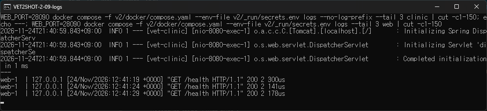

`docker compose logs` 로 서비스의 기동 기록과 web(Apache)의 접근 기록을 본다. 서비스는 파일이 아니라 표준 출력으로 남긴다.

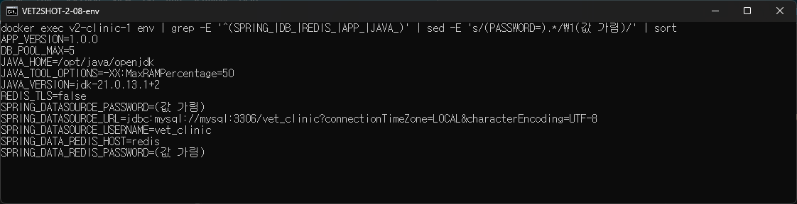

설정은 모두 환경 변수로 들어간다 (① 3.3). 비밀번호 두 줄은 화면에서 값을 가렸다 (명령의 `sed`). 비밀번호는 compose 파일이 아니라 `--env-file` 로 준다.

### 6.7 이미지 배포 (ECR, linux/amd64)

WSL 에서 만든 이미지에 `1.0.0-wsl` 태그를 붙여 ECR 로 올렸다. 로그인 비밀번호는 `aws ecr get-login-password` 의 출력을 `--password-stdin` 으로 바로 넘겨 화면과 기록에 남기지 않고, 끝나면 `docker logout` 한다. 계정 번호는 `sed` 로 가렸다.

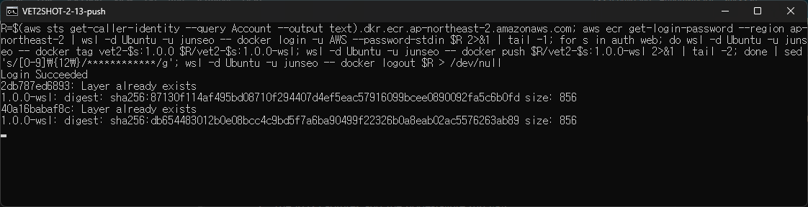

이 캡처는 같은 명령을 두 번째 실행했을 때의 것이다. 첫 실행에서 이미 올라간 층은 `Layer already exists` 로 건너뛰고 목록(manifest)만 다시 쓴다. 바뀐 층만 올라가므로 C-7 에서 의존성 층을 나눈 것이 push 시간에도 도움이 된다.

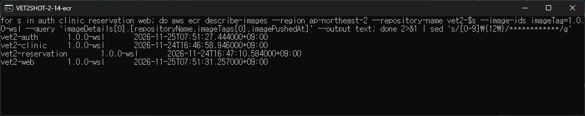

네 서비스 이미지 모두 ECR 에 `1.0.0-wsl` 로 있다 (clinic, reservation 은 11-24 에 먼저 올린 것). ③④ 의 클러스터는 같은 저장소의 `1.0.0` 태그(같은 Dockerfile 로 먼저 만들어 올린 것)를 받는다. `1.0.0-wsl` 은 WSL 에서도 같은 길로 올라간다는 확인이다.
EC2 노드와 EKS 노드는 x86_64 이고, WSL 2 도 x86_64 라서 `docker build` 가 따로 지정하지 않아도 `linux/amd64` 이미지를 만든다 (`docker image inspect` 로 확인, 캡처 없음). 노드에서 받아 실행되는 것은 ③ 의 3-04, ④ 의 4-02 캡처가 보여 준다.

### 6.8 비밀번호

> 이미지 안의 비밀번호 검사는 Windows · Docker Desktop 기록 (캡처 없음). 실행 중인 컨테이너의 환경 변수는 6.6 의 캡처처럼 값을 가려 보였다.

```
vet2-auth:1.0.0 에서 비밀번호 값이 나온 횟수: 0
vet2-clinic:1.0.0 에서 비밀번호 값이 나온 횟수: 0
vet2-reservation:1.0.0 에서 비밀번호 값이 나온 횟수: 0
vet2-web:1.0.0 에서 비밀번호 값이 나온 횟수: 0
vet2-db:1.0.0 에서 비밀번호 값이 나온 횟수: 0
Git: secrets.env 는 무시됨, 새 파일 중 비밀 값 포함: 0개
```

이미지의 기록(`docker history --no-trunc`)과 설정(`docker inspect`)에서 실제 비밀번호 값 5개를 찾았다.
실행 중인 컨테이너에는 환경 변수로 들어 있으므로 `docker inspect <컨테이너>` 로는 보인다. 이 PC 의 도커를 쓸 수 있는 사람에게는 보인다는 뜻이다.

### 6.9 서비스 하나를 멈췄을 때

> Windows · Docker Desktop 기록 (캡처 없음).

clinic 을 멈췄다.

| 요청 | 응답 |
|---|---|
| `/` (소개 페이지) | 200 (0.004초) |
| `/api/status/auth` | 200 (0.007초) |
| `/api/notices` (clinic) | **503, 3.0초 뒤** (6번 모두) |
| clinic 을 다시 시작한 뒤 | 4초 뒤 200 |

clinic 으로 가는 요청만 실패한다. 3.0초는 접속 포기 2초와 이름 찾기 포기 1초를 더한 것이다. 요청을 받은 프로세스가 clinic 의 IP 를 아직 기억하지 않고 있었다면 이름 찾기에서 바로 실패해 1.0초 뒤 500 으로 답한다 (그렇게 나온 실행도 있었다).

이때 응답은 Apache 의 HTML 이고 JSON 이 아니다. 예약 화면은 JSON 이 아닌 5xx 를 받으면 "서버에 일시적인 문제가 있습니다"를 보여 주도록 되어 있어(`web/app/src/api.ts`) 그대로 두었다.

## 7. 문제와 해결

각 문제는 **판단 기준**을 먼저 세우고, 후보마다 그 기준을 넘는지 적었다. 표의 ○ 는 기준을 넘음, △ 는 일부만, × 는 미달이다.
근거 표시: **측정** 은 이번 작업에서 직접 실행해 얻은 값, **동작** 은 그 도구의 공식 동작(문서에 적힌 성질), **추론** 은 실행해 보지 않고 따져 본 것이다.

### C-1. 빌드 중 `./gradlew: not found`

**증상.**

```
#8 [4/4] RUN ./gradlew :auth-service:bootJar
#8 1.692 /bin/sh: 1: ./gradlew: not found
ERROR: process "/bin/sh -c ./gradlew :${SERVICE}-service:bootJar" did not complete successfully: exit code: 127
```

파일은 `COPY . .` 로 분명히 들어갔는데 "없다"고 한다.

**원인.** 이 PC 의 `msa/gradlew` 는 줄 끝이 CRLF 다.

```
$ git ls-files --eol msa/gradlew
i/lf    w/crlf  attr/text eol=lf        msa/gradlew
```

Git 에는 LF 로 들어 있지만(`i/lf`) 작업 폴더의 파일은 CRLF 다(`w/crlf`). 첫 줄이 `#!/bin/sh\r` 이 되어, 리눅스가 `/bin/sh\r` 이라는 없는 프로그램을 찾는다. "gradlew 가 없다"가 아니라 "gradlew 를 실행할 프로그램이 없다"는 뜻이다. ①에서는 Git Bash 가 CRLF 를 봐줘서 드러나지 않았다.

**판단 기준.**

1. **어느 PC 에서 받은 소스로도** 같은 이미지가 만들어진다 (이 PC 의 설정에 기대지 않는다).
2. 빌드에 필요한 것이 이미지 안에 다 있다 (PC 에 JDK 를 깔지 않아도 된다).
3. 소스와 저장소 설정을 고치지 않는다.

**후보와 탈락 이유.**

| 후보 | 1. 어느 PC 에서나 | 2. 빌드가 이미지 안에서 | 3. 소스·저장소 그대로 | 판정 | 근거 |
|---|---|---|---|---|---|
| 작업 폴더의 파일을 LF 로 다시 받는다 (`core.autocrlf` 조정 등) | × 이 PC 만 고쳐진다. 다른 Windows PC 에서 같은 일이 생긴다 | ○ | △ PC 마다 Git 설정을 바꿔야 한다 | 탈락 | 측정 (`w/crlf` 확인) + 추론 |
| PC 에서 jar 를 만들고 이미지에는 jar 만 넣는다 | △ PC 의 JDK 버전에 따라 결과가 달라질 수 있다 | × PC 에 JDK 가 있어야 한다 | ○ | 탈락 | 추론 |
| `RUN sh ./gradlew ...` 처럼 셸을 직접 부른다 | △ 첫 줄은 피하지만, 스크립트 안의 다른 줄 끝 CR 은 그대로다 | ○ | ○ | 탈락 | 추론 (실행해 보지 않았다) |
| Dockerfile 안에서 줄 끝을 고친 뒤 실행한다 | ○ 받은 줄 끝과 무관하다 | ○ | ○ 이미지 안의 사본만 고친다 | **채택** | 측정 (아래) |

**고른 방법.** `RUN sed -i 's/\r$//' gradlew && ./gradlew ...`

**확인.** 빌드가 끝까지 갔다 (`BUILD SUCCESSFUL in 1m 39s`).

이 줄을 고칠 때 한 번 실수했다. 셸에서 `sed` 로 Dockerfile 을 고치다가 `\r` 이 글자 그대로의 CR 문자로 들어갔다. 빌드는 됐지만 화면에는 `sed -i "s/$//"` 로 보여서 아무 일도 안 하는 줄처럼 읽혔다. `od -c` 로 확인하고 파일을 다시 썼다.

### C-2. 예약 화면이 읽는 응답 헤더가 없다

**증상.** v0 로 시나리오 테스트를 돌리면 한 항목만 실패한다.

```
[실패] 0-8 응답에 웹 서버 이름과 버전이 실린다 — X-Web-Node=없음 X-Web-Version=없음
결과: 통과 64 / 실패 1
```

**원인.** 예약 화면은 하단에 "어느 웹 서버와 어느 서비스가 답했는지"를 보여 준다. 그 값을 응답 헤더에서 읽는다 (`web/app/src/api.ts`).

| 헤더 | 누가 붙이나 |
|---|---|
| `X-Served-By`, `X-App-Version` | 서비스 (소스에 있다) |
| `X-Web-Node`, `X-Web-Version` | 웹 서버 (**설정해 줘야 한다**) |

**판단 기준.**

1. 시나리오 0-8 이 통과한다 (화면이 읽는 헤더 두 개가 모든 응답에 있다).
2. **소스를 고치지 않는다.**
3. 값이 컨테이너마다 맞게 바뀐다 (어느 web 이 답했는지가 보여야 한다).

**후보와 탈락 이유.**

| 후보 | 1. 모든 응답에 | 2. 소스 그대로 | 3. 컨테이너마다 다른 값 | 판정 | 근거 |
|---|---|---|---|---|---|
| 서비스가 `X-Web-*` 도 붙이게 한다 | △ 서비스가 답한 응답에만. 화면 파일(정적 파일)에는 없다 | × 소스 수정 | × 서비스는 어느 web 을 거쳤는지 모른다 | 탈락 | 추론 |
| 헤더 값을 설정 파일에 글자로 적는다 | ○ | ○ | × 모든 web 이 같은 이름을 보낸다 | 탈락 | 추론 |
| `mod_headers` + 환경 변수 (`PassEnv`) | ○ `always` 로 오류 응답까지 | ○ | ○ `HOSTNAME` 은 도커가 컨테이너마다 넣는다 | **채택** | 측정 (아래) |

**고른 방법.** `mod_headers` 로 붙인다. 값은 컨테이너의 환경 변수에서 가져온다. `HOSTNAME` 은 도커가 넣어 주고, `WEB_VERSION` 은 Dockerfile 이 이미지 버전으로 넣는다.

```apache
PassEnv HOSTNAME WEB_VERSION
Header always set X-Web-Node    "%{HOSTNAME}e"
Header always set X-Web-Version "%{WEB_VERSION}e"
```

`always` 를 붙여야 오류 응답과 서비스가 대신 답한 응답에도 실린다.

**확인.**

```
[통과] 0-8 응답에 웹 서버 이름과 버전이 실린다 — X-Web-Node=있음 X-Web-Version=1.0.0
```

```
X-Web-Node: (컨테이너 이름)
X-Web-Version: 1.0.0
X-App-Version: 1.0.0
X-Served-By: (컨테이너 이름)
```

### C-3. 폴더 안의 파일 목록이 그대로 보인다

**증상.** v0 에서 폴더 주소를 요청하면 파일 목록이 나온다.

```
v0:    /assets/css/ → 200, "Index of" 포함
```

**원인.** 공식 이미지의 기본 설정이 문서 폴더에 `Options Indexes FollowSymLinks` 를 준다. `Indexes` 는 `index.html` 이 없는 폴더의 목록을 만들어 보여 주는 기능이다. v0 는 기본 설정을 그대로 썼다.

이 화면에는 숨길 파일이 없지만, 무엇이 들어 있는지 그대로 드러낼 이유도 없다.

**판단 기준.**

1. 폴더 주소가 목록을 보여 주지 않는다.
2. **켜져 있는 기능이 무엇인지 파일 하나로 다 보인다** (기본 설정에 숨어 있는 것이 없다).
3. 이미지의 기반(`httpd:2.4-alpine`)이 바뀌어도 설정이 같은 뜻으로 남는다.

**후보와 탈락 이유.**

| 후보 | 1. 목록 없음 | 2. 켜진 것이 다 보임 | 3. 기반이 바뀌어도 | 판정 | 근거 |
|---|---|---|---|---|---|
| 기본 설정을 `sed` 로 고쳐 `Indexes` 만 뺀다 | ○ | × 기본 설정의 모듈 22개는 그대로 켜져 있다 | × 기본 설정의 문구가 바뀌면 `sed` 가 아무것도 못 고치고 조용히 지나간다 | 탈락 | 측정 (모듈 수) + 추론 |
| 폴더마다 빈 `index.html` 을 둔다 | △ 파일을 둔 폴더만 | × | △ 새 폴더가 생길 때 잊으면 다시 보인다 | 탈락 | 추론 |
| 기본 설정 뒤에 `Options -Indexes` 를 덧붙인다 | ○ | × 나머지 기본값은 여전히 숨어 있다 | ○ | 탈락 | 추론 |
| 필요한 것만 적은 `httpd.conf` 로 통째로 바꾼다 | ○ `mod_autoindex` 자체를 불러오지 않는다 | ○ 모듈 25개(기본 22 + v0 가 켠 3) → 11개 | ○ 기본 설정을 읽지 않는다 | **채택** | 측정 (아래) |

**고른 방법.** 기본 설정을 고치는 대신 `httpd.conf` 를 통째로 바꾸면서 `Options FollowSymLinks` 만 남겼다. 목록을 만드는 모듈(`mod_autoindex`)은 아예 불러오지 않는다.

**확인.**

```
1.0.0: /assets/css/ → 404
```

### C-4. 종료 신호가 자바에 전달되지 않아 처리 중인 요청이 끊긴다

**증상.** v0 의 서비스 컨테이너를 멈췄다.

```
reservation: docker stop 3499ms, 종료 코드 137, graceful 로그 0줄
clinic:      docker stop 3446ms, 종료 코드 137, graceful 로그 0줄
v0 docker stop -t 20: 20459ms, 종료 코드 137
SIGTERM 만 보내고 4초 뒤 상태: running
```

종료 코드 137 은 강제 종료(SIGKILL)다. 기다리는 시간을 20초로 늘리면 정확히 20초를 다 기다린 뒤 강제 종료된다. SIGTERM 만 보내면 아무 일도 일어나지 않는다.

**원인.** 컨테이너의 1번 프로세스가 자바가 아니다.

```
USER   PID     COMMAND
root   47474   /bin/sh -c java -jar ${SERVICE}-service/build/libs/...
root   47498   java -jar auth-service/build/libs/vet-auth-1.0.0.jar
```

`CMD java -jar ...` 처럼 대괄호 없이 쓰면 도커가 `/bin/sh -c` 로 감싼다. 종료 신호는 1번 프로세스인 셸이 받는데, 셸은 그것을 자바에 넘기지 않는다. 자바는 종료를 통보받지 못한 채 강제로 죽는다.

**판단 기준.**

1. `docker stop` 의 종료 신호(SIGTERM)를 **자바가 직접** 받는다 (종료 코드 143. 강제 종료면 137).
2. 처리 중인 요청이 끊기지 않는다 (끊긴 요청 0건).
3. 이미지에 셸 같은 중간 프로세스를 두지 않는다 (③ 쿠버네티스도 같은 신호를 보낸다).

**후보와 탈락 이유.**

| 후보 | 1. 자바가 직접 받음 | 2. 끊긴 요청 0 | 3. 중간 프로세스 없음 | 판정 | 근거 |
|---|---|---|---|---|---|
| 그대로 둔다 (`CMD java ...`) | × 셸이 받고 넘기지 않는다 | × 강제 종료와 같다 (20건) | × | 탈락 | 측정 (137, 20건) |
| 기다리는 시간(`stop_grace_period`)만 늘린다 | × 늘린 만큼 기다린 뒤 결국 137 | × | × | 탈락 | 측정 (`-t 20` 에서 20,459ms 뒤 137) |
| `CMD exec java -jar ...` | ○ `exec` 로 셸이 자바로 바뀐다 | ○ (추론) | △ 시작할 때 셸을 한 번 거치고, `exec` 를 빠뜨리면 바로 원래 문제로 돌아간다 | 탈락 | 동작 |
| `tini` 같은 작은 init 을 1번 프로세스로 둔다 | ○ init 이 신호를 넘긴다 | ○ (추론) | × 이미지에 프로그램이 하나 는다. 자식 프로세스를 만들지 않는 자바에는 할 일이 없다 | 탈락 | 동작 + 추론 |
| `ENTRYPOINT ["java", "-jar", "/app/app.jar"]` | ○ 처음부터 자바가 1번 프로세스다 | △ 1 ~ 2건 (강제 종료는 20건) | ○ | **채택** | 측정 (아래) |

**고른 방법.** 대괄호 형식. jar 경로에 변수가 필요 없도록 빌드 단계에서 `/app.jar` 로 복사해 둔다.

**확인.** 요청을 보내는 중에 내렸다. 두 번씩 쟀고 캡처는 6.3 에 있다.

| | 처리 중 끊긴 요청 (1회 / 2회) |
|---|---|
| 최종 이미지, `docker stop` (SIGTERM) | 2건 / 1건 |
| `docker kill` (SIGKILL, 비교) | 20건 / 20건 |


v0 는 SIGTERM 이 전달되지 않아 늘 강제 종료였으므로 아래 줄과 같은 처지였다.
**기준 2(끊긴 요청 0건)는 다 채우지 못했다.** 20건이 1 ~ 2건으로 줄었지만 0 은 아니다. 처음 Windows · Docker Desktop 에서 잰 때는 0건이었다 (캡처 없음). 남은 1 ~ 2건의 원인은 확인하지 못했다 (8장).

`stop_grace_period` 는 40초로 두었다. 스프링은 처리 중인 요청을 최대 30초 기다리는 것이 기본값이다. 이 30초는 재 보지 않았고 스프링 문서의 값이다. 이 앱의 요청은 길어야 수 초라 실제로는 0.8초에 끝났다.

### C-5. 컨테이너가 root 로 돈다

**증상.** v0 에서 1번 프로세스의 사용자를 봤다.

```
auth   /bin/sh -c java -jar ...   uid=0
web    httpd -DFOREGROUND         uid=0   (자식 프로세스는 82)
mysql  mysqld                     uid=999
redis  redis-server *:6379        uid=999
```

서비스와 web 의 주 프로세스가 root(0)다. MySQL 과 Redis 의 공식 이미지는 스스로 전용 사용자로 바꾼다.

**원인.** Dockerfile 에 `USER` 가 없으면 root 로 실행된다. Apache 는 주 프로세스를 root 로 띄우고 요청을 처리하는 자식만 `www-data` 로 바꾼다.

**판단 기준.**

1. 6개 모두 1번 프로세스가 root(0) 가 아니다.
2. 기능은 그대로다 (시나리오 통과, 포트·로그·PID 파일이 동작).
3. ③ 에서 쿠버네티스가 `runAsNonRoot` 로 **강제할 수 있다** (사용자를 번호로 알 수 있다).

**후보와 탈락 이유 (서비스).**

| 후보 | 1. root 아님 | 2. 기능 그대로 | 3. 번호로 강제 가능 | 판정 | 근거 |
|---|---|---|---|---|---|
| `useradd` 로 이름 있는 사용자를 만들고 `USER app` | ○ | ○ | △ 이름만으로는 쿠버네티스가 root 가 아닌지 확인하지 못한다 (`runAsNonRoot` 는 번호를 본다) | 탈락 | 동작 |
| 실행할 때만 `docker run --user` 로 준다 | ○ | ○ | × 이미지 자체는 root 로 남아, 띄우는 쪽이 잊으면 root 로 돈다 | 탈락 | 추론 |
| `USER 10001:10001` (번호) | ○ | ○ | ○ | **채택** | 측정 (아래) |

**서비스.** `USER 10001:10001`. 번호로 적는다. 이미지에 사용자를 만들 필요가 없다.

**web.** `USER` 만 바꾸면 뜨지 않는다. v0 이미지를 `www-data` 로 실행해 봤다.

```
$ docker run --rm --user 82:82 vet2-web:v0
[core:error] (13)Permission denied: AH00099: could not create /usr/local/apache2/logs/httpd.pid.XXXXXX
[core:error] AH00100: httpd: could not log pid to file /usr/local/apache2/logs/httpd.pid
```

`logs/` 폴더가 root 것이라 PID 파일을 만들지 못한다. 고친 것은 세 가지다.

| 설정 | 값 | 이유 |
|---|---|---|
| `PidFile` | `/tmp/httpd.pid` | 누구나 쓸 수 있는 폴더 |
| `Listen` | `8080` | 1024 아래 포트는 보통 root 만 열 수 있다. 80 을 root 아닌 사용자로 열어 보지는 않았다 |
| `USER` | `82:82` | `www-data` 의 번호 |

포트를 8080 으로 옮긴 이유 (위 기준 1, 2):

| 후보 | 1. root 아님 | 2. 기능 그대로 | 판정 | 근거 |
|---|---|---|---|---|
| 80 그대로, 주 프로세스만 root (Apache 의 원래 방식) | × 주 프로세스가 root | ○ | 탈락 | 측정 (v0 의 uid=0) |
| 80 그대로, `httpd` 에 낮은 포트를 여는 권한(`setcap cap_net_bind_service`)을 준다 | ○ | ○ (추론) | 탈락 — 이미지에 권한 조작이 하나 늘고, ③ 에서 기능(capability)을 모두 버리는 설정과 부딪친다 | 추론 |
| 8080 으로 옮긴다 | ○ | ○ 바깥 포트는 compose 의 `28080:8080`, ③ 의 Service 가 바꿔 준다 | **채택** | 측정 (아래) |

로그는 처음부터 파일이 아니라 표준 출력으로 나가므로 고칠 것이 없었다.

**확인.** 컨테이너마다 1번 프로세스의 사용자 번호를 봤다.

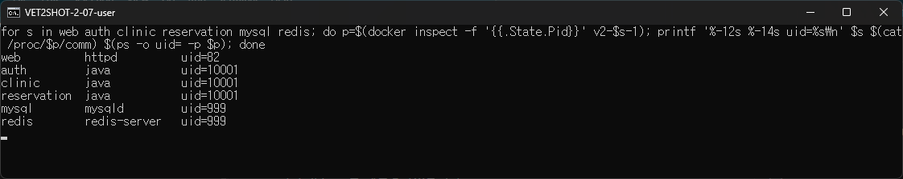

6개 모두 0(root)이 아니다.

**고치다가 만든 문제 두 가지.**

1. **Redis 가 root 가 됐다.** 비밀번호를 명령줄에 적지 않으려고 Redis 의 명령을 `sh -c 'exec redis-server --requirepass "$REDIS_PASSWORD"'` 로 바꿨는데, 측정해 보니 `redis pid1-uid=0` 이었다. 공식 이미지는 명령이 `redis-server` 로 시작할 때만 사용자를 바꿔 준다.

   ```
   $ grep -n "id -u" /usr/local/bin/docker-entrypoint.sh
   11:if [ "$1" = 'redis-server' ] && [ "$(id -u)" = '0' ]; then
   ```

   compose 에 `user: redis` 를 적어 해결했다.

2. **그러자 Redis 가 죽었다 살아나기를 반복했다.**

   ```
   # Fatal error: can't open the RDB file dump.rdb for reading: Permission denied
   상태=restarting 종료코드=1 재시작=11
   ```

   root 로 돌던 동안 만든 `dump.rdb` 가 볼륨에 root 소유로 남아 있었고, redis 사용자는 그것을 읽지 못했다. Redis 의 볼륨을 지우고 다시 만들어 해결했다 (세션뿐이라 지워도 된다).

**root 로 한 번 돌린 볼륨은 사용자를 바꾼 뒤에도 문제를 남긴다.** 처음부터 root 가 아닌 사용자로 시작해야 한다.

### C-6. 메모리 한도가 없어 힙 상한이 1.88GiB 로 잡힌다

**증상.** v0 에서:

```
v2-auth-1          267.2MiB / 7.52GiB
MaxHeapSize = 2019557376
```

한도가 "7.52GiB" 로 나온다. 도커 전체의 메모리다. JVM 은 그 25% 인 1.88GiB 까지 힙을 쓰겠다고 정했다.

**원인.** ①에서 본 것과 같다. JVM 은 보이는 메모리의 25% 를 힙 상한으로 잡는다. 컨테이너에 한도가 없으면 호스트 전체가 보인다. 서비스 3개가 각자 1.88GiB 까지 쓸 수 있다고 믿는 셈이다.

**판단 기준.**

1. 컨테이너 **전체**(힙 + 메타스페이스 + 스레드)가 정한 크기 안에 머문다.
2. 한도를 바꿀 때 **한 곳만** 고치면 된다 (③ 의 `resources.limits` 로 이어진다).
3. 시나리오를 돌려도 메모리 부족으로 재시작하지 않는다.

**후보와 탈락 이유.**

| 후보 | 1. 전체가 안에 | 2. 한 곳만 고침 | 3. 재시작 0 | 판정 | 근거 |
|---|---|---|---|---|---|
| 그대로 둔다 | × 힙 상한 1.88GiB, 컨테이너 한도 없음 | - | △ 지금은 쓰는 양이 적어 괜찮다 | 탈락 | 측정 (1.88GiB) |
| `-Xmx` 로 힙만 정한다 | × 힙만 막는다. 메타스페이스와 스레드는 한도가 없다 | × 컨테이너 한도와 `-Xmx` 두 곳을 맞춰 고쳐야 한다 | ○ (추론) | 탈락 | 동작 |
| 컨테이너 한도만 주고 비율은 기본 25% | ○ | ○ | △ 384m 의 25% 는 96MiB. ① 의 힙 사용량 34 ~ 52MB 에 비해 여유가 얇다 | 탈락 | 측정 (①의 힙) + 추론 |
| 컨테이너 한도 + `MaxRAMPercentage=50` | ○ | ○ 한도만 바꾸면 힙이 따라온다 | ○ | **채택** | 측정 (아래) |

**고른 방법.** compose 의 `mem_limit` + 이미지의 `-XX:MaxRAMPercentage=50`. 한도 값은 6.4 의 실험으로 384m 로 정했다.

비율을 기본값 25% 가 아니라 50% 로 둔 이유: 384m 의 25% 는 96MiB 다. ①에서 잰 힙 사용량이 34 ~ 52MB 였으므로 50%(192MiB)면 여유가 충분하다. 나머지 절반은 메타스페이스(약 65MB), 스레드, JIT 가 쓴다.

**확인.** 384m 에서 힙 상한 192MiB, 사용량 181 ~ 189MiB, 재시작 0, 시나리오 통과.

### C-7. 이미지가 1.52GB 이고 한 줄을 고쳐도 다시 빌드하는 데 55초가 걸린다

**어떻게 쟀나.** 방법을 하나씩 더한 Dockerfile A ~ E 를 만들어 ([bench/](../docker/bench/)) 같은 조건으로 auth 를 빌드했다. 각 단계에서 자바 파일 하나에 주석 한 줄을 덧붙이고(매번 다른 내용이라 캐시가 맞지 않는다) 다시 빌드한 시간과 이미지 크기를 쟀다. 빌드가 끝나면 소스를 되돌린다. 단계마다 한 번씩 쟀다 (WSL 2, 2026-11-24).

```bash
v2/tests/touch-src.sh msa/auth-service/src/main/java/kr/bodeum/vet/AuthServiceApplication.java
time docker build --progress=plain -f v2/docker/bench/A.Dockerfile --build-arg SERVICE=auth -t vet2-bench:A msa
git checkout -- msa/auth-service/src/main/java/kr/bodeum/vet/AuthServiceApplication.java
```

**증상 (A = v0 그대로).**

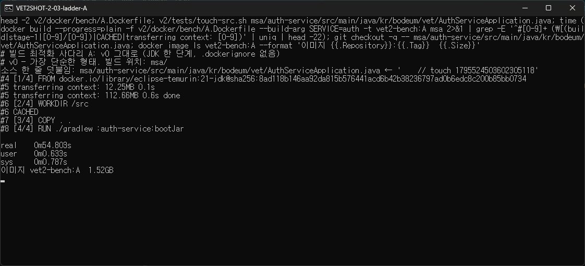

- 빌드에 보내는 파일(`transferring context`)이 112.66MB 다. PC 에서 만든 `build/`, `.gradle` 이 섞여 있다.
- 소스 한 줄을 고치면 `COPY . .` 이 바뀌고, 그 뒤의 `RUN ./gradlew` 가 처음부터 다시 돈다 (CACHED 가 아니다). 54.8초.
- 이미지가 1.52GB 다. 실행에는 jar(37MB)와 JRE 만 있으면 되는데 JDK·Gradle·소스·중간 결과가 모두 들어 있다.

**판단 기준.**

1. **실행 이미지에는 실행에 필요한 것만** 있다 (JRE 와 jar). 작을수록 ③④ 에서 노드가 받는 시간이 짧다.
2. **한 줄 고친 뒤 재빌드가 짧다** (라이브러리·Gradle 을 다시 내려받지 않는다).
3. Dockerfile 이 세 서비스에 하나로 남는다 (서비스마다 따로 쓰지 않는다).
4. 실행 결과가 같다 (시나리오 통과).

**하나씩 더해 본 결과.**

| 단계 | 더한 것 | 보내는 파일 | 이미지 | 한 줄 고친 뒤 재빌드 | 캡처 |
|---|---|---|---|---|---|
| A | v0 그대로 (JDK 한 단계) | 112.66MB | 1.52GB | 54.8초 | 2-03-ladder-A |
| B | + `.dockerignore` | 6.88kB | 1.31GB | 46.7초 | 2-03-ladder-B |
| C | + 두 단계 빌드 (실행은 JRE) | 6.88kB | 550MB | 33.5초 | 2-03-ladder-C |
| D | + 실행 이미지를 JRE alpine 으로 | 6.88kB | 366MB | 31.4초 | 2-03-ladder-D |
| E | + Gradle 캐시를 빌드 사이에 남김 | 6.88kB | 366MB | **12.1초** | 2-03-ladder-E |

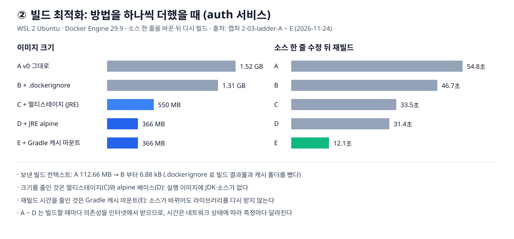

한 번씩만 잰 값이라 몇 초 차이(C 와 D)는 오차 안일 수 있다. 크기는 매번 같다.

**후보와 탈락 이유 (크기, 기준 1·3·4).**

| 후보 | 1. 필요한 것만 | 3. 하나로 | 4. 같은 결과 | 판정 | 근거 |
|---|---|---|---|---|---|
| 그대로 (JDK 위에서 빌드하고 그대로 실행) | × 1.52GB | ○ | ○ | 탈락 | 측정 (A) |
| `.dockerignore` 만 | △ 1.31GB. 보내는 파일은 줄지만 JDK·Gradle 은 그대로 | ○ | ○ | 함께 채택 (혼자로는 부족) | 측정 (B) |
| 두 단계 빌드 + 실행은 일반 JRE | △ 550MB | ○ | ○ (추론) | 탈락 | 측정 (C) |
| 두 단계 빌드 + 실행은 JRE alpine | ○ 366MB | ○ | ○ 시나리오 통과 (6.1) | **채택** | 측정 (D) |
| jlink 로 필요한 모듈만 담은 JRE 를 만든다 | ○ 더 작아질 수 있다 | △ 서비스가 쓰는 모듈을 따로 골라야 한다 | △ 빠뜨린 모듈은 실행 중에야 드러난다 | 탈락 | 추론 (해 보지 않았다) |

**후보와 탈락 이유 (재빌드 시간, 기준 2·3).**

| 후보 | 2. 재빌드 짧음 | 3. 하나로 | 판정 | 근거 |
|---|---|---|---|---|
| 그대로 (`COPY . .` 뒤에 빌드) | × 31 ~ 55초. 빌드 단계가 매번 처음부터 돈다 | ○ | 탈락 | 측정 (A ~ D) |
| 빌드 파일만 먼저 복사해 라이브러리 층을 따로 만든다 | ○ (추론) | × 서비스 셋의 빌드 파일을 나눠 복사하는 줄이 늘고, 공통 모듈이 바뀌면 층이 깨진다 | 탈락 | 추론 (해 보지 않았다) |
| Gradle 캐시를 빌드 사이에 남긴다 (`--mount=type=cache`) | ○ 12.1초 | ○ 한 줄이고 세 서비스가 함께 쓴다 | **채택** | 측정 (E) |

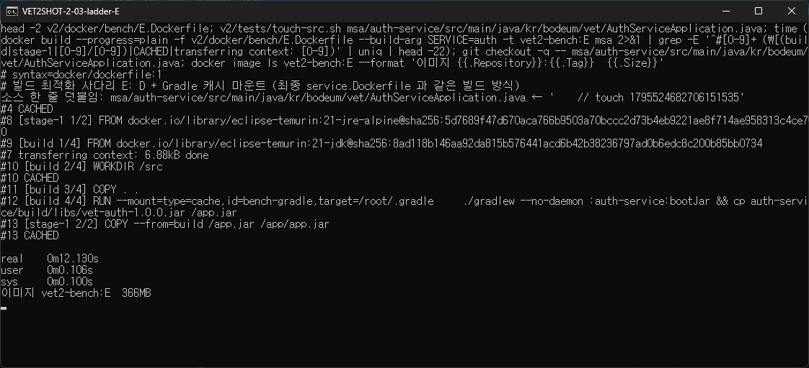

E 에서도 `RUN ./gradlew` 는 CACHED 가 아니다 (소스가 바뀌었으니 다시 돈다). 다만 Gradle 배포판과 라이브러리가 캐시에 남아 있어 컴파일만 한다.

web 은 v0 도 빌드 단계와 실행 단계가 나뉘어 있어서 크기가 같다 (115MB). 줄어든 것은 `.dockerignore` 로 보내는 파일뿐이다 (`node_modules` 제외. Windows 기록 86MB → 9.2MB, 캡처 없음).

한계: 캐시는 이 PC 의 도커에 있다. 캐시가 없는 곳(다른 PC, 새 빌드 서버)에서는 처음 한 번 D 와 비슷하게 걸린다 (추론).

### C-8. DB 가 빈 채로 뜨고, 초기화가 실패해도 "끝"이라고 나온다

**증상 1.** v0 는 공식 `mysql:8.4` 를 그대로 썼다. `up` 한 뒤에 `db-init.sh` 를 손으로 실행해야 했고, 그 전에는 모든 API 가 503 이었다. "다시 띄워도 정상"이 아니다.

**판단 기준.**

1. **명령 하나**(`up`)로 띄우면 손으로 할 일 없이 앱이 쓸 수 있는 DB 가 된다.
2. 같은 방법이 ③ 쿠버네티스에서도 된다 (PC 의 폴더에 기대지 않는다).
3. 이미 데이터가 있으면 다시 초기화하지 않는다 (데이터 유지).

**후보와 탈락 이유.**

| 후보 | 1. 명령 하나 | 2. 쿠버네티스에서도 | 3. 데이터 유지 | 판정 | 근거 |
|---|---|---|---|---|---|
| v0 처럼 띄운 뒤 `db-init.sh` 를 손으로 | × 그 전에는 모든 API 가 503 | × | ○ | 탈락 | 측정 |
| compose 에서 SQL 파일을 볼륨으로 끼운다 | ○ | × 쿠버네티스 노드에는 PC 의 폴더가 없다. 시드를 띄우는 날 만들어야 해서(C-10) SQL 파일만으로는 안 된다 | ○ 공식 이미지는 빈 폴더일 때만 실행 | 탈락 | 동작 |
| 초기화만 하는 컨테이너를 따로 둔다 | △ MySQL 이 준비될 때까지 기다리고, 실패하면 다시 하는 처리를 따로 짜야 한다 | ○ | △ 이미 했는지 스스로 판단해야 한다 | 탈락 (이 단계에서는) | 추론 |
| 초기화를 품은 DB 이미지 | ○ | ○ 이미지만 있으면 된다 | ○ 공식 이미지가 빈 데이터 폴더일 때만 실행한다 | **채택** | 동작 + 측정 (아래) |

**고른 방법.** DB 이미지를 따로 만든다. 공식 이미지는 데이터 폴더가 비어 있을 때 `/docker-entrypoint-initdb.d/` 의 스크립트를 실행해 준다.

**증상 2.** 그렇게 만든 이미지를 띄웠더니 `up --wait` 가 154초 뒤 "unhealthy" 로 끝났다.

```
[Entrypoint]: running /docker-entrypoint-initdb.d/10-init.sh
[vet] 1) 스키마 4개와 서비스 계정 3개
/docker-entrypoint-initdb.d/10-init.sh: line 11: docker_process_sql: command not found
[vet] 2) 테이블과 시드 (vet_load)
/docker-entrypoint-initdb.d/10-init.sh: line 22: docker_process_sql: command not found
...
[vet] 초기화 끝
[Entrypoint]: MySQL init process done. Ready for start up.
```

모든 단계가 실패했는데 마지막 줄은 "초기화 끝"이고, MySQL 은 정상으로 떴다. 속은 비어 있다.

**원인.** 두 가지가 겹쳤다.

1. 공식 이미지의 함수(`docker_process_sql`)를 쓰려면 스크립트가 "불러와져야(source)" 한다. 진입 스크립트는 파일에 실행 권한이 있으면 따로 실행하고, 없으면 불러온다.

   ```
   67:  if [ -x "$f" ]; then
   69:      "$f"            ← 실행 권한이 있으면 별도 프로세스로 실행 (함수가 안 보인다)
   72:      . "$f"          ← 없으면 불러온다
   ```

   Windows 에서 보낸 파일은 이미지 안에서 실행 권한이 붙는다 (`-rwxr-xr-x`). 그래서 따로 실행됐다.

2. 스크립트가 오류에서 멈추지 않았다. 그리고 한 번 "초기화했다"고 기록되면, 볼륨이 남아 있는 한 다시 초기화하지 않는다. **빈 DB 가 영구히 남는다.**

healthcheck 가 "서비스 계정으로 시드를 읽는다"였기 때문에 이것을 잡아냈다. `mysqladmin ping` 이었다면 정상으로 보였을 것이다.

**증상 2 의 판단 기준.**

1. 실행 권한이 있든 없든 같게 동작한다 (Windows 에서 보낸 파일도).
2. 한 줄이라도 실패하면 거기서 멈춘다 ("빈 DB 가 초기화 끝" 으로 남지 않는다).

| 후보 | 1. 권한과 무관 | 2. 실패하면 멈춤 | 판정 | 근거 |
|---|---|---|---|---|
| Dockerfile 에서 실행 권한을 빼서(`chmod -x`) 불러와지게 한다 | △ 이 파일은 되지만, 권한 하나에 동작이 갈리는 구조는 그대로다 | × 이것만으로는 실패한 줄이 그대로 지나간다 | 탈락 | 동작 (진입 스크립트 67 ~ 72줄) |
| 공식 이미지의 함수 대신 `mysql` 을 직접 + `set -euo pipefail` | ○ | ○ | **채택** | 측정 (아래) |

**고른 방법.**

- 공식 이미지의 함수에 기대지 않고 `mysql` 을 직접 부른다. 실행되든 불러와지든 똑같이 동작한다.
- 맨 위에 `set -euo pipefail`. 한 줄이라도 실패하면 거기서 멈춘다.
- 비밀번호 환경 변수가 없으면 아무것도 만들기 전에 멈춘다.

**확인.** 볼륨을 지우고 다시 띄웠다.

```
up --wait exit=0 22s
[vet] 1) 스키마 4개와 서비스 계정 3개
[vet] 2) 테이블과 시드 (vet_load)
[vet] 3) 서비스별 스키마로 옮기고 권한 주기
[vet] 초기화 끝
```

명령 하나로 6개가 뜨고 시나리오가 통과한다.

### C-9. 멈춘 서비스로 가는 요청이 64초 매달린다

**증상.** v0 에서 clinic 을 멈춘 직후 clinic 으로 가는 요청:

```
멈춘 직후 1 /api/notices: 503 64.000699s
멈춘 직후 2 /api/notices: 503 6.917967s
멈춘 직후 3 /api/notices: 503 6.930607s
그동안 auth: 200 0.005936s

[proxy:error] (113)Host is unreachable: AH00957: http: attempt to connect to 172.22.0.4:8080 (clinic:8080) failed
[proxy_http:error] AH01114: HTTP: failed to make connection to backend: clinic
```

다른 서비스는 정상이지만, 죽은 서비스로 간 첫 요청은 **64초** 동안 답이 없다. 브라우저에서는 그동안 화면이 멈춘다.

**원인.** 시간이 두 군데서 쓰인다.

| 단계 | 걸린 시간 | 이유 |
|---|---|---|
| 기억하던 IP 로 접속 시도 | 60초 | 컨테이너가 사라져 답이 없다. Apache 의 접속 제한 시간은 따로 정하지 않으면 `Timeout` 의 값(60초)을 쓴다 |
| 이름을 다시 찾기 | 4 ~ 7초 | 도커의 DNS 가 멈춘 컨테이너의 이름에 "없다"고 답하는 데 걸리는 시간 |

Apache 문서의 설명 ([mod_proxy](https://httpd.apache.org/docs/2.4/mod/mod_proxy.html)): `connectiontimeout` 의 기본값은 `timeout` 이고, `retry` 의 기본값은 60 이다. `retry` 는 "한 번 실패한 서비스로는 그 시간 동안 요청을 보내지 않는다"는 뜻이다.

**판단 기준.**

1. 멈춘 서비스로 가는 요청이 **몇 초 안에** 실패로 답한다 (①의 MySQL 처럼 3초 안팎).
2. 그 서비스가 살아나면 **바로** 다시 붙는다.
3. 살아 있는 서비스의 정상 요청(느린 요청 포함)에는 영향이 없다.

**후보와 탈락 이유.**

| 후보 | 1. 몇 초 안에 | 2. 살아나면 바로 | 3. 정상 요청 영향 없음 | 판정 | 근거 |
|---|---|---|---|---|---|
| 그대로 둔다 | × 첫 요청 64초 | × `retry` 기본 60초 동안 보내지 않는다 | ○ | 탈락 | 측정 + 동작 |
| 전체 `Timeout` 을 줄인다 | ○ | × | × 접속뿐 아니라 응답을 기다리는 시간도 줄어, 느린 정상 요청까지 끊긴다 | 탈락 | 동작 |
| `connectiontimeout` 만 줄인다 | △ 접속 2초 + 이름 찾기 4 ~ 7초가 남는다 | × | ○ | 탈락 | 측정 (이름 찾기 4 ~ 7초) + 추론 |
| 서비스 상태를 따로 검사하는 모듈(`mod_proxy_hcheck`) | ○ (추론) | ○ (추론) | ○ | 탈락 — `ProxyPass` 8줄을 모두 balancer 로 바꿔야 해서 설정이 크게 는다 | 추론 |
| `connectiontimeout=2` + `retry=0` + web 의 `dns_opt` | ○ 3.0초 | ○ 다시 시작한 뒤 4초에 200 | ○ 응답을 기다리는 시간은 그대로 | **채택** | 측정 (아래) |

**고른 방법.** 세 가지를 정했다.

| 설정 | 값 | 뜻 |
|---|---|---|
| `connectiontimeout` (ProxyPass 줄마다) | 2 | 접속이 2초 안에 안 되면 포기한다. 같은 네트워크 안이라 정상이면 수 밀리초다 |
| `retry` (ProxyPass 줄마다) | 0 | 실패한 서비스도 요청마다 다시 시도한다. 서비스가 살아나면 바로 붙는다 |
| `dns_opt` (compose 의 web) | `timeout:1`, `attempts:1` | 이름 찾기를 1초에 포기한다 |

**확인.**

```
멈춘 직후 1 /api/notices: 503 3.008634s
멈춘 직후 2 /api/notices: 503 3.007225s
...
멈춘 직후 6 /api/notices: 503 3.024796s
clinic 을 다시 시작한 뒤 4초에 200
```

64초가 3.0초로 줄었다. 서비스의 IP 가 바뀌었을 때 첫 요청이 2초 걸리는 것(6.5)도 같은 설정의 결과다. 설정 전이었다면 그 2초가 60초였을 것이다 (이 경우는 설정 전에 재 보지 않았다).

### C-10. 오래전에 만든 DB 이미지로 띄우면 예약할 시간이 하나도 없다

**증상.** 처음에는 시드를 이미지를 만들 때 생성해 넣었다 (이미지에 Node 가 필요 없어 더 단순하다). 이 방식이 괜찮은지 보려고 "20일 전에 만든 이미지"를 흉내 냈다. 시드 생성기를 20일 전 날짜로 실행한 이미지다.

```
-- 슬롯 576개, 예약 175건, ... 이벤트 날 2026-11-09, 2026-11-10, 2026-11-11

  clinic 로그: 슬롯 채우기 실패 (DB 초기화 전일 수 있음)
  [20일 전 시드, 한 번에 띄움] [실패] 2-4 예약 가능 시간 조회 — 빈 시간이 있는 날을 찾지 못함
```

예약할 수 있는 시간이 하나도 없다.

**원인.** 두 가지가 겹친다.

1. 시드의 슬롯은 "시드를 만든 날부터 14일"이다. 20일 전 시드면 전부 지난 날짜다.
2. clinic 은 뜰 때 "오늘부터 14일"의 슬롯을 채운다. 하지만 **그 순간 DB 가 준비되지 않았으면 실패하고, 다음 날 00:05 까지 다시 시도하지 않는다.** 한꺼번에 띄우면 clinic 이 DB 보다 먼저 뜬다.

clinic 을 다시 시작하니 `슬롯 576개 추가 (오늘부터 14일)` 가 나오고 테스트가 통과했다. 즉 "DB 가 먼저 떠야 한다"는 순서 의존이 숨어 있었다. 오늘 만든 이미지로는 시드에 오늘 날짜의 슬롯이 있어서 드러나지 않는다.

**판단 기준.**

1. **이미지를 언제 만들었든** 처음 띄운 날부터 예약할 시간이 있다.
2. 뜨는 순서에 기대지 않는다 (③ 쿠버네티스에는 순서가 없다).
3. **소스를 고치지 않는다.**

**후보와 탈락 이유.**

| 후보 | 1. 언제 만든 이미지든 | 2. 순서 무관 | 3. 소스 그대로 | 판정 | 근거 |
|---|---|---|---|---|---|
| 시드를 이미지를 만들 때 생성 (처음 방식) | × 20일 전 이미지는 슬롯이 모두 지난 날짜 | × clinic 이 먼저 뜨면 채우지 못한다 | ○ | 탈락 | 측정 (2-4 실패) |
| clinic 이 DB 뒤에 뜨도록 순서를 정한다 (`depends_on`) | △ clinic 이 채워 준다 | × compose 에서만 된다 | ○ | 탈락 | 동작 |
| clinic 의 슬롯 채우기가 다시 시도하게 소스를 고친다 | ○ | ○ | × 소스 수정 | 범위 밖 | 추론 |
| 이미지를 날마다 다시 만든다 | △ 만든 날 쓰면 된다 | × | ○ | 탈락 — 쓰는 날과 만든 날이 어긋나면 그대로 깨지고, 날마다 빌드해야 한다 | 추론 |
| 시드를 DB 가 처음 뜨는 날 기준으로 만든다 | ○ | ○ clinic 이 실패해도 시드가 14일 치를 넣는다 | ○ 시드 생성기를 그대로 쓴다 | **채택** | 측정 (아래) |

이미지가 1.10GB → 1.27GB 로 커지는 것(Node 실행 파일)은 기준 밖의 비용으로 받아들였다.

**고른 방법.** DB 이미지에 Node 실행 파일 하나를 넣고, 초기화할 때 시드를 만든다.

```dockerfile
FROM node:22-slim AS node
FROM mysql:8.4
COPY --from=node /usr/local/bin/node /usr/local/bin/node
```

```bash
node /opt/vet/db/gen-seed.mjs | sql vet_load
```

이미지는 1.10GB 에서 1.27GB 가 됐다.

**확인.** 볼륨을 지우고 띄운 뒤 슬롯의 날짜 범위:

```
2026-11-23    2026-12-05    576
```

오늘(11-23)부터다. 시나리오 통과 65 / 65.

**남은 한계.** clinic 이 DB 보다 먼저 뜨면 슬롯 채우기를 그날 다시 시도하지 않는 것은 그대로다. 시드가 14일 치를 넣어 주므로 처음 띄울 때는 문제가 없다. 오래 운영하다가 clinic 과 DB 가 함께 다시 뜨는 날에는 14일째 날의 슬롯이 다음 날 00:05 까지 비어 있을 수 있다. 이 경우는 재 보지 않았다.

### C-11. (nginx 일 때) 새로 띄운 직후 동시 요청 일부가 응답을 못 받았다 — 원인 미확정

web 이 nginx 이던 때 겪은 일이다. Apache 로 바꾼 뒤로는 나오지 않았다. 원인을 끝까지 밝히지 못했으므로 기록으로 남긴다.

**증상.** 시나리오 7-1 이 실패했다.

```
[실패] 7-1 보호자 10명이 같은 시간을 동시에 신청하면 1명만 성공 — 201 × 1, 409 SLOT_TAKEN × 4, 0(The operation was aborted due to timeout) × 5
```

10건 중 5건이 15초 동안 응답이 없었다. 그전까지 20회 넘게 통과하던 항목이다.

**조사.** 같은 동시 신청을 반복하는 스크립트를 만들어 재현했다 ([race-repeat.mjs](../tests/race-repeat.mjs)).

| 조건 | 결과 |
|---|---|
| nginx, 떠 있는 지 오래된 구성에서 150회 반복 | 비정상 0회 |
| nginx, 전부 지우고 새로 띄운 직후, PC 에서 | 조사하며 7번 띄워 2번 발생 (처음 발견한 것까지 3번) |
| nginx, 전부 지우고 새로 띄운 직후, 도커 네트워크 안에서 | 5번 띄워 0번 |
| **Apache, 전부 지우고 새로 띄운 직후, PC 에서** | **8번 띄워 0번** |

nginx 에서 발생했을 때 살펴본 것:

| 살펴본 곳 | 결과 |
|---|---|
| nginx 접근 로그 | 보낸 10건 중 9건만 기록됨 (다른 회차는 4건). 응답 없는 요청은 499 로도 남지 않았다 |
| MySQL 의 실행 중인 트랜잭션 | 요청이 매달린 19초 동안 없음 |
| reservation 의 스레드 덤프 | 요청을 처리 중인 스레드 없음, 경고·오류 로그 없음 |

**판단.** 앱과 DB 의 문제는 아니다. 매달린 동안 둘 다 한가했다.

그 앞 구간 어디인지는 확정하지 못했다. 처음에는 "nginx 에 기록이 없고 네트워크 안에서는 정상"이라는 점에서 Docker Desktop 이 PC 의 포트를 컨테이너로 넘겨 주는 구간이라고 판단했다. 그런데 **같은 구간을 지나는 Apache 에서는 8번 모두 정상이었다.** 그래서 그 판단은 유지할 수 없다. nginx 쪽의 요인이거나, nginx 와 그 구간이 만났을 때만 생기는 일일 수 있다. 표본이 작아(nginx 7번, Apache 8번) 우연일 가능성도 남는다.

**대응.** 원인이 확정되지 않아 "고칠 방법"을 후보로 놓고 고를 수 없었다. 그래서 기준을 "다시 나오면 앱의 실패와 구분할 수 있다" 하나로 두고 아래만 했다. web 이 Apache 로 바뀐 뒤(사용자 지시)로는 8번 띄워 0번이라 더 조사하지 않았다.

- 시나리오 테스트가 응답 없는 요청의 이유를 출력하도록 고쳤다 (`0(The operation was aborted due to timeout)`). 이 표시가 나오면 앱의 실패와 구분할 수 있다.
- 같은 테스트를 도커 네트워크 안에서 돌리는 방법을 두었다.

  ```bash
  docker run --rm -i --network v2_default node:22-alpine \
      node --input-type=module - --base-url http://web:8080 < v2/tests/scenario.mjs
  ```

- nginx 를 쓰지 않게 되어 더 조사하지 않았다.

## 8. 확인하지 못한 것

| 항목 | 이유 |
|---|---|
| 정상 종료에서 1 ~ 2건이 끊기는 원인 | WSL 2 에서 다시 잰 값이다 (Windows 에서는 0건). 연결 단위로 추적하지 않았다 |
| CPU 한도 | 주지 않았다. ③에서 요청량과 한도를 정할 때 잰다 |
| 이미지의 알려진 취약점 | 검사 도구를 돌리지 않았다 |
| web 을 내리는 동안 처리 중인 요청이 끊기는가 | 종료 코드(0)와 시간(1.6초)만 봤다 |
| C-11 의 원인 | nginx 를 쓰지 않게 되어 조사를 멈췄다 |
| Redis 가 멈췄을 때의 동작 | ①의 W-3 그대로일 것으로 보고 다시 재지 않았다 |
| 14일 넘게 운영한 뒤 clinic 과 DB 가 함께 다시 뜨는 경우 | C-10 의 남은 한계 |

## 9. 작업 중에 한 일 가운데 알려 둘 것

처음 빌드 시간을 재려고 `docker builder prune -af` 를 실행했다. **이 PC 의 도커 빌드 캐시가 전부 지워졌다.** 이 프로젝트와 무관한 다른 이미지의 빌드 캐시도 포함이다. 이미지와 컨테이너, 볼륨은 그대로이고, 다른 프로젝트를 다음에 빌드할 때 처음 한 번 오래 걸린다.

## 10. 다음 단계로 넘기는 것

| 넘기는 것 | ③에서 할 일 |
|---|---|
| web 의 설정에 서비스 이름이 `auth`, `clinic`, `reservation` 으로 적혀 있다 | 쿠버네티스에서 그 이름으로 찾아지는지 확인한다 |
| web 의 `dns_opt` 는 compose 의 설정이다 | 쿠버네티스에서 멈춘 서비스로 가는 요청이 얼마나 걸리는지 다시 잰다 |
| Apache 는 프로세스마다 서비스의 IP 를 기억한다 | Pod 가 바뀔 때의 동작을 다시 잰다 |
| 서비스의 설정은 전부 환경 변수다 | ConfigMap 과 Secret 으로 나눈다 |
| `/health` 는 DB 와 Redis 를 보지 않는다 | probe 에 그대로 쓴다. DB 장애 때 서비스가 재시작되지 않는다 |
| 서비스는 384MiB 한도에서 181 ~ 189MiB 를 쓴다 | 메모리 요청량과 한도의 근거 |
| DB 연결 수 = 서비스 3개 × 복제본 수 × `DB_POOL_MAX` | 복제본을 2개로 하면 30. 151 을 넘지 않는다 |
| 종료 신호에 처리 중인 요청을 마친다 (1 ~ 2건은 끊김) | 무중단 배포의 전제. ③에서 `preStop` 으로 몇 초 기다렸다 내린다 |
| DB 이미지는 볼륨이 비어 있을 때만 초기화한다 | 볼륨에 다른 파일이 있으면 어떻게 되는지 확인 |
| MySQL 의 준비 여부는 TCP 로 묻는다 | probe 에 그대로 쓴다 |
| 이미지 5개를 ECR 에 올렸다 (6.7) | 노드가 ECR 에서 받으려면 로그인 정보가 필요하다 |

## 11. 다시 실행하는 순서

```bash
# 비밀번호 파일 (없을 때만. ①에서 만들었다면 그대로 쓴다)
cp v2/docker/env.example v2/_run/secrets.env      # 값 5개를 채운다

# WSL 2 Ubuntu 의 작업 폴더에서 (~/vet2-lab, ① 11장)
# 빌드하고 띄우기 (28080 을 다른 것이 쓰고 있으면 WEB_PORT 로 바꾼다)
export WEB_PORT=28090
C="docker compose -f v2/docker/compose.yaml --env-file v2/_run/secrets.env"
$C up -d --build --wait
$C ps

# 테스트 (비밀번호가 화면에 나오지 않게 with-secrets.sh 로 넘긴다)
v2/tests/with-secrets.sh node v2/tests/scenario.mjs --base-url http://localhost:28090 --db-container v2-mysql-1

# 종료 확인 (요청을 보내는 중에 auth 를 내린다. stop 을 kill 로 바꾸면 강제 종료 비교)
(docker run --rm -i --network v2_default node:22-alpine node --input-type=module - http://auth:8080 20 \
    < v2/tests/shutdown-check.mjs) & sleep 4; docker stop v2-auth-1; wait; docker start v2-auth-1

# 빌드 사다리 (C-7): A ~ E 를 바꿔 가며
v2/tests/touch-src.sh msa/auth-service/src/main/java/kr/bodeum/vet/AuthServiceApplication.java
time docker build -f v2/docker/bench/E.Dockerfile --build-arg SERVICE=auth -t vet2-bench:E msa
git checkout -- msa/auth-service/src/main/java/kr/bodeum/vet/AuthServiceApplication.java

# 정리
$C down          # 데이터는 남긴다
$C down -v       # 데이터까지 지운다
```

브라우저: `http://localhost:28090/` (소개 페이지), `http://localhost:28090/app/` (예약 화면). WSL 2 의 포트는 Windows 의 localhost 로 그대로 열린다.
화면 캡처는 `v2/tests/shots-2.ps1` 이 같은 명령을 실행하며 찍었다.
실행 기록의 원본은 `v2/_run/2-container/` 에 있다 (Git 에 올라가지 않는다).
