# ③ Kubernetes 전환

②의 컨테이너 6개를 쿠버네티스로 옮긴 기록이다.
먼저 이 PC 의 클러스터(Docker Desktop)에서 미리 돌려 보고, 그다음 AWS EC2 3대에 kubeadm 으로 만든 클러스터에서 같은 것을 쟀다.
가장 단순한 배포(v0)로 시작해 점검 기준에 걸린 것을 하나씩 고쳤다.

DB 는 클러스터 안의 MySQL(StatefulSet + 볼륨)이다. 선택 과제로 같은 클러스터에 RDS 를 쓰는 구성을 하나 더 띄웠다 (네임스페이스 `vet2-rds`, [⑥ 선택 과제](6-선택과제.md)). 이 문서의 측정은 모두 필수 구성(네임스페이스 `vet2`)의 것이다.

명령과 출력은 모두 직접 실행한 것이다. 그림은 2026-11-24 에 EC2 kubeadm 클러스터에서 실행하며 찍은 실제 터미널 화면이다 ([shots-3.ps1](../tests/shots-3.ps1), [shots-3p.ps1](../tests/shots-3p.ps1)). 계정 번호와 공인 IP 는 가렸다 (사설 IP 10.20.x.x 는 VPC 안의 주소라 그대로 두었다).
처음(2026-11-23)에는 이 PC 의 Docker Desktop 클러스터에서 미리 돌려 보았다. 그때 잰 것 가운데 다시 재지 않은 것은 "캡처 없음" 이라고 밝혀 두었다.

## 0. 완성 기준과 근거

| 과제 | 완성 기준 (명세) | 결과 | 근거 |
|---|---|---|---|
| 클러스터 구축 | EC2 VM 3대에 kubeadm 으로 구축, 노드가 모두 `Ready` | 컨트롤 플레인 1 + 워커 2, kubeadm 1.36.6, 3대 `Ready` | 2.2, 9장 |
| | 필요한 포트만 보안 그룹에 | 밖에서: 30080·30081(웹), 6443(kubectl) 을 이 PC 의 IP 에만. 노드끼리: UDP 8472(Flannel), TCP 6443, 10250 만 | 2.3 |
| 배포와 운영 | APP 을 여러 Pod 로, Probe | web·서비스 3개 모두 복제본 2, startup·readiness·liveness probe | 5장, K-1 |
| | 롤링 업데이트 · 롤백 | 업데이트·롤백 중 실패 2건 (약 5,800건 중) | 6.2 |
| | Pod 삭제 후 자동 복구 | web 9초, reservation 18초에 복구, 실패 0 | 6.2 |
| 노출 | 클러스터 밖에서 접속해 시나리오 통과 | NodePort 30080, 시나리오 65 / 65 (워커 두 대 모두) | 6.1, K-12 |
| | DB 는 클러스터 안에서만 | mysql 은 `ClusterIP`. 이 PC 에서 노드의 3306 은 닿지 않는다 | 6.1 |
| 데이터와 설정 | DB 데이터를 볼륨에, DB Pod 를 교체해도 유지 | StatefulSet + 워커 디스크 볼륨. MySQL Pod 를 지운 뒤에도 예약 217번 유지 | 6.3, K-2, K-6 |
| | 설정은 ConfigMap, 비밀번호는 Secret | `vet-config` / `vet-db`, `vet-redis`. 배포 정보에 비밀번호 0줄 | K-3 |

**수업과 다르게 한 것.**

| 수업 | 여기 | 이유 |
|---|---|---|
| MetalLB(L2)로 LoadBalancer | NodePort | EC2(VPC)에서는 L2 광고(ARP)가 동작하지 않는다 (명세). K-12 에 후보 비교 |
| Calico | Flannel | K-13 에 후보 비교 |

## 1. 결과

둘 다 EC2 kubeadm 클러스터에서 같은 도구로 쟀다 (2026-11-24).

| 점검 기준 | v0 (단순한 배포) | 최종 | 근거 |
|---|---|---|---|
| 시나리오 테스트 전부 통과 | 통과 (56 / 56, DB 계정 경계 제외) | **통과 65 / 65** | 6.1 |
| 배포 중 실패한 요청 0 | **실패 240건** | 0건 | K-1, 6.2 |
| 업데이트·롤백 중 실패한 요청 0 | **실패 125건** | 2건 (연결 끊김, O-4) — 기준을 다 채우지 못함 | K-1, 6.2 |
| Pod 를 지우면 스스로 복구 | 복구되지만 그동안 실패 (이 PC 기록 45 ~ 89건, 캡처 없음) | 실패 0건 | K-1, 6.2 |
| DB Pod 를 교체해도 데이터 유지 | **실패 — 예약 176번이 사라짐** | 통과 (교체하는 약 11초 동안 DB 요청 26건 실패) | K-2, 6.3 |
| 워커 노드 1대를 멈춰도 서비스 지속 | (재지 않음) | 부분 통과 — 아래 표 | K-8 ~ K-11, 6.4 |
| 설정과 비밀이 이미지 밖에 있음 | 비밀번호가 배포 정보에 그대로 보임 | 통과 — Secret 으로 분리 | K-3 |

워커 1대가 멈췄을 때:

| 멈춘 노드 | 고치기 전 | 고친 뒤 |
|---|---|---|
| 앱만 있는 노드 (vet2-w2) | 6분 넘게 로그인 불가, 실패 675건 | 115초 뒤 전부 복구, 실패 110건 |
| DB 가 있는 노드 (vet2-w1) | 클러스터 DNS 까지 멈춰 **DB 와 무관한 요청도 전부 실패** | DB 와 무관한 요청은 정상. **DB 는 그 노드가 돌아올 때까지 멈춤 (한계, K-11)** |

문제는 13건이다. 12건은 해결했고 1건은 한계로 남겼다 (선택 과제의 RDS 가 이 한계를 푼다).

| 번호 | 문제 | 어디서 | 상태 |
|---|---|---|---|
| K-1 | 다시 배포하면 수백 건이 503 으로 실패한다 | 공통 | 해결 |
| K-2 | MySQL Pod 를 지우면 예약 데이터가 사라진다 | 공통 | 해결 |
| K-3 | 비밀번호가 배포 정보에 그대로 보인다 | 공통 | 해결 |
| K-4 | Pod 에 자원 요청·한도가 없다 | 공통 | 해결 |
| K-5 | 노드가 ECR 에서 이미지를 받지 못한다 | kubeadm | 해결 (12시간 한계) |
| K-6 | MySQL 의 볼륨이 만들어지지 않는다 | kubeadm | 해결 |
| K-7 | 볼륨 설정을 고쳐 다시 적용하면 거부된다 | 공통 | 해결 |
| K-8 | 다시 배포하면 복제본 둘이 한 노드에 몰린다 | 노드 여러 대 | 해결 |
| K-9 | 노드가 죽으면 Pod 를 5분 동안 옮기지 않는다 | 노드 여러 대 | 해결 |
| K-10 | 클러스터 DNS 둘이 한 노드에 있어, 그 노드가 죽자 모든 요청이 실패했다 | kubeadm | 해결 |
| K-11 | DB 가 있는 노드가 죽으면 DB 가 다른 노드로 옮겨 가지 못한다 | kubeadm | **한계** (⑥ RDS) |
| K-12 | 클러스터 밖으로 여는 방법 (MetalLB 가 EC2 에서 동작하지 않음) | kubeadm | 해결 — NodePort |
| K-13 | 네트워크 플러그인(CNI) 고르기 | kubeadm | 해결 — Flannel |

①의 W-3(Redis 가 멈추면 로그인한 요청이 늦게 실패)은 여기서도 그대로다. 그 밖에 소스에서 온 것 하나를 새로 찾았다 (8장 O-2).

## 2. 환경

### 2.1 이 PC 의 클러스터 (미리 돌려 보기, 2026-11-23, 캡처 없음)

| 항목 | 값 |
|---|---|
| 클러스터 | Docker Desktop 내장 쿠버네티스 v1.36.1, 노드 1대 |
| 네임스페이스 | `vet2` (이 PC 에 이전부터 있던 다른 배포와 섞이지 않게 따로 만들었다) |
| 이미지 | PC 의 도커에 있는 ②의 이미지 그대로 |
| 밖으로 여는 법 | LoadBalancer → `http://localhost:28080` |
| 볼륨 | 클러스터 기본 StorageClass(`standard`) |

노드가 1대뿐이라 노드 장애와 분산은 볼 수 없다. 이 문서의 그림과 표는 모두 EC2 kubeadm 의 것이다.

### 2.2 EC2 kubeadm 클러스터

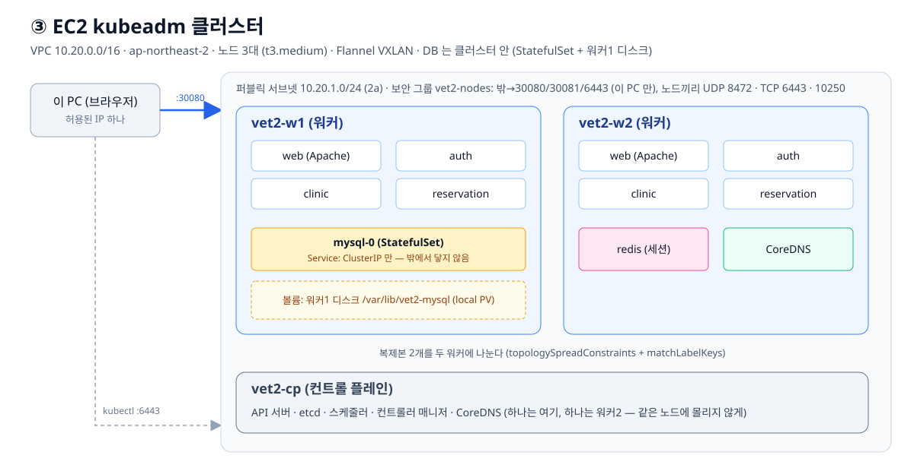

| 항목 | 값 |
|---|---|
| EC2 | t3.medium (2 vCPU, 4GiB) × 3, Ubuntu 24.04, 루트 디스크 20GB gp3 |
| 쿠버네티스 | kubeadm·kubelet·kubectl v1.36.6 (`pkgs.k8s.io`), containerd (Ubuntu 패키지) |
| 네트워크 플러그인 | Flannel v0.28.11 (VXLAN), Pod 대역 10.244.0.0/16 (K-13) |
| 접속 | SSH 없음. 명령은 Session Manager 로 보낸다. kubectl 은 이 PC 에서 API 서버(6443)로 |
| 노드 IAM 역할 | `AmazonSSMManagedInstanceCore`, `AmazonEC2ContainerRegistryReadOnly` |
| 밖으로 여는 법 | NodePort 30080 → `http://<노드의 공인 IP>:30080` (K-12) |
| 이미지 | ECR. 압축 크기: 서비스 각 110MB, web 29MB, db 284MB |

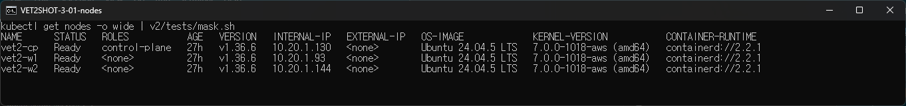

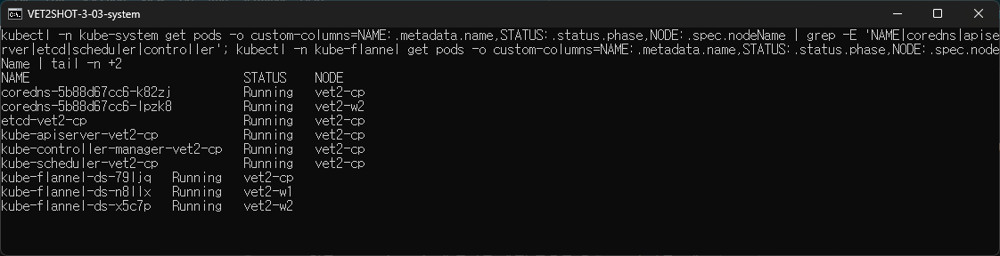

CoreDNS 둘은 서로 다른 노드(vet2-cp, vet2-w2)에 있다 (K-10). Flannel 은 노드마다 하나.

모든 AWS 자원에 `Project=vet2` 태그와 `vet2-` 이름을 붙였다. 같은 계정에 이 작업과 무관한 자원이 있어서, 지울 때 섞이지 않게 하려는 것이다.
이 리전에는 기본 VPC 가 없어서 VPC 를 새로 만들었다. NAT 게이트웨이는 만들지 않았다 (노드가 퍼블릭 서브넷에 있다).

### 2.3 보안 그룹 (필요한 포트만)

노드 보안 그룹 `vet2-nodes` ([network.yaml](../infra/network.yaml)):

| 방향 | 포트 | 어디서 | 왜 |
|---|---|---|---|
| 밖 → 노드 | TCP 30080 | 이 PC 의 IP | 웹 (필수 구성 NodePort) |
| 밖 → 노드 | TCP 30081 | 이 PC 의 IP | 웹 (선택 과제 RDS 구성 NodePort) |
| 밖 → 노드 | TCP 6443 | 이 PC 의 IP | kubectl → API 서버 |
| 노드 ↔ 노드 | UDP 8472 | 같은 보안 그룹 | Flannel VXLAN. Pod 끼리의 통신은 모두 이 안에 감싸여 간다 |
| 노드 ↔ 노드 | TCP 6443 | 같은 보안 그룹 | kubelet, kube-proxy, Flannel → API 서버 |
| 노드 ↔ 노드 | TCP 10250 | 같은 보안 그룹 | API 서버 → kubelet (logs, exec) |

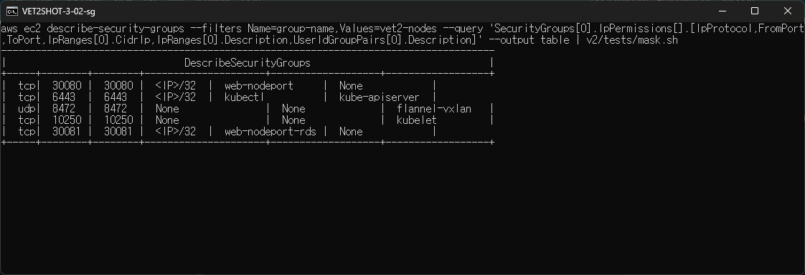

`<IP>/32` 는 이 PC 의 공인 IP 를 캡처에서 가린 것이다. `None` 인 줄(UDP 8472, TCP 10250)은 IP 대역이 아니라 같은 보안 그룹을 출처로 연 규칙이다. TCP 6443 은 두 출처(이 PC, 같은 보안 그룹)가 한 규칙에 들어 있어서 한 줄에 둘 다 보인다.

처음에는 노드끼리 모든 포트를 열었다. 2026-11-24 에 위의 세 가지로 좁혔다. 좁힌 뒤에도 노드 3대가 Ready 이고(2.2 의 캡처), 다른 노드의 Pod 끼리 부르는 시나리오가 65 / 65 로 통과했다 (6.1 의 캡처).

etcd(2379-2380), 스케줄러·컨트롤러 매니저(10257, 10259)는 컨트롤 플레인 안에서만 쓰므로 열지 않았다. SSH(22)도 열지 않았다 (Session Manager).

## 3. 만든 것

```
v2/k8s/
├── v0/all.yaml                       가장 단순한 형태 (비교용)
├── base/                             환경과 무관한 바탕 (DB 는 들어 있지 않다)
│   ├── kustomization.yaml            설정(ConfigMap) 포함
│   ├── web.yaml  auth.yaml  clinic.yaml  reservation.yaml  redis.yaml
│   └── pdb.yaml                      PodDisruptionBudget
├── mysql/mysql.yaml                  StatefulSet + 볼륨 + Service(ClusterIP)
├── overlays/
│   ├── local/                        이 PC (LoadBalancer, 로컬 이미지)
│   ├── kubeadm/                      EC2 (NodePort 30080, ECR 이미지, 노드 디스크 볼륨)
│   └── kubeadm-rds/                  선택 과제: RDS 구성 (⑥)
├── cluster/kubeadm/
│   ├── storage.yaml                  노드 디스크 볼륨 (K-6)
│   └── coredns-patch.yaml            CoreDNS 분산 (K-10)
├── kubeadm/
│   ├── ssm-run.sh                    Session Manager 로 명령 보내기
│   └── ecr-pull-secret.sh            ECR 로그인 정보를 Secret 으로 (K-5)
├── secrets.sh                        Secret 넣기 (K-3)
└── apply.sh                          ECR 주소·내 IP 를 넣어 적용 (계정 번호를 Git 에 적지 않는다)
v2/tests/
├── traffic.mjs                       계속 요청을 보내며 실패를 센다
└── k8s-ops.sh                        다시 배포, 업데이트·롤백, Pod 삭제, DB 교체를 차례로 잰다
```

### compose 와 대응

| ② compose | ③ 쿠버네티스 | 달라진 점 |
|---|---|---|
| 서비스 하나 = 컨테이너 하나 | Deployment (복제본 2) + Service | 하나가 내려가도 다른 하나가 받는다 |
| `environment` (비밀번호 포함) | ConfigMap `vet-config` + Secret `vet-db`, `vet-redis` | 비밀은 Git 과 배포 파일 밖에 |
| `healthcheck` | startupProbe / readinessProbe / livenessProbe | 준비되기 전에는 요청을 보내지 않는다 |
| `mem_limit` | `resources.requests` / `limits` | 요청량으로 노드를 고른다 |
| `restart: unless-stopped` | Deployment 가 항상 복제본 수를 맞춘다 | 노드가 죽어도 다른 노드에 다시 띄운다 |
| `stop_grace_period` | `terminationGracePeriodSeconds` + `preStop` | Service 에서 빠진 뒤에 종료 신호 |
| 볼륨 `mysql-data` | StatefulSet 의 `volumeClaimTemplates` | 볼륨의 종류는 환경이 정한다 |
| `ports: 28080:8080` | Service (LoadBalancer / NodePort) | 환경마다 overlay 가 정한다 |
| `dns_opt` (web) | 없음 | 쿠버네티스에서는 서비스 주소(ClusterIP)가 바뀌지 않는다 (4.3) |

## 4. 진행 방식

### 4.1 가장 단순한 형태 (v0)

compose 의 6개를 Deployment 와 Service 로 그대로 옮겼다 ([v0/all.yaml](../k8s/v0/all.yaml)). 복제본 1개, probe·자원·볼륨 없음, 비밀번호는 `${...}` 자리에 넣어 적용했다.

비교를 위해 운영 중인 `vet2` 와 섞이지 않게 네임스페이스 `vet2-v0`, NodePort 30081 로 같은 클러스터에 띄웠다 ([v0-kubeadm.sh](../tests/prob/v0-kubeadm.sh). 이미지 주소와 네임스페이스만 바꾸고 v0/all.yaml 의 내용은 그대로).

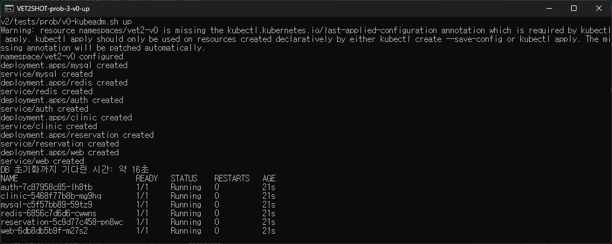

21초 만에 6개가 `Running` 이 됐고 시나리오 테스트는 56 / 56 으로 통과했다 (DB 계정 경계 9개는 넣지 않고 돌렸다). **기능은 된다.**

### 4.2 운영 동작을 재는 방법

기능 테스트만으로는 차이가 보이지 않는다. 그래서 부하 도구([traffic.mjs](../tests/traffic.mjs))가 요청을 계속 보내는 동안 운영 작업을 하고, 실패한 요청을 센다 ([k8s-ops.sh](../tests/k8s-ops.sh)).
도구는 화면이 쓰는 요청 8가지를 동시 5개로 쉬지 않고 보낸다. 초당 60 ~ 70건쯤 나가므로, 100초 남짓 걸리는 다시 배포 동안 수천 건이 쌓인다. 아래 표에서 중요한 것은 **실패한 수**이고, 전체 건수는 어림으로 적었다 (정확한 값은 `v2/_run/` 의 원본 기록).

| 작업 | 하는 일 |
|---|---|
| 다시 배포 | web, auth, clinic, reservation 을 차례로 `rollout restart` |
| 업데이트·롤백 | clinic 을 1.0.1 이미지로 바꿨다가 `rollout undo` |
| 자동 복구 | web, reservation 의 Pod 하나를 지운다 |
| 데이터 유지 | 예약을 하나 만들고 MySQL Pod 를 지운 뒤 그 예약이 남아 있는지 본다 |
| 노드 장애 (EC2 만) | 워커 하나를 강제로 멈춘다 |

### 4.3 v0 를 기준으로 쟀을 때

| 작업 | 결과 | 그림 |
|---|---|---|
| 다시 배포 | **실패 240건** (약 300건 중. 모두 503) | K-1 |
| 업데이트·롤백 | **실패 125건** (약 210건 중). 업데이트 직후 버전을 물었더니 응답이 없었다 | K-1 |
| MySQL Pod 삭제 | 다시 응답했지만 **만들어 둔 예약 176번이 없다** | K-2 |
| 배포 정보의 비밀번호 | `kubectl get deploy -o yaml` 에서 16줄 | K-3 |
| 자원 등급 | 6개 모두 `BestEffort` (요청·한도 없음) | K-4 |
| 서비스를 0개로 줄였을 때 그 경로 | 바로 503 (이 PC 기록, 캡처 없음) | |

마지막 줄은 문제가 아니라 확인이다. ② 에서 Apache 가 멈춘 서비스로 가는 요청에 64초씩 매달렸는데(② C-9), 쿠버네티스에서는 Apache 가 서비스의 고정 주소(ClusterIP)로 보내므로 바로 503 이 된다.

```
$ kubectl -n vet2 exec deploy/web -- getent hosts auth
10.96.2.138       auth.vet2.svc.cluster.local  auth
$ kubectl -n vet2 get svc auth -o jsonpath='{.spec.clusterIP}'
10.96.2.138
```

## 5. 최종 구성

파일에 이유를 주석으로 적었다. 요점만 적는다.

| 대상 | 설정 | 근거 |
|---|---|---|
| web, 서비스 3개 | 복제본 2, `maxSurge 1`, `maxUnavailable 0` | K-1 |
| | startupProbe(서비스만, 최대 120초) · readinessProbe · livenessProbe, 모두 `/health` | K-1. `/health` 는 DB 를 보지 않으므로 DB 장애 때 재시작되지 않는다 (① 7장) |
| | `preStop: sleep 5`, `terminationGracePeriodSeconds` 45 (web 30) | K-1 |
| | 노드에 나누기: `topologySpreadConstraints` + `matchLabelKeys: [pod-template-hash]` | K-8 |
| | PodDisruptionBudget `minAvailable: 1` | 노드 정비(drain) 때 둘을 한꺼번에 내리지 않는다 |
| 모든 Pod | 노드가 죽으면 30초 뒤 옮긴다 (`tolerationSeconds: 30`) | K-9 |
| | `runAsNonRoot`, 권한 상승 금지, 기능(capability) 모두 제거, seccomp 기본 | ② C-5 를 클러스터가 강제하게 |
| | 루트 파일 시스템 읽기 전용 (MySQL 제외), 쓰는 곳은 `/tmp` 만 | |
| | 자원: 서비스 요청 256Mi / 한도 384Mi, web 32Mi / 64Mi, MySQL 512Mi / 1Gi, Redis 32Mi / 64Mi | K-4, ② 6.4 |
| MySQL | StatefulSet, 볼륨 2Gi, TCP 로 시드를 읽는 probe, Service 는 `ClusterIP` | K-2, K-6, ① W-2 |
| Redis | 복제본 1, `Recreate`, 디스크에 남기지 않음 | 세션 저장소는 한 곳 |
| 설정 | ConfigMap 을 `configMapGenerator` 로: 값을 바꾸면 이름이 바뀌어 Pod 가 새로 뜬다 | K-3 |
| 비밀 | `secrets.sh` 로 클러스터에 직접 | K-3 |
| DB 연결 수 | `DB_POOL_MAX=5`: 서비스 3개 × 복제본 2 × 5 = 30, 배포 중 1개씩 더 떠도 45 (한도 151) | ② 10장 |

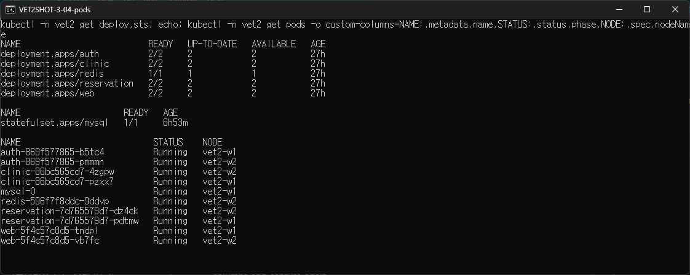

web 과 서비스 3개는 복제본 2개가 두 워커에 하나씩 놓였다. MySQL 은 볼륨이 있는 vet2-w1 에만 뜬다 (K-6).

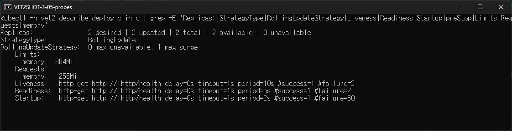

clinic 의 예. 업데이트 중 `0 max unavailable, 1 max surge`, 한도 384Mi / 요청 256Mi, probe 세 가지가 모두 `/health`.

## 6. 기준별 측정 (최종 구성)

### 6.1 시나리오 테스트와 노출

```bash
v2/k8s/secrets.sh -n vet2
v2/k8s/apply.sh kubeadm
set -a; . v2/_run/secrets.env; set +a
node v2/tests/scenario.mjs --base-url http://<워커 공인 IP>:30080 --db-exec "kubectl -n vet2 exec mysql-0 --"
```

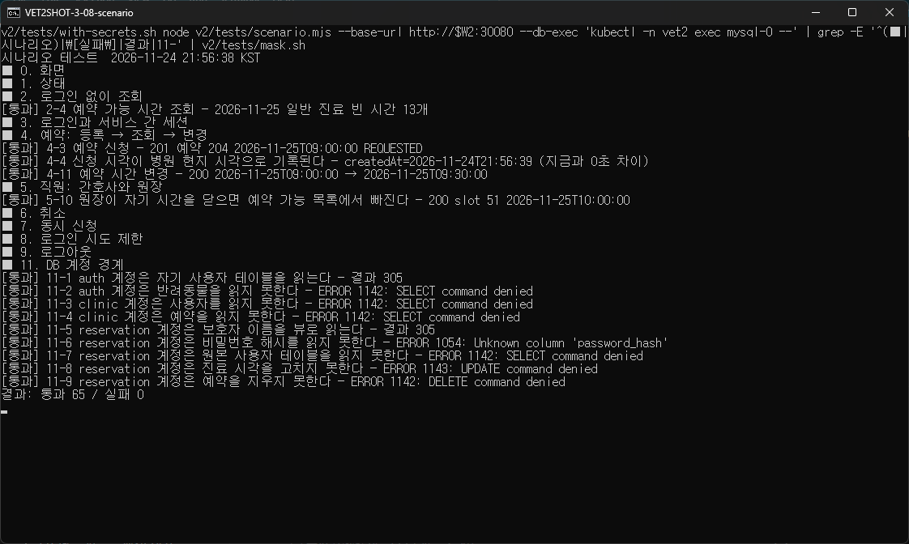

**통과 65 / 65.** 워커2 의 공인 IP 로 들어갔다 (보안 그룹을 좁힌 뒤). 워커1 로도 같았다 (6.2 의 도구가 워커1 로 들어간다).

어느 노드의 30080 으로 들어와도 같다. NodePort 는 모든 노드에 같은 포트를 열고, 요청을 web Pod 가 있는 노드로 넘긴다.

**DB 는 클러스터 안에서만 접근된다.** 밖으로 열린 것은 web 의 NodePort 하나다.

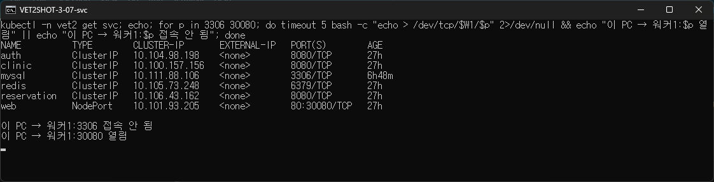

DB 계정 경계(11번)는 MySQL Pod 안에서 확인해야 해서, ②의 `--db-container` 대신 `--db-exec` 를 새로 두었다. "못 한다" 9개는 로그인한 뒤 **권한 때문에** 막혀야 통과한다 (로그인 실패 ERROR 1045 는 실패로 센다).

화면 (2026-11-24, kubeadm 의 NodePort 로 찍음, `v2/tests/screenshots.mjs`):

| 보호자: 온라인 예약 | 간호사: 예약 현황 |
|---|---|
| 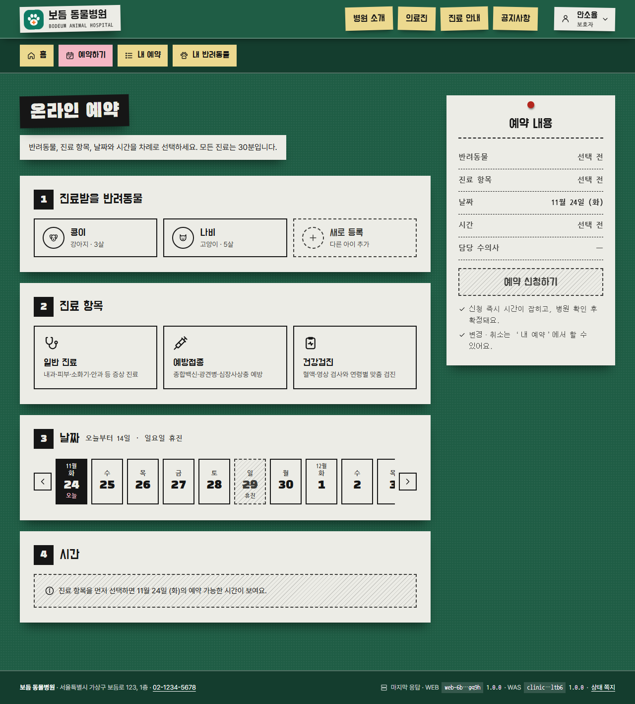 | 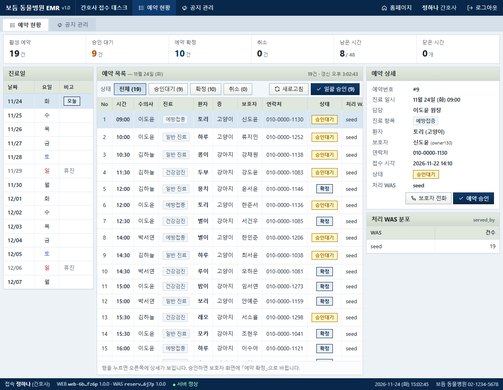 |

화면 아래쪽의 `WEB web-6b…gq9h 1.0.0 · WAS clinic…1tb6 1.0.0` 은 그 요청에 답한 web Pod 와 서비스 Pod 의 이름과 버전이다 (② C-2).

### 6.2 배포, 업데이트, 자동 복구

부하 도구가 계속 요청을 보내는 동안 작업하고 실패한 요청을 셌다 (4.2). 전체 건수는 어림이고, 실패 수는 정확한 값이다.

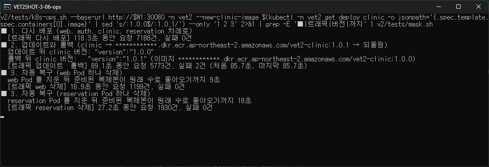

| 작업 | v0 | 최종 |
|---|---|---|
| 다시 배포 (4개 차례로) | **실패 240건** (약 300건 중, 12.7초) | 실패 0건 (약 7,200건 중, 118초) |
| 업데이트·롤백 (clinic 1.0.1 → 되돌림) | **실패 125건** (약 210건 중, 16.9초) | 실패 2건 (약 5,800건 중, 89초) |
| web Pod 삭제 | 이번에 재지 않음 | 실패 0건, 9초에 복구 |
| reservation Pod 삭제 | 이번에 재지 않음 | 실패 0건, 18초에 복구 |

같은 EC2 kubeadm 클러스터, 같은 도구로 쟀다. v0 는 네임스페이스 `vet2-v0`(NodePort 30081)에 따로 띄웠다 (그림은 K-1). v0 는 다시 배포가 12.7초에 끝나 요청 수 자체가 적다. 끝나는 시간이 짧은 것은 준비를 기다리지 않기 때문이다 (K-1).
v0 의 Pod 삭제는 이번 실행에 넣지 않았다. 처음 이 PC 의 클러스터에서 잰 때는 45 ~ 89건이 실패했다 (캡처 없음).

업데이트·롤백의 실패 2건은 85.7초, 롤백이 끝나 갈 무렵에 났다. 응답 코드가 아니라 연결이 끊긴 것이다 (8장 O-4). 원인은 확인하지 못했다. 처음(2026-11-23) EC2 에서 잰 때는 0건, 다시 배포에서 1건이었다 (캡처 없음).

업데이트가 실제로 됐는지도 봤다. 1.0.1 로 바꾼 뒤 `/api/status/clinic` 은 `"version":"1.0.1"` 이었다. 다만 롤백 직후에도 1.0.1 이 답했다 (그림의 "롤백 뒤 clinic 버전"). 이유는 8장 O-1.

### 6.3 데이터 유지 (DB Pod 교체)

예약을 하나 만들고 MySQL Pod 를 지운 뒤 그 예약이 남아 있는지 봤다.

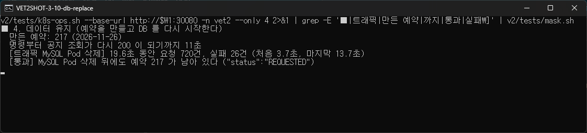

| | v0 (볼륨 없음) | 최종 (StatefulSet + 볼륨) |
|---|---|---|
| MySQL Pod 를 지운 뒤 예약 | **사라짐** (176번) | 남아 있음 (217번) |
| 다시 응답하기까지 | 17초 (빈 DB 를 새로 초기화) | 11초 |
| 그동안 실패 | 35건 (약 700건 중) | 26건 (약 720건 중) |

DB 가 하나라 교체되는 동안 DB 를 쓰는 요청은 실패한다 (26건). 이것은 구성의 한계다 (DB 를 여러 대로 두지 않았다). 그 실패의 일부가 503 이 아니라 500 이다. 소스에서 온 것이다 (8장 O-2).

**앱과 DB Pod 를 모두 한꺼번에 지웠을 때**도 봤다 ([pod-replace-check.sh](../tests/pod-replace-check.sh)).

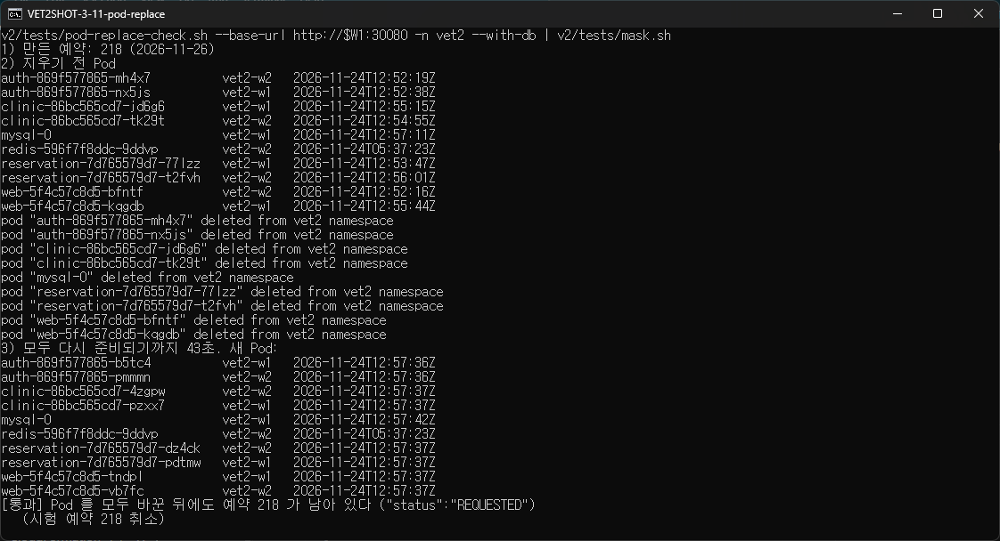

Pod 10개(Redis 제외)가 모두 새 이름으로 바뀌고 43초 뒤 준비됐다. 예약 218번이 그대로 있었다.

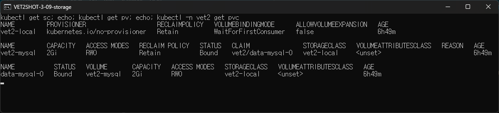

볼륨 `vet2-mysql` 은 `Retain` 이라 PVC 를 지워도 데이터 폴더가 남는다.

### 6.4 노드 장애 (EC2)

워커 하나를 `aws ec2 stop-instances --force` 로 강제로 멈추고, 요청을 보내면서 클러스터를 3 ~ 5초마다 관찰했다 (2026-11-23 기록. 아래 두 블록은 그때의 출력이고 캡처는 없다).

**앱만 있는 노드(vet2-w2)를 멈췄을 때** — K-8, K-9 를 고치기 전과 뒤:

```
[고치기 전]
+0s    워커2 강제 중지 요청
+61s   노드2=NotReady | auth=0/2 clinic=1/2 redis=0/1 reservation=1/2 web=1/2
+358s  노드2=NotReady | ... Terminating=6
+393s  노드2=NotReady | auth=2/2 clinic=2/2 redis=1/1 reservation=2/2 web=2/2
[트래픽] 410.3초 동안 요청 1922건, 실패 675건 (마지막 378.7초)

[고친 뒤]
+0s    워커2 강제 중지 요청
+52s   노드2=NotReady | auth=1/2 clinic=1/2 redis=0/1 reservation=1/2 web=1/2
+83s   노드2=NotReady | auth=1/2 clinic=1/2 redis=1/1 reservation=1/2 web=1/2
+115s  노드2=NotReady | auth=2/2 clinic=2/2 redis=1/1 reservation=2/2 web=2/2
[트래픽] 248.7초 동안 요청 7850건, 실패 110건 (마지막 100.7초)
```

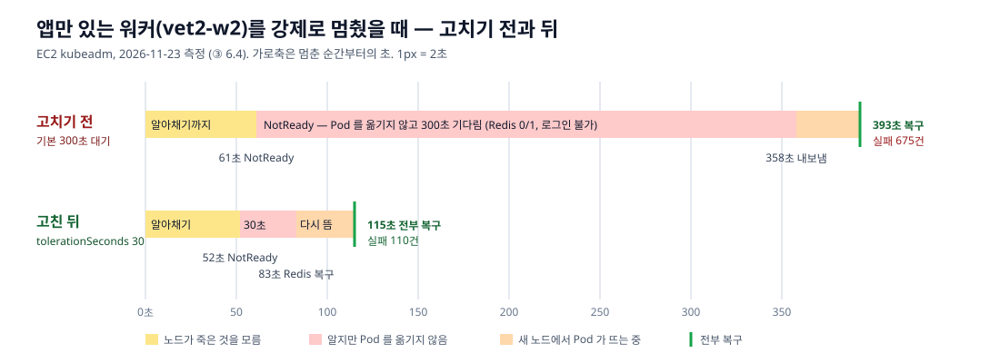

고친 뒤에도 남은 실패 110건의 내용:

| 원인 | 시간 | 실패 |
|---|---|---|
| 노드가 죽은 것을 쿠버네티스가 알아채기까지 (`NotReady`) | 약 50초 | 죽은 노드의 Pod 로 간 요청이 응답 없음 |
| 알아챈 뒤 Pod 를 옮기기까지 | 30초 (K-9) | |
| Redis 가 그 노드에 있었다 | 약 30초 | 로그인이 풀리고(401), 세션을 읽는 요청이 늦게 실패 (W-3) |

**DB 가 있는 노드(vet2-w1)를 멈췄을 때** — K-10 을 고치기 전과 뒤 (2026-11-23 기록, 캡처 없음. 고친 뒤의 같은 실험은 ⑥ 의 캡처):

```
[고치기 전]
+53s   노드1=NotReady | auth=1/2 clinic=1/2 redis=0/1 reservation=1/2 web=1/2 | mysql-0=Running
+81s   노드1=NotReady | ... | mysql-0=Terminating
+108s  노드1=NotReady | auth=2/2 clinic=2/2 redis=1/1 reservation=2/2 web=2/2 | mysql-0=Terminating
[트래픽] 219.1초 동안 요청 262건, 실패 213건 (마지막 219.0초)
    /api/status/auth → 응답 없음: 28건    ← DB 를 쓰지 않는 요청까지 실패

[고친 뒤]
+53s   노드1=NotReady | auth=2/2 clinic=2/2 redis=1/1 reservation=2/2 web=2/2 | mysql-0=Running
+81s   노드1=NotReady | ... | mysql-0=Terminating     (끝까지 그대로)
[트래픽] 188.2초 동안 요청 892건, 실패 313건 (마지막 188.1초)
    /api/notices → 503: 100건   /api/pets → 503: 99건   /api/reservations/me → 503: 96건
DB 가 필요 없는 요청: / 200, /api/status/auth 200, /api/status/clinic 200, /api/status/reservation 200
```

고친 뒤에는 DB 를 쓰는 요청만 실패하고, 3초 안에 503 으로 답한다. DB 는 워커1 이 돌아올 때까지 멈춰 있었고, 워커1 을 다시 켠 뒤 41초(고치기 전 실행에서는 50초) 만에 돌아왔다. 이것이 K-11 이다. 같은 실험을 RDS 구성에서 하면 DB 요청이 멈추지 않는다 (⑥ 2.7).

## 7. 문제와 해결

각 문제는 **증상 → 원인 → 판단 기준 → 후보와 탈락 이유 → 고른 방법 → 확인 → 한계** 순서로 적는다.
후보 표의 ○ 는 기준을 채움, △ 는 일부만 채우거나 조건이 붙음, × 는 채우지 못함이다. 근거는 셋으로 나눠 적는다.

- **측정**: 이 작업에서 직접 실행해 본 결과
- **동작**: 도구의 문서나 정해진 동작 (재 보지는 않았다)
- **추론**: 재 보지 않고 따져 본 것

### K-1. 다시 배포하면 수백 건이 503 으로 실패한다

**증상.** v0 를 다시 배포하는 동안 약 300건 중 240건이, 업데이트·롤백 동안 약 210건 중 125건이 실패했다. 모두 503 이다.

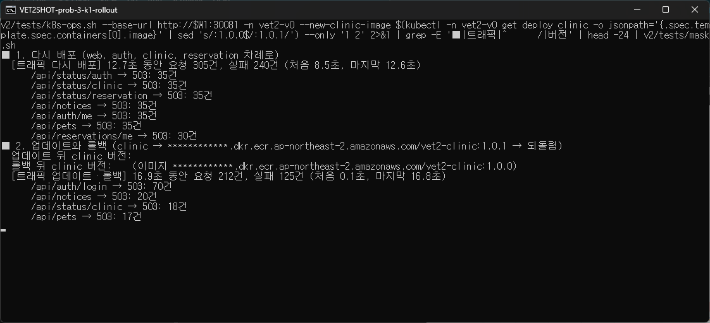

업데이트 직후 clinic 의 버전을 물었을 때 아무것도 돌아오지 않았다 ("업데이트 뒤 clinic 버전:" 뒤가 비어 있다). 새 Pod 가 아직 요청을 받을 수 없는데 옛 Pod 는 이미 내려간 상태다.
처음 이 PC 의 클러스터에서 잰 때 새 Pod 의 로그에 `Started ClinicServiceApplication in 3.402 seconds` 가 찍히기 전까지 503 이 이어졌다 (캡처 없음).

**원인.** 세 가지가 겹쳤다.

1. **준비 판정이 없다.** probe 가 없으면 쿠버네티스는 컨테이너 프로세스가 시작된 순간을 "준비됨"으로 본다. 스프링이 실제로 요청을 받기까지는 약 5초가 더 걸린다. 그 사이 Service 가 요청을 보내서 실패한다.
2. **복제본이 하나다.** 옛 Pod 가 내려가는 동안 받을 곳이 없다.
3. **내려가는 Pod 가 바로 종료 신호를 받는다.** Pod 를 Service 에서 빼는 일과 종료 신호를 보내는 일은 동시에 시작된다. Service 에서 빠진 것이 모든 노드에 퍼지기 전에 프로세스가 끝나면, 그 사이 들어온 요청이 끊긴다.

**판단 기준.**

1. 배포·업데이트·롤백 중 실패한 요청 0
2. 소스를 고치지 않는다 (이 작업의 범위)
3. 평소 자원이 크게 늘지 않는다 (노드 2대에 다 들어가야 한다)

**후보와 탈락 이유.** 세 원인 각각에 대한 후보다.

| 후보 | 1 실패 0 | 2 소스 그대로 | 3 자원 | 판정 |
|---|---|---|---|---|
| 원인 1: `readinessProbe` 없이 `initialDelaySeconds` 만큼 기다리기 | △ 기동 시간이 매번 다르다 (3.4초 ~ 수십 초). 짧으면 실패, 길면 배포가 느리다 (추론) | ○ | ○ | 탈락 |
| 원인 1: **startupProbe + readinessProbe (`/health`)** | ○ 실제로 답할 때만 요청을 보낸다 (동작) | ○ `/health` 가 이미 있다 | ○ | **채택** |
| 원인 2: 복제본 1 + `maxSurge 1` | × 노드 장애 땐 0 개다 (추론) | ○ | ○ | 탈락 |
| 원인 2: **복제본 2 + `maxUnavailable 0`** | ○ 새 Pod 가 준비된 뒤에 옛 Pod 를 내린다 (동작) | ○ | △ 서비스당 메모리 요청 256Mi → 512Mi. 노드 2대에 들어간다 (측정, K-4) | **채택** |
| 원인 3: 스프링의 정상 종료 설정만 (`server.shutdown=graceful`) | △ 이미 받은 요청은 끝내지만, Service 에서 빠지기 전에 들어오는 새 요청은 막지 못한다 (동작) | × 앱 설정을 바꿔야 한다 | ○ | 탈락 |
| 원인 3: **`preStop: sleep 5`** | ○ 빠진 것이 퍼진 뒤 종료 신호 (동작) | ○ | ○ 종료가 5초 늦어질 뿐 | **채택** |

`livenessProbe` 도 `/health` 로 두었다. `/health` 는 DB 와 Redis 를 보지 않으므로(① 7장), DB 가 죽었다고 서비스 Pod 가 재시작되는 일은 없다. DB 를 보는 확인을 liveness 에 쓰면 DB 장애 때 모든 Pod 가 재시작을 반복한다 (추론).

**확인.** 6.2 의 표: 다시 배포 240 → 0, 업데이트·롤백 125 → 2. 남은 2건은 응답 코드가 아니라 연결 끊김이다 (O-4, 원인 미확인).

### K-2. MySQL Pod 를 지우면 예약 데이터가 사라진다

**증상.** v0 에서 예약 176번을 만들고 MySQL Pod 를 지웠다.

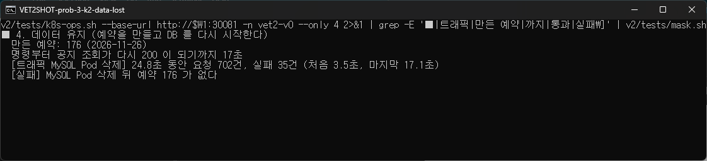

**원인.** v0 의 MySQL 은 볼륨이 없는 Deployment 다. 데이터가 컨테이너 안에만 있어서 Pod 가 바뀌면 함께 사라진다. 새 Pod 는 빈 데이터 폴더를 보고 초기화를 다시 했다(② C-8 의 동작). 17초가 걸린 것도 초기화 때문이다.

**판단 기준.**

1. DB Pod 를 교체해도 데이터가 남는다
2. 다시 배포할 때 MySQL 두 개가 같은 데이터를 동시에 쓰지 않는다
3. DB 는 클러스터 안에서 볼륨과 함께 실행한다 (필수 과제)
4. 설치할 것이 없다

**후보와 탈락 이유.**

| 후보 | 1 데이터 | 2 동시 쓰기 없음 | 3 클러스터 안 | 4 설치 | 판정 |
|---|---|---|---|---|---|
| Deployment, 볼륨 없음 (v0) | × 예약 176번 사라짐 (측정) | ○ | ○ | ○ | 탈락 |
| Deployment + 볼륨(PVC) 하나 | ○ | × 다시 배포할 때 새 Pod 가 먼저 떠서 두 MySQL 이 같은 볼륨을 잡으려 한다 (동작: RollingUpdate 는 새 Pod 를 먼저 만든다) | ○ | ○ | 탈락 |
| Deployment + 볼륨 + `strategy: Recreate` | ○ | △ 옛 Pod 를 내린 뒤 새 Pod (동작). 노드가 응답하지 않으면 옛 Pod 가 정말 끝났는지 확인하지 않는다 (동작) | ○ | ○ | 탈락 — StatefulSet 은 이것을 기다린다 |
| MySQL 오퍼레이터 | ○ | ○ | ○ | × 오퍼레이터 설치 (동작) | 탈락 |
| 관리형 DB (RDS) | ○ | ○ | × 클러스터 밖 | ○ | 필수 과제가 아니다 — 선택 과제로 따로 했다 (⑥) |
| **StatefulSet + `volumeClaimTemplates`** | ○ 볼륨은 Pod 이름(`mysql-0`)에 묶여 따라온다 | ○ 같은 이름의 Pod 를 한 번에 하나만 두고, 옛 Pod 가 끝난 뒤 새 Pod 를 띄운다 (동작) | ○ | ○ | **채택** |

**고른 방법.** StatefulSet ([mysql.yaml](../k8s/mysql/mysql.yaml)). Pod 의 사용자를 999(mysql) 로 정하고 `fsGroup: 999` 로 볼륨을 쓸 수 있게 했다.

**확인.** 6.3. MySQL Pod 를 지운 뒤에도 예약 217번이 남아 있었고, 11초 만에 다시 답했다 (초기화를 다시 하지 않는다). 앱과 DB Pod 를 모두 지웠을 때도 예약 218번이 남았다.

### K-3. 비밀번호가 배포 정보에 그대로 보인다

**증상.**

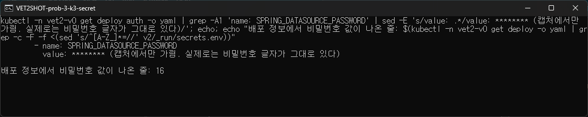

`value:` 뒤의 값은 이 캡처에서만 가렸다. 실제 출력에는 비밀번호 글자가 그대로 나온다. 배포 정보 전체에서 비밀번호 값이 나온 줄은 16줄이다.

배포 정보를 읽을 수 있는 사람은 비밀번호도 읽는다. 값을 채운 파일(`v0-rendered.yaml`)도 남는다.

**판단 기준.**

1. Git 과 배포 파일에 비밀번호 값이 없다
2. `kubectl get deploy -o yaml` 로 값이 보이지 않는다
3. 값을 채운 파일이 디스크에 남지 않는다
4. 클러스터에 따로 설치할 것이 없다 (kubeadm 과 EKS 모두)

**후보와 탈락 이유.**

| 후보 | 1 Git | 2 배포 정보 | 3 파일 | 4 설치 | 판정 |
|---|---|---|---|---|---|
| 값을 `envsubst` 로 채워 적용 (v0) | ○ | × 16줄 (측정) | × `v0-rendered.yaml` (측정) | ○ | 탈락 |
| Secret 을 YAML 파일로 Git 에 | × base64 는 암호화가 아니다 (동작) | ○ | × | ○ | 탈락 |
| Sealed Secrets, External Secrets 같은 도구 | ○ | ○ | ○ | × 컨트롤러 설치와 키 관리 (동작) | 탈락 |
| **Secret 을 스크립트로 클러스터에 직접 (파일을 만들지 않고 바로 적용)** | ○ | ○ `secretKeyRef` 로 이름만 | ○ | ○ | **채택** |

**고른 방법.**

- 비밀이 아닌 설정(DB 주소, 연결 수, Redis 주소, TLS 여부)은 ConfigMap `vet-config` 로. 배포 파일과 함께 Git 에 둔다. `configMapGenerator` 가 내용의 해시를 이름에 붙여, 값을 바꾸면 그것을 쓰는 Pod 가 새로 뜬다.
- 비밀번호는 Secret `vet-db`, `vet-redis` 로. 배포 파일에는 이름만 적고(`secretKeyRef`), 값은 [secrets.sh](../k8s/secrets.sh) 가 `v2/_run/secrets.env`(Git 에 없음)에서 읽어 클러스터에 바로 넣는다.

**확인.**

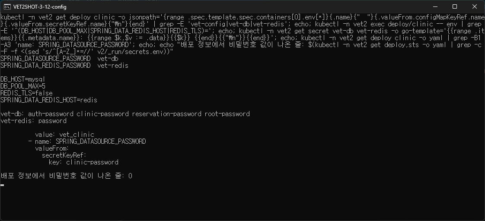

비밀번호 환경 변수는 Secret 이름(`vet-db`, `vet-redis`)만 가리키고, 나머지 설정은 ConfigMap 에서 온다. 배포 정보(deploy, sts)에서 실제 비밀번호 값이 나온 줄은 0 이다. Secret 의 키 이름만 보이고 값은 보이지 않는다. EKS 에서도 0 이었다 (④).

**한계.** Secret 은 base64 로 저장된다. Secret 을 읽을 권한이 있으면 값이 보인다. kubeadm 은 etcd 에 저장할 때 암호화하지 않는 것이 기본이다. 이 실습에서는 권한을 나누거나 etcd 암호화를 켜지 않았다.

### K-4. Pod 에 자원 요청·한도가 없다

**증상.** v0 의 Pod 6개 모두 자원 등급이 `BestEffort` 다.

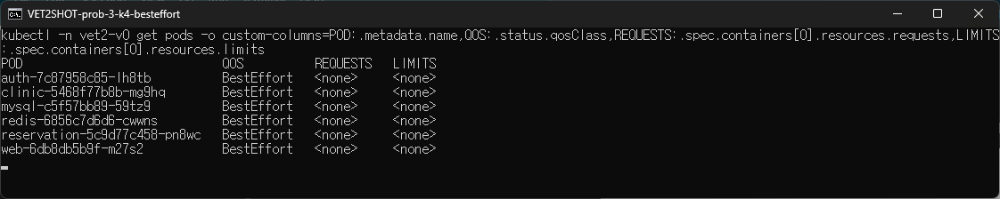

**원인과 영향.** 요청량(`requests`)이 없으면 스케줄러는 노드에 자리가 있는지 모르고 놓는다. 한도(`limits`)가 없으면 ②의 C-6 처럼 JVM 이 노드 전체 메모리를 기준으로 힙을 잡는다. 노드의 메모리가 모자라면 `BestEffort` 가 가장 먼저 쫓겨난다.

**판단 기준.**

1. 스케줄러가 노드의 남은 자리를 보고 놓는다
2. JVM 의 힙이 한도를 기준으로 잡힌다 (② C-6 의 `MaxRAMPercentage`)
3. 값에 측정 근거가 있다
4. 노드 2대(4GiB × 2)에 배포 중의 여분 Pod 까지 들어간다

**후보와 탈락 이유.**

| 후보 | 1 | 2 | 3 | 4 | 판정 |
|---|---|---|---|---|---|
| 없음 (v0) | × `BestEffort` (측정) | × | - | ○ | 탈락 |
| 요청 = 한도 (`Guaranteed`) | ○ | ○ | ○ | △ 평소 181 ~ 206MiB 인데 384Mi 를 늘 잡아 둔다 (추론) | 탈락 |
| 자동으로 정하기 (VerticalPodAutoscaler) | ○ | △ 바꿀 때마다 Pod 가 다시 뜬다 (동작) | ○ | ○ | 탈락 — 지표 서버와 VPA 를 설치해야 한다 |
| **②의 측정값으로 요청 < 한도 (`Burstable`)** | ○ | ○ | ○ 평소 사용량 위에 여유 | ○ (측정) | **채택** |

**고른 방법.** 서비스는 요청 256Mi / 한도 384Mi (평소 181 ~ 206MiB), MySQL 은 512Mi / 1Gi (446 ~ 460MiB).

**확인.** 모두 `Burstable`. 노드가 1대인 이 PC 와 2대인 EC2 모두에서 전부 배치됐다. 사용량을 쿠버네티스로는 재지 못했다 (지표 서버 `metrics-server` 를 설치하지 않았다).

### K-5. 노드가 ECR 에서 이미지를 받지 못한다 (kubeadm)

**증상.** 이 PC 에서 되던 배포를 EC2 에 그대로 적용하자 web 과 서비스 3개가 모두 `ImagePullBackOff` 였다. 로그인 Secret 이 없는 네임스페이스에서 같은 이미지를 받게 해 다시 일으켰다.

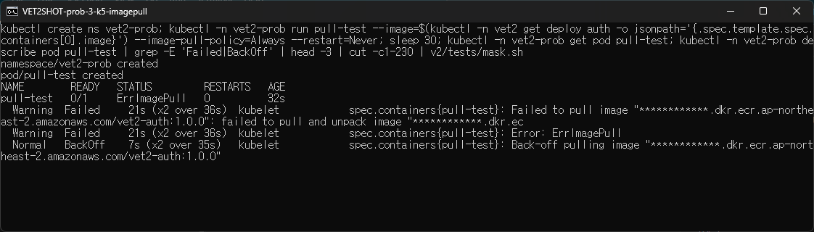

**원인.** 노드에는 ECR 을 읽을 수 있는 IAM 역할(`AmazonEC2ContainerRegistryReadOnly`)이 붙어 있다. 하지만 **kubelet 은 그 역할을 저절로 쓰지 않는다.** kubelet 이 ECR 에 로그인하려면 따로 "자격 증명 제공자"를 설치하고 설정해야 한다. EKS 의 노드는 그것이 갖춰져 있지만 kubeadm 노드에는 없다. Redis 는 Docker Hub 의 공개 이미지라 받아졌다.

**판단 기준.**

1. 이미지를 비공개로 둔다
2. 배포 파일을 환경마다 고치지 않는다
3. 노드에 설치할 것이 적다
4. 로그인 정보가 만료되지 않는다

**후보와 탈락 이유.**

| 후보 | 1 비공개 | 2 배포 파일 | 3 설치 | 4 만료 | 판정 |
|---|---|---|---|---|---|
| 이미지를 공개 저장소에 | × (동작) | ○ | ○ | ○ | 탈락 |
| kubelet 에 ECR 자격 증명 제공자 설치 | ○ | ○ | × 노드마다 실행 파일과 kubelet 설정 (동작) | ○ 노드 IAM 역할을 쓴다 | 보류 — 오래 운영한다면 이쪽 |
| **ECR 로그인 정보를 Secret 으로 넣고 기본 ServiceAccount 에 붙이기** | ○ | ○ | ○ 명령 두 줄 | × 12시간 (동작) | **채택** |

하루 안에 끝나는 실습이라 4 를 포기하고 3 을 골랐다.

**고른 방법.** Secret `ecr-pull`. 네임스페이스의 기본 ServiceAccount 에 붙여서, 배포 파일을 고치지 않아도 모든 Pod 가 쓰게 했다 ([ecr-pull-secret.sh](../k8s/kubeadm/ecr-pull-secret.sh)).

**확인.** Pod 를 다시 만들자 모든 이미지를 받았다.

**한계.** 12시간 뒤에는 이미 받아 둔 이미지로 뜨는 Pod 는 괜찮지만, 새 노드나 새 이미지를 받아야 하는 Pod 는 다시 실패한다. 2026-11-24 에 EC2 를 다시 켰을 때도 새 이미지를 받기 전에 이 스크립트를 다시 실행했다.

### K-6. MySQL 의 볼륨이 만들어지지 않는다 (kubeadm)

**증상.** `mysql-0` 이 `Pending` 에 머물렀다.

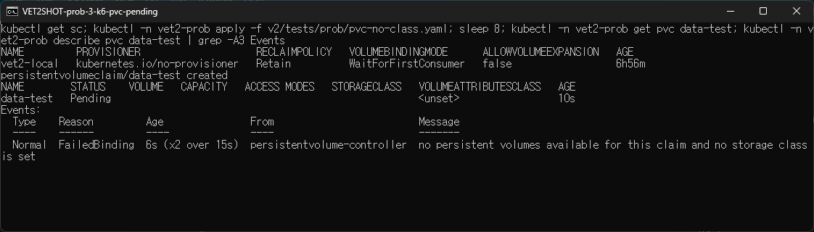

다시 일으킨 장면이다. 지금은 `vet2-local` 이 있지만 자동으로 만들어 주지 않고(`no-provisioner`) 기본 StorageClass 도 아니어서, StorageClass 를 적지 않은 요청은 처음과 같은 이유로 묶이지 않는다.

**원인.** PVC(볼륨 요청)는 StorageClass 가 볼륨을 만들어 주거나, 미리 만들어 둔 볼륨(PV)이 있어야 묶인다. 이 PC 의 클러스터에는 기본 StorageClass(`standard`)가 있어서 저절로 됐다. kubeadm 클러스터에는 아무것도 없다.

**판단 기준.**

1. MySQL 의 볼륨 요청이 묶인다
2. 설치할 것이 적다
3. 노드가 다시 켜져도 데이터가 남는다
4. DB 가 다른 노드로 옮겨 갈 수 있다

**후보와 탈락 이유.**

| 후보 | 1 묶임 | 2 설치 | 3 재시작 | 4 이동 | 판정 |
|---|---|---|---|---|---|
| `hostPath` 를 Pod 에 직접 | ○ | ○ | ○ | × 어느 노드에 뜨느냐에 따라 데이터가 달라진다 (동작) | 탈락 |
| 볼륨을 자동으로 만들어 주는 프로그램 (local-path-provisioner 등) | ○ | × 설치 | ○ | × 노드의 디스크를 쓰는 것은 같다 (동작) | 탈락 |
| EBS CSI 드라이버 | ○ | × 드라이버와 IAM 설정 (동작) | ○ | △ 같은 가용 영역 안에서만 | 탈락 — ④ EKS 에서 쓴다 |
| NFS 등 네트워크 파일 시스템 | ○ | × 서버를 따로 둔다 | ○ | ○ | 탈락 — 서버가 하나 더 생기고, MySQL 을 NFS 위에 두는 것은 권하지 않는다 (추론) |
| **워커 한 대의 디스크 폴더를 볼륨으로 직접 등록 (local PV)** | ○ | ○ | ○ | × 그 노드에 묶인다 | **채택** — 4 를 포기했다. 그 대가가 K-11 |

**고른 방법.** [storage.yaml](../k8s/cluster/kubeadm/storage.yaml). StorageClass `vet2-local`(자동 생성 없음) + `vet2-w1` 의 `/var/lib/vet2-mysql` 을 가리키는 PV 하나. overlay 가 MySQL 의 볼륨 요청에 `storageClassName: vet2-local` 을 붙인다. 폴더는 노드를 만들 때 준비 스크립트가 만든다 ([kubeadm.yaml](../infra/kubeadm.yaml)).

폴더는 root 소유로 만들었지만, kubelet 이 `fsGroup: 999` 에 맞춰 권한을 바꿔 주어 MySQL 이 초기화를 마쳤다.

**확인.** 6.3 의 볼륨 그림: `data-mysql-0  Bound  vet2-mysql  2Gi  vet2-local`. `mysql-0` 은 `vet2-w1` 에 있다 (5장 그림).

### K-7. 볼륨 설정을 고쳐 다시 적용하면 거부된다

**증상.** K-6 을 고친 overlay 를 다시 적용했다.

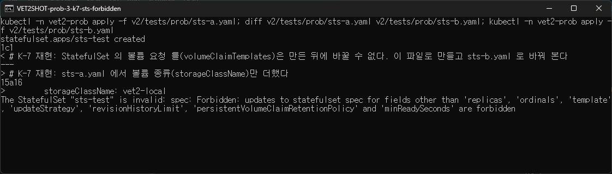

다시 일으킨 장면이다. 볼륨 종류(`storageClassName`) 한 줄만 다른 두 파일을 차례로 적용했다.

**원인.** StatefulSet 의 볼륨 요청 틀(`volumeClaimTemplates`)은 만든 뒤에 바꿀 수 없다. 이미 만들어진 PVC 도 StorageClass 를 바꿀 수 없다.

**판단 기준.** ① 데이터를 잃지 않는다 ② 새 볼륨 설정이 실제로 반영된다 ③ 무엇이 지워지는지 드러난다.

| 후보 | ① | ② | ③ | 판정 |
|---|---|---|---|---|
| 그대로 다시 적용 | ○ | × 거부 (측정) | ○ | 탈락 |
| `kubectl replace --force` | △ 내부적으로 지우고 다시 만든다 (동작) | ○ | × 무엇이 지워지는지 드러나지 않는다 | 탈락 |
| PVC 만 고친다 | ○ | × StorageClass 는 바꿀 수 없다 (동작) | ○ | 탈락 |
| **StatefulSet 과 PVC 를 지우고 다시 적용** | ○ 이번에는 PVC 가 한 번도 묶이지 않아 잃을 데이터가 없었다 (측정: `Pending`) | ○ | ○ | **채택** |

```bash
kubectl -n vet2 delete sts mysql
kubectl -n vet2 delete pvc data-mysql-0      # Pending 이라 데이터가 없었다
v2/k8s/apply.sh kubeadm
```

**한계.** 데이터가 있는 상태에서 볼륨 설정을 바꾸려면 백업하고 옮기는 절차가 따로 필요하다. 그래서 볼륨의 종류는 처음 배포하기 전에 정해야 한다.

### K-8. 다시 배포하면 복제본 둘이 한 노드에 몰린다

**증상.** K-9 의 첫 실험에서 워커2 를 멈추자 auth 가 `0/2` 가 됐다. 복제본 둘이 모두 워커2 에 있었다. 노드에 나누는 규칙(`topologySpreadConstraints`)을 넣었는데도 그랬다. 다시 배포하며 배치를 기록했다.

```
1회: vet2-w2 vet2-w2
2회: vet2-w1 vet2-w2
3회: vet2-w2 vet2-w2
4회: vet2-w2 vet2-w1
5회: vet2-w2 vet2-w2
```

5번 중 3번 한 노드에 몰렸다.

**원인.** 규칙은 `app: auth` 라벨이 붙은 Pod 를 모두 센다. 다시 배포하는 동안에는 곧 내려갈 옛 판(ReplicaSet)의 Pod 도 같은 라벨을 달고 있다. 새 Pod 는 그 옛 Pod 들과 균형을 맞추는 자리에 놓이고, 옛 Pod 가 내려가고 나면 새 Pod 둘만 한쪽에 남는다. **노드 2대에서 다시 배포한 뒤에만** 나타난다.

**판단 기준.**

1. 다시 배포한 뒤에도 복제본이 두 노드에 나뉜다
2. 워커가 2대뿐이어도 배포가 멈추지 않는다 (배포 중에는 복제본이 잠깐 3개다)
3. 노드가 1대인 로컬 클러스터에서도 같은 base 로 뜬다
4. 따로 설치할 것이 없다

**후보와 탈락 이유.**

| 후보 | 1 나뉨 | 2 배포 | 3 로컬 | 4 설치 | 판정 |
|---|---|---|---|---|---|
| `topologySpreadConstraints` 만 (처음 설정) | × 5번 중 3번 몰림 (측정) | ○ | ○ | ○ | 탈락 |
| 반드시 다른 노드에 (`podAntiAffinity` required) | ○ | × 3번째(새) Pod 를 놓을 곳이 없어 배포가 멈춘다 (동작) | × 둘째 복제본이 못 뜬다 | ○ | 탈락 |
| 되도록 다른 노드에 (`podAntiAffinity` preferred) | × 지킬 수 없으면 그냥 놓는다 (동작) | ○ | ○ | ○ | 탈락 |
| "하나 내리고 하나 올리기" (`maxUnavailable 1`, `maxSurge 0`) | △ 덜 몰린다 (추론) | ○ | ○ | ○ | 탈락 — 배포 중 복제본이 1개가 되어 K-1 의 기준을 어긴다 |
| 배포 뒤 다시 나눠 주는 도구 (descheduler) | ○ 사후에 (동작) | ○ | ○ | × 설치 | 탈락 |
| **`matchLabelKeys: [pod-template-hash]`** | ○ 같은 판의 Pod 만 센다 (동작) | ○ | ○ | ○ | **채택** |

**확인.** 같은 실험을 다시 했다.

```
1회: vet2-w2 vet2-w1
2회: vet2-w1 vet2-w2
3회: vet2-w2 vet2-w1
4회: vet2-w2 vet2-w1
5회: vet2-w1 vet2-w2
```

### K-9. 노드가 죽으면 Pod 를 5분 동안 옮기지 않는다

**증상.** 워커2 를 멈춘 첫 실험(6.4 의 "고치기 전"). 노드는 61초에 `NotReady` 가 됐지만, 그 위의 Pod 는 358초가 되어서야 내보내졌고 393초에 전부 복구됐다. 실패는 675건이다.

**원인.** 쿠버네티스는 모든 Pod 에 "노드가 응답하지 않아도 300초는 기다린다"는 허용 설정을 기본으로 붙인다.

```
$ kubectl -n kube-system get pod -l k8s-app=kube-dns -o jsonpath='{.items[0].spec.tolerations}'
... "key":"node.kubernetes.io/unreachable" ... "tolerationSeconds":300
```

복제본이 2개인 web 과 서비스는 그동안 하나로 버티지만, 복제본이 1개인 Redis 는 5분 동안 없다.

**판단 기준.**

1. 노드가 죽고 2분 안에 전부 복구된다
2. 잠깐 끊긴 노드 때문에 Pod 를 불필요하게 옮기지 않는다
3. 배포 파일로 정한다 (EKS 처럼 컨트롤 플레인 설정을 못 바꾸는 곳에서도 같게)

**후보와 탈락 이유.**

| 후보 | 1 2분 | 2 성급하지 않음 | 3 배포 파일 | 판정 |
|---|---|---|---|---|
| 기본값 300초 그대로 | × 393초 (측정) | ○ | ○ | 탈락 |
| API 서버의 기본값을 바꾼다 (`--default-unreachable-toleration-seconds`) | ○ | ○ | × kubeadm 의 컨트롤 플레인 설정이다. EKS 에서는 바꿀 수 없다 (동작) | 탈락 |
| Redis 도 복제본을 늘린다 | △ Pod 는 여전히 5분 뒤에 옮긴다 | ○ | ○ | 탈락 — 세션 저장소를 여럿 두려면 Redis 복제 구성이 필요하다 (추론) |
| 10초 이하로 아주 짧게 | ○ | × 잠깐 끊겨도 옮긴다 (추론) | ○ | 탈락 |
| **Pod 마다 30초** | ○ 알아채는 데 약 50초 + 30초 (측정) | △ 30초 안에 돌아오는 노드는 옮기지 않는다 | ○ | **채택** |

```yaml
tolerations:
  - { key: node.kubernetes.io/not-ready,   operator: Exists, effect: NoExecute, tolerationSeconds: 30 }
  - { key: node.kubernetes.io/unreachable, operator: Exists, effect: NoExecute, tolerationSeconds: 30 }
```

**확인.** 6.4 의 "고친 뒤". 115초에 전부 복구, 실패 675 → 110건.

### K-10. 클러스터 DNS 둘이 한 노드에 있어, 그 노드가 죽자 모든 요청이 실패했다 (kubeadm)

**증상.** DB 가 있는 워커1 을 멈췄다. 108초에 web 과 서비스는 모두 2/2 로 돌아왔는데, DB 를 쓰지 않는 `/api/status/auth` 까지 끝까지 실패했다. 살아 있는 워커2 의 web Pod 로그:

```
[proxy:error] (EAI 3)Try again: AH00898: DNS lookup failure for: auth returned by /api/status/auth
"GET /api/status/auth 500" 5s
```

**원인.** 클러스터 DNS(CoreDNS) 둘이 모두 워커1 에 있었다.

```
coredns-589f44dc88-bm594   vet2-w1
coredns-589f44dc88-z5bhf   vet2-w1
```

kubeadm 이 설치하는 CoreDNS 는 "되도록 다른 노드에"(preferred) 규칙만 있다. 네트워크 플러그인을 설치한 직후 먼저 준비된 워커에 둘 다 놓였고, 그 뒤로 옮겨지지 않았다. CoreDNS 도 K-9 의 300초 기본값을 갖고 있었다. **앱의 배포 파일을 아무리 잘 써도 클러스터의 부품 하나가 앱 전체를 멈추게 했다.**

**판단 기준.**

1. DNS 가 노드 하나에 몰리지 않는다 (다시 배치돼도)
2. 노드가 죽으면 DNS 도 30초 뒤 옮긴다 (K-9 과 같게)
3. 설치할 것이 적다
4. 앱 설정을 DNS 이름에서 떼어 내지 않는다

**후보와 탈락 이유.**

| 후보 | 1 몰리지 않음 | 2 30초 | 3 설치 | 4 이름 | 판정 |
|---|---|---|---|---|---|
| CoreDNS 를 한 번 다시 배치 (`rollout restart`) | × preferred 규칙 그대로라 다시 몰릴 수 있다 (추론) | × | ○ | ○ | 탈락 |
| CoreDNS 복제본을 3개로 | △ preferred 라 보장이 없다 (동작) | × | ○ | ○ | 탈락 |
| 노드마다 DNS 캐시 (NodeLocal DNSCache) | ○ | ○ | × DaemonSet 과 kubelet 설정 (동작) | ○ | 탈락 |
| Apache 가 이름 대신 서비스 IP 를 쓴다 | ○ DNS 를 안 쓴다 | - | ○ | × 서비스를 다시 만들면 IP 가 바뀐다 (동작) | 탈락 |
| **CoreDNS 에 필수 분산 규칙 + 30초 허용을 패치** | ○ | ○ | ○ 패치 파일 하나 | ○ | **채택** |

**고른 방법.** [coredns-patch.yaml](../k8s/cluster/kubeadm/coredns-patch.yaml).

```
coredns-5b88d67cc6-86sc8   vet2-cp
coredns-5b88d67cc6-cffr5   vet2-w2
```

**확인.** 같은 실험을 다시 했다. DB 를 쓰지 않는 요청은 모두 200 이었고, DB 를 쓰는 요청만 3초 안에 503 으로 실패했다 (6.4 의 "고친 뒤").

**한계.** kubeadm 을 업그레이드하면 CoreDNS 설정이 기본값으로 돌아갈 수 있다. 그때 이 패치를 다시 적용해야 하는지는 확인하지 않았다.

### K-11. DB 가 있는 노드가 죽으면 DB 가 다른 노드로 옮겨 가지 못한다 (한계)

**증상.** 워커1 을 강제로 멈추고, 같은 시간에 RDS 구성(⑥)에도 요청을 보냈다 (2026-11-25).

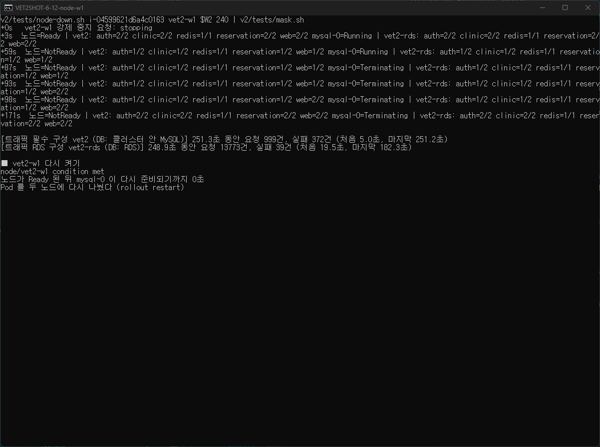

87초에 `mysql-0` 이 `Terminating` 이 됐고, 관찰을 끝낸 240초까지 그대로였다. 새 `mysql-0` 은 만들어지지 않았다. 앱 Pod 는 171초에 모두 2/2 로 돌아왔지만, 필수 구성(`vet2`)은 약 1,000건 중 372건이 실패했고 실패가 측정 끝까지 이어졌다. 같은 시간에 RDS 구성(`vet2-rds`)은 약 13,800건 중 39건이었다.
(2026-11-23 의 같은 실험: 81초에 `Terminating`, 188초 동안 DB 요청 313건 실패, 캡처 없음.)

**원인.** 두 가지다.

1. **볼륨이 워커1 의 디스크다 (K-6 의 선택).** 다른 노드에서 띄워도 데이터가 없다.
2. **StatefulSet 은 같은 이름의 Pod 를 둘 만들지 않는다.** 옛 `mysql-0` 이 정말 끝났는지 확인될 때까지 새 `mysql-0` 을 만들지 않는다. 죽은 노드의 kubelet 은 대답할 수 없으므로 확인이 끝나지 않는다. 두 MySQL 이 같은 데이터를 쓰는 사고를 막으려는 동작이다.

**판단 기준.** ① 노드가 죽어도 DB 가 다른 곳에서 계속 ② 필수 과제의 범위(클러스터 안 DB + 볼륨) ③ 설치할 것이 적다.

| 후보 | ① | ② | ③ | 판정 |
|---|---|---|---|---|
| 노드 밖의 디스크 (EBS) | △ 1 은 풀린다. 2 때문에 여전히 죽은 노드를 지우거나 Pod 를 강제로 지워야 옮겨 간다 (동작) | ○ | × kubeadm 에 EBS 드라이버 설치 | ④ EKS 에서 쓴다 |
| MySQL 복제 구성 | ○ | ○ | × 구성이 크게 늘어난다 (추론) | 탈락 |
| 관리형 DB (RDS) | ○ (측정, ⑥ 2.7) | × 클러스터 밖 | ○ | 선택 과제로 했다 |
| **고치지 않고 한계로 둔다** | × | ○ | ○ | **채택** — 워커1 이 돌아오면 41 ~ 50초 안에 DB 가 다시 뜬다 |

위 캡처의 아래 줄이 같은 시간의 RDS 구성이다. DB 요청이 멈추지 않았다 ([⑥ 2.7](6-선택과제.md)).

### K-12. 클러스터 밖으로 여는 방법 (MetalLB 가 EC2 에서 동작하지 않음)

**증상.** 수업에서는 MetalLB(L2)로 `LoadBalancer` 서비스에 IP 를 주었다. EC2 에서는 그 방식이 동작하지 않는다 (명세). kubeadm 클러스터에는 `LoadBalancer` 를 처리할 것이 없어, 그대로 두면 `EXTERNAL-IP` 가 `<pending>` 으로 남는다.

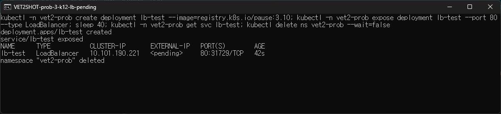

40초를 기다려도 `<pending>` 이다.

**원인.** MetalLB L2 는 같은 네트워크에 ARP 로 "이 IP 는 내 것"이라고 알린다. VPC 는 ARP 를 그대로 전달하지 않고, 인스턴스에 할당되지 않은 IP 로는 트래픽을 보내지 않는다 (동작).

**판단 기준.** ① 이 PC 에서 시나리오를 돌릴 수 있다 ② 이 PC 의 IP 에만 연다 ③ 설치·추가 비용이 적다 ④ ④ EKS 로 옮길 때 앱 배포 파일이 바뀌지 않는다.

| 후보 | ① | ② | ③ | ④ | 판정 |
|---|---|---|---|---|---|
| MetalLB L2 | × EC2 에서 동작 안 함 (명세, 동작) | - | ○ | ○ | 탈락 |
| MetalLB BGP | △ VPC 라우터와 BGP 를 맺을 수 없다 (동작) | - | × | ○ | 탈락 |
| AWS 클라우드 컨트롤러 + 로드밸런서 | ○ | ○ | × 클라우드 컨트롤러 설치, IAM, 시간당 과금 (동작) | ○ | 탈락 — ④ EKS 에서 한다 |
| Ingress 컨트롤러(nginx 등) + NodePort | ○ | ○ | × 설치. 결국 NodePort 로 연다 | ○ | 탈락 — web(Apache)이 이미 경로를 나눈다 |
| `kubectl port-forward` | ○ | ○ | ○ | ○ | 탈락 — 이 PC 의 명령이 떠 있는 동안만, 한 Pod 로만 간다 (동작) |
| **NodePort 30080 + 보안 그룹으로 이 PC 의 IP 에만** | ○ | ○ | ○ 설치 없음, 추가 비용 없음 | ○ Service 의 `type` 만 overlay 가 바꾼다 | **채택** |

**확인.** 6.1 (NodePort 30080 으로 65 / 65, 이 PC 에서 3306 은 닿지 않음).

**한계.** 노드의 공인 IP 로 접속하므로 EC2 를 다시 켜면 주소가 바뀐다. 노드 하나가 죽으면 그 노드의 주소로는 접속할 수 없다 (다른 노드의 주소로는 된다).

### K-13. 네트워크 플러그인(CNI) 고르기

**증상.** `kubeadm init` 뒤 노드가 `NotReady`, CoreDNS 가 `Pending` 이다. kubeadm 은 네트워크 플러그인을 설치하지 않는다 (9장).

**판단 기준.** ① 노드 3대에서 Pod 끼리 통신 ② 보안 그룹에 열 것이 적고 분명하다 ③ 설치가 매니페스트 하나 ④ 이 실습에 쓰지 않는 기능을 위해 부품을 늘리지 않는다.

| 후보 | ① | ② | ③ | ④ | 판정 |
|---|---|---|---|---|---|
| Calico (수업, IP-in-IP) | ○ | △ IP 프로토콜 4 를 열어야 한다 (명세). BGP(179)를 쓰는 구성도 있다 (동작) | △ 오퍼레이터 + 사용자 지정 리소스 (동작) | △ 네트워크 정책 등 쓰지 않는 기능이 많다 | 탈락 |
| Cilium | ○ | ○ | × CLI 또는 Helm, 커널 조건 (동작) | × | 탈락 |
| **Flannel (VXLAN)** | ○ | ○ UDP 8472 하나 | ○ 매니페스트 하나 | ○ 네트워크 정책이 없다 — 이 실습에서는 쓰지 않는다 | **채택** |

**확인.** 설치 9초 뒤 노드 3대 `Ready`. 보안 그룹을 UDP 8472 로 좁힌 뒤에도 다른 노드의 Pod 와 DNS 가 정상 (2.3).

**한계.** Flannel 은 NetworkPolicy 를 지원하지 않는다. Pod 사이의 접근을 막으려면 다른 플러그인이 필요하다.

## 8. 관찰한 것 (문제는 아니지만 알아 둘 것)

**O-1. "배포 완료" 직후 몇 초는 옛 버전이 답한다.** 1.0.1 로 업데이트하고 `rollout status` 가 끝났는데 4번 모두 1.0.0 이 답했다.

```
clinic-947c566d5-b26w2    vet2-clinic:1.0.0     ← preStop 으로 기다리는 중인 옛 Pod
{"service":"clinic","status":"ok","version":"1.0.0","servedBy":"clinic-947c566d5-b26w2"}  × 4
```

롤백 때 다시 쟀더니 옛 Pod 가 사라진 6초 뒤부터 새 버전만 답했다. Apache 가 서비스와의 연결을 재사용하는데, 그 연결이 아직 살아 있는 옛 Pod 로 이어져 있기 때문으로 보인다. 같은 이유로 요청이 Pod 에 고르게 나뉘지 않는다. clinic 에 60번 물었을 때 Apache 를 거치면 18 : 42, 클러스터 안에서 매번 새로 연결하면 26 : 34 였다. 실패는 없으므로 고치지 않았다.

**O-2. MySQL 이 바뀌는 동안 일부 요청이 503 이 아니라 500 이다 (소스).** 서비스의 로그:

```
ERROR ApiExceptionHandler : 처리하지 못한 오류
org.springframework.dao.RecoverableDataAccessException: PreparedStatementCallback; SQL [SELECT r.reservation_id, ...
```

새 연결을 못 맺는 오류는 소스의 오류 처리가 503 `DB_UNAVAILABLE` 로 바꾸지만, 이미 맺어 둔 연결이 끊긴 오류는 바꾸지 않아 500 이 된다. ①의 W-3 처럼 소스의 동작이라 고치지 않았다.

**O-3. 죽었던 노드가 돌아와도 Pod 는 돌아가지 않는다.** 워커1 장애 뒤 워커1 이 돌아왔지만, 옮겨 간 Pod 는 모두 워커2 에 남아 있었다 (MySQL 만 워커1). 스케줄러는 떠 있는 Pod 를 옮기지 않는다. 다시 배포(`rollout restart`)하자 다시 나뉘었다. 장애 뒤에는 다시 배포해 두어야 한다.

**O-4. EC2 에서만 소켓 끊김이 가끔 난다.** 다시 배포와 업데이트에서 약 6,000건에 1건씩 `UND_ERR_SOCKET`(응답 없이 연결이 끊김)이 났다. 이 PC 의 클러스터와 EKS 에서는 0건이었다. 원인은 확인하지 못했다.

**O-5. `kubectl rollout undo` 는 Git 의 배포 파일과 어긋난다.** 롤백 때 이런 경고가 나온다.

```
Warning: ... Rolling back will not update the kubectl.kubernetes.io/last-applied-configuration annotation ...
```

클러스터는 옛 이미지로 돌아갔지만 Git 의 파일은 그대로다. 실제 운영에서는 파일을 되돌려 다시 적용하는 것이 맞다.

## 9. EC2 클러스터를 만든 과정

> 처음에는 AWS CLI 로 하나씩 만들었다. 그 뒤 같은 구성을 CloudFormation 스택으로 바꿨다 ([⑤ 7장](5-최종문서.md)). 지금 다시 만들 때는 `v2/infra/stacks.sh up all` 과 `v2/infra/kubeadm-bootstrap.sh` 를 쓴다.

| 단계 | 내용 | 걸린 시간 / 결과 |
|---|---|---|
| 네트워크 | VPC, 인터넷 게이트웨이, 퍼블릭 서브넷, 라우팅, 보안 그룹 | - |
| IAM | 노드 역할 `vet2-node` + 인스턴스 프로파일 | - |
| ECR | 저장소 5개, 이미지 6개(clinic 1.0.1 포함) 올림 | 212초 |
| EC2 | 3대, user-data 로 노드 준비 스크립트 실행 (지금은 [kubeadm.yaml](../infra/kubeadm.yaml) 안에 있다) | 생성 뒤 몇 분 안에 3대 모두 준비 |
| `kubeadm init` | 컨트롤 플레인. API 서버 인증서에 공인 IP 를 넣었다 (`--apiserver-cert-extra-sans`) | 32초 |
| `kubeadm join` | 워커 2대. 토큰은 출력에 남기지 않았다 | - |
| 네트워크 플러그인 | Flannel v0.28.11. 설치 전에는 노드가 `NotReady`, CoreDNS 가 `Pending` | 설치 뒤 9초에 3대 모두 Ready |
| kubeconfig | `admin.conf` 를 Session Manager 로 받아 `v2/_run/` 에 저장 (Git 에 없음) | - |
| 배포 | K-5 ~ K-7 을 고친 뒤 | 52초에 모두 준비 |

과정에서 만난 작은 문제들 (설치 절차의 것이라 문제 번호를 붙이지 않았다):

- **EC2 를 만들 때 user-data 가 거부됐다.** 이 PC 의 AWS CLI 가 한글 주석이 든 파일을 글자로 읽지 못했다(`text contents could not be decoded`). 인스턴스는 만들어지지 않았다. 원인(문자 집합)은 ⑤ 7장.
- **Session Manager 로 보낸 `kubectl` 이 설정을 못 찾았다.** Session Manager 의 셸에는 `HOME` 이 없어서 `~/.kube/config` 를 읽지 못한다. kubectl 은 이 PC 에서 쓰기로 했다.
- **EC2 를 멈췄다 켜면 공인 IP 가 바뀐다.** API 서버 인증서에는 옛 공인 IP 가 들어 있어 그 주소로는 인증서 확인이 실패한다. 인증서에는 `kubernetes` 라는 이름도 들어 있어서, kubeconfig 에 `tls-server-name: kubernetes` 를 두고 서버 주소만 새 IP 로 바꾸자 클러스터를 다시 만들지 않고 붙었다 (⑤ 7.2).

## 10. 작업 중에 한 일 가운데 알려 둘 것

측정 도구를 만들면서 실수한 것이 있다. 모두 발견해 고쳤고, 위의 수치는 고친 뒤의 것이다.

- 시나리오 테스트의 `--db-exec` 처리에서 정규식의 `\` 가 빠져 명령이 엉뚱하게 잘렸다. 처음 실행에서 DB 계정 경계 9개가 실패로 나왔다.
- Windows 의 Git Bash 에서 `kill` 이 `node.exe` 를 바로 끝내 버려 트래픽 결과가 남지 않았다. 파일이 생기면 멈추게 바꿨다. Windows 의 `node`, `curl` 이 `/tmp`, `/c/...` 경로를 못 읽는 문제도 있어 저장소 안의 `_run/` 과 `C:/...` 형식을 쓰게 했다.
- 워커1 장애 실험의 첫 실행에서, 명령 끝의 `&` 가 앞의 준비 명령까지 함께 뒤로 보내 아무것도 하지 않고 끝났다. AWS 에는 변화가 없었다.
- 트래픽 도구가 로그인 실패를 세지 않고 다시 시도만 해서, 로그인을 기다리는 동안의 장애가 숨었다. K-10 의 고치기 전 실험(실패 213건)은 이 상태로 잰 것이라 실제 실패는 더 많았을 수 있다.
- DB 계정 경계의 "못 한다" 검사가 로그인 실패도 통과로 셌다. 서비스 계정 비밀번호를 넘기지 않고 돌렸을 때 드러났고, 로그인 실패(ERROR 1045)는 실패로 세게 고쳤다. 그 전의 65 / 65 실행들은 비밀번호를 넘겨 돌린 것이라 영향이 없다.

## 11. 확인하지 못한 것

| 항목 | 이유 |
|---|---|
| 실제 사용량 (CPU, 메모리) | 지표 서버를 설치하지 않았다 |
| 노드 정비(`kubectl drain`) 때 PodDisruptionBudget 의 동작 | 재지 않았다 |
| 컨트롤 플레인이 죽었을 때 | 1대뿐이라 죽으면 배포·복구가 멈춘다. 재지 않았다 |
| ECR 로그인 정보가 만료된 뒤 | 12시간을 기다리지 않았다 |
| O-4 의 원인 | |
| 가용 영역이 다른 노드 | 3대 모두 ap-northeast-2a 에 있다 |

## 12. 다음 단계(④ EKS)로 넘기는 것

| 넘기는 것 | ④에서 할 일 |
|---|---|
| K-5: ECR 을 Secret 으로 받았다 (12시간) | EKS 노드는 IAM 역할로 받는지 확인 |
| K-6, K-11: DB 볼륨이 노드에 묶였다 | ④ 는 EBS 로 바꿨다 (④ E-2). EKS 노드를 갑자기 멈출 권한이 없어 옮겨 가는지는 재지 못했다 |
| K-10: CoreDNS 를 직접 고쳤다 | EKS 의 CoreDNS 는 어떻게 놓이는지 확인 |
| K-12: NodePort 를 썼다 (노드의 공인 IP, 30080) | 로드밸런서(ALB)로 |
| O-1: 배포 직후 옛 Pod 가 답한다 | ④ 에서 확인: ALB 가 Pod 로 바로 보낼 때도 같았다 (④ 5.4) |

## 13. 다시 실행하는 순서

**이 PC 의 클러스터에서**

```bash
v2/k8s/secrets.sh -n vet2 --context docker-desktop
kubectl --context docker-desktop apply -k v2/k8s/overlays/local
node v2/tests/scenario.mjs --base-url http://localhost:28080 \
     --db-exec "kubectl --context docker-desktop -n vet2 exec mysql-0 --"
v2/tests/k8s-ops.sh --base-url http://localhost:28080 -n vet2 --context docker-desktop \
     --new-clinic-image vet2-clinic:1.0.1
```

**EC2 kubeadm 에서** (스택으로 만들 때는 아래를 `v2/infra/kubeadm-bootstrap.sh` 가 모두 한다)

```bash
export KUBECONFIG=v2/_run/kubeconfig-kubeadm
kubectl -n kube-system patch deploy coredns --patch-file v2/k8s/cluster/kubeadm/coredns-patch.yaml
kubectl apply -f v2/k8s/cluster/kubeadm/storage.yaml
v2/k8s/secrets.sh -n vet2
v2/k8s/kubeadm/ecr-pull-secret.sh -n vet2
v2/k8s/apply.sh kubeadm
node v2/tests/scenario.mjs --base-url http://<워커 공인 IP>:30080 --db-exec "kubectl -n vet2 exec mysql-0 --"
v2/tests/k8s-ops.sh --base-url http://<워커 공인 IP>:30080 -n vet2 --new-clinic-image <ECR 주소>/vet2-clinic:1.0.1
```

**정리**: AWS 자원을 지우는 순서와 남은 자원 확인은 ⑤ 7장에 적는다.
