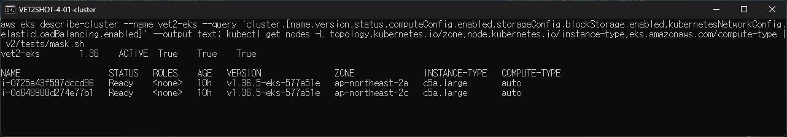
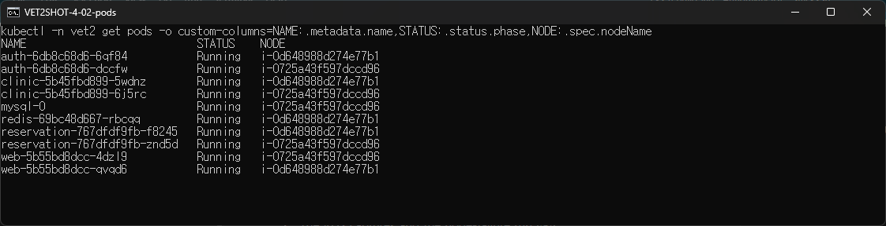
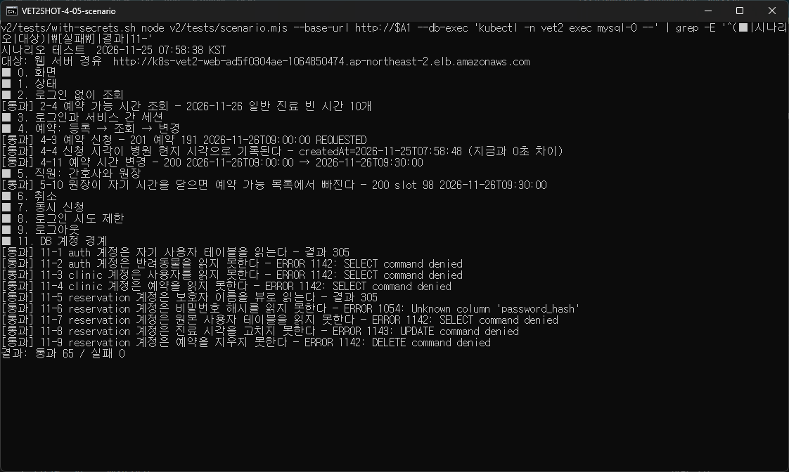
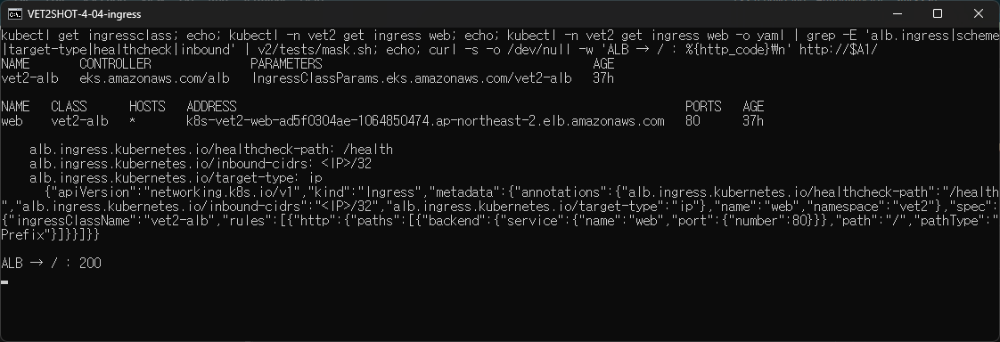
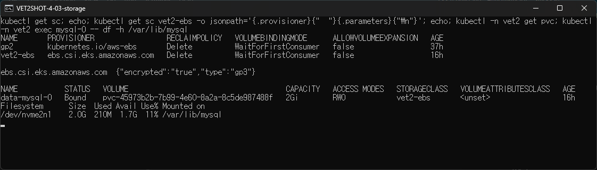
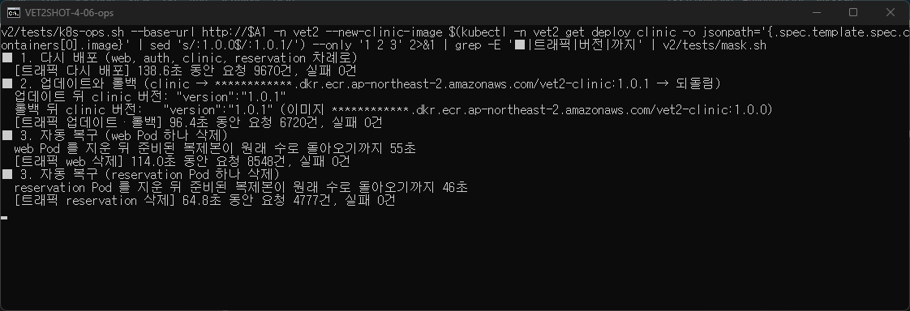
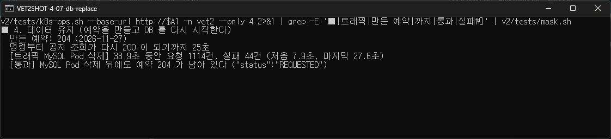
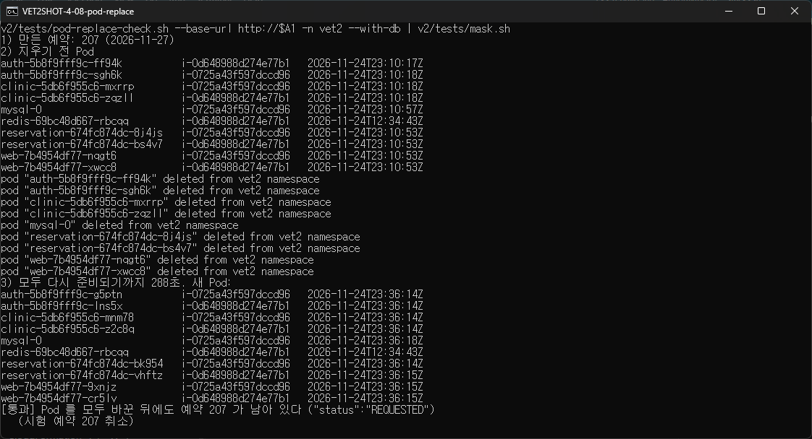
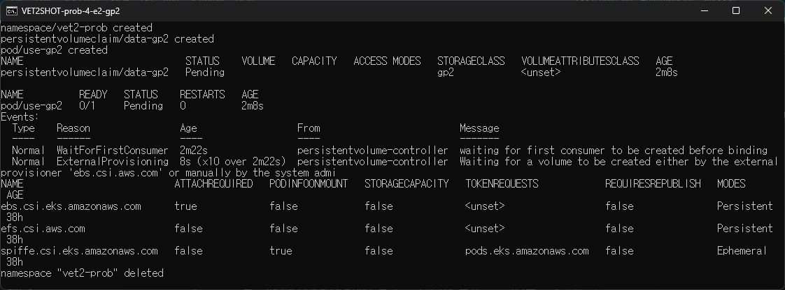

# ④ EKS 전환

③의 kubeadm 배포를 Amazon EKS(Auto Mode)로 옮긴 기록이다.
③에서 쓴 배포 파일을 **그대로 올려서 무엇이 안 되는지부터** 보고, 걸린 것을 하나씩 고쳤다.

필수 구성은 ③과 같다: 앱 4개 + Redis + **클러스터 안 MySQL(StatefulSet)**, 네임스페이스 `vet2`. 바뀐 것은 밖으로 여는 법(ALB)과 MySQL 볼륨(EBS)이다.
DB 를 RDS 로 바꾼 구성은 선택 과제라서 [⑥](6-선택과제.md)에 따로 적는다 (네임스페이스 `vet2-rds`, 같은 클러스터에 함께 떠 있다).

명령의 결과는 모두 실제 터미널 화면의 캡처다 (`v2/tests/shots-4.ps1` 이 명령을 실행하며 찍었다, 2026-11-25). AWS 계정 번호와 IP 는 가렸다. 캡처가 없는 옛 기록은 그렇다고 밝혔다.

## 0. 한 장 요약

| 숫자 | 뜻 |
|---|---|
| **65 / 65** | ALB 를 거친 시나리오 테스트 (DB 계정 경계 9개 포함) |
| **0건** | 다시 배포·업데이트·롤백 중 실패한 요청 |
| **예약 204** | MySQL Pod 를 지운 뒤에도 예약이 EBS 볼륨에 남았다 |

EKS 가 대신해 준 것: 컨트롤 플레인, 노드(만들기·고르기·정리), ECR 로그인, EBS 볼륨 드라이버, 로드밸런서, Pod 네트워크.
내가 직접 정해야 했던 것: **StorageClass**(E-2), **IngressClass**(E-1), 노드와 영역 분산(E-3), 정리에서 빼 둘 Pod(E-4).

## 1. 완성 기준 점검표

| 명세의 기준 | 결과 | 근거 |
|---|---|---|
| EKS 클러스터에 같은 워크로드 배포 | Auto Mode 1.36, 노드 2대(2a, 2c), Pod 10개 Running | 4.1, 4.3 |
| 외부에서 접속 | Ingress → ALB, 이 PC 의 IP 에서만. `/` 가 200 | E-1, 5.2 |
| 데이터가 남는 저장소 | StorageClass `vet2-ebs`(gp3, 암호화) → PVC `data-mysql-0` 2Gi Bound | E-2, 5.3 |
| 시나리오 테스트 통과 | **65 / 65** | 5.1 |
| 무중단 배포·업데이트·롤백 | 다시 배포 0건 (약 9,700건 중), 업데이트·롤백 0건 (약 6,700건 중) | 5.4 |
| Pod 를 지우면 스스로 복구 | web, reservation Pod 삭제 모두 실패 0건. 다시 원래 수가 되기까지 55초, 46초 | 5.5 |
| DB Pod 를 바꿔도 데이터 유지 | MySQL Pod 를 지워도 예약 204 유지 (25초 동안 요청 44건 실패). 모든 Pod 를 바꿔도 예약 207 유지 | 5.5 |
| ③에서 바꾼 값과 이유 | 3장의 표 | 3 |
| 비용과 정리 | 시간당 요금과 지우는 순서 | 7 |

만난 문제는 4건이다.

| 번호 | 문제 | 상태 |
|---|---|---|
| E-1 | 웹에 밖에서 접속할 길이 없다 (NodePort 만 있음) | 해결 — Ingress → ALB |
| E-2 | 클러스터에 처음부터 있는 `gp2` 로는 볼륨이 영영 만들어지지 않는다 | 해결 — StorageClass `vet2-ebs` 를 직접 만듦 |
| E-3 | 노드가 하나 빠지자 모든 Pod 가 남은 노드 1대에 몰렸다 | 해결 — `minDomains: 2`, 가용 영역 분산 |
| E-4 | MySQL·Redis 를 지키려고 붙인 표시 때문에 노드를 지워도 24시간 동안 지워지지 않는다 | **맞바꿈** — 사람이 옮기는 절차로 |

예상했는데 일어나지 않은 것:

| 예상 | 결과 |
|---|---|
| ALB 가 내려가는 Pod 를 늦게 빼서 배포 중 502 가 난다 | ③의 `preStop: sleep 5` 그대로. 5.4 의 실패는 0건이다. **재현 안 됨** |
| ③의 ECR 로그인 Secret(12시간 만료, ③ K-5)이 또 필요하다 | **필요 없음.** 노드가 IAM 역할로 ECR 에 로그인한다 (4.2) |

## 2. 환경

| 항목 | 값 |
|---|---|
| 클러스터 | EKS 1.36, **Auto Mode** (노드·EBS·로드밸런서 기능 포함) |
| 노드 | Auto Mode 가 고름: `c5a.large` (2 vCPU, 4GiB), Bottlerocket. 2대 (ap-northeast-2a, 2c) |
| 네트워크 | ③의 `vet2-vpc`, 퍼블릭 서브넷 2개. NAT 없음. Pod 가 VPC 의 IP 를 받는다 |
| API 접속 | 공개 엔드포인트를 이 PC 의 IP 에만 열었다 |
| 밖으로 | Ingress → ALB (internet-facing, `target-type: ip`), 이 PC 의 IP 에서만 |
| DB | 클러스터 안 MySQL 8.4 StatefulSet, EBS gp3 2Gi |
| 이미지 | ③과 같은 ECR, 같은 태그 `1.0.0` |
| IAM | 클러스터 역할 `vet2-eks-cluster` (Auto Mode 정책 5개), 노드 역할 `vet2-eks-node` (`AmazonEKSWorkerNodeMinimalPolicy`, `AmazonEC2ContainerRegistryPullOnly`) |
| 만든 방법 | CloudFormation [eks.yaml](../infra/eks.yaml) (`v2/infra/stacks.sh up eks`). eksctl 은 쓰지 않았다 |



`describe-cluster` 의 `True True True` 는 차례로 Auto Mode 의 노드 관리, EBS, 로드밸런서 기능이 켜져 있다는 뜻이다. 노드 이름이 인스턴스 ID 이고 `COMPUTE-TYPE` 이 `auto` 다. 두 노드는 다른 가용 영역에 있다 (E-3).

**Auto Mode 를 고른 이유.**

판단 기준: ① ALB 와 볼륨을 쓰기 위해 따로 설치할 것이 적다 ② 노드를 직접 관리하지 않는다 ③ 실습 비용 ④ 무엇이 클러스터 밖에서 일어나는지 볼 수 있다.

| 후보 | ① 설치 | ② 노드 관리 | ③ 비용 | ④ 보임 | 판정 |
|---|---|---|---|---|---|
| 관리형 노드 그룹 | × AWS Load Balancer Controller 와 EBS CSI 드라이버를 설치하고 IAM 을 각각 연결 (동작) | △ 노드 그룹의 크기·AMI 를 직접 정한다 | ○ | ○ 노드에 직접 손댈 수 있다 | 탈락 |
| Fargate | △ ALB 는 컨트롤러 필요, EBS 를 못 쓴다 (동작) | ○ | △ Pod 마다 과금 | × 노드가 없다 | 탈락 — MySQL 볼륨을 못 붙인다 |
| **Auto Mode** | ○ 둘 다 들어 있다 (동작) | ○ | ○ 노드 요금 + 관리 수수료 | △ 노드를 멈추거나 지울 수 없다 (2026-11-23 측정, 캡처 없음) | **채택** |

대가로 AWS 가 노드를 정리하는 동작이 생겼다. 그것이 E-3, E-4 다.

```
                   이 PC (IP 하나에만 열림)
                          │ http
                          ▼
                 ALB (internet-facing)  ─ 대상: Pod 의 IP (target-type ip)
          ┌───────────────┴───────────────┐
  ap-northeast-2a                  ap-northeast-2c
  노드 (c5a.large)                 노드 (c5a.large)
  web, auth, clinic, reservation   web, auth, clinic, reservation
  mysql-0 ── EBS gp3 2Gi (2a)      redis
```

## 3. ③에서 바뀐 것 (EKS 가 대신하는 일)

배포 파일은 ③과 같은 base 에 overlay 하나만 다르다 ([overlays/eks](../k8s/overlays/eks/kustomization.yaml)). 클러스터에 한 번 넣는 것은 [cluster/eks](../k8s/cluster/eks/) 의 두 파일이다.

| | kubeadm (③) | EKS (④) | 바꾼 이유 |
|---|---|---|---|
| 컨트롤 플레인 | EC2 1대에 직접 (`kubeadm init`) | EKS 가 운영 | - |
| 노드 | EC2 2대 고정, 직접 join | Auto Mode 가 Pod 요청량을 보고 만들고 줄인다 | - |
| Pod 네트워크 | Flannel, Pod 대역 10.244.0.0/16 | VPC CNI, Pod 가 VPC 의 IP | ALB 가 Pod 로 바로 보낼 수 있다 |
| 클러스터 DNS | 두 노드에 직접 나눔 (③ K-10) | Auto Mode 가 맡음 (Pod 로 보이지 않음) | - |
| 밖으로 | NodePort 30080 | **Ingress → ALB** | E-1 |
| MySQL 볼륨 | vet2-w1 의 디스크 폴더를 직접 등록한 PV (StorageClass `vet2-local`, 자동 생성 없음) | **EBS gp3, StorageClass `vet2-ebs`** | E-2. 노드가 바뀌어도 볼륨은 남는다 |
| ECR 로그인 | Secret, 12시간 만료 (③ K-5) | 없음 (노드 IAM 역할) | - |
| 노드 분산 | `maxSkew: 1` | + `minDomains: 2`, 가용 영역 분산 | E-3 |
| 정리 예외 | - | mysql, redis 에 `karpenter.sh/do-not-disrupt` | E-4 |
| 노드 장애 대기 | `tolerationSeconds: 30` (③ K-9) | 그대로 | - |

`apply.sh` 가 적용할 때 `ECR_REGISTRY`(계정 번호)와 `MY_CIDR`(이 PC 의 IP)를 채워 넣는다. 둘 다 Git 에 적지 않는다.

## 4. 진행

### 4.1 클러스터 만들기

```bash
v2/infra/stacks.sh up eks          # CloudFormation. 2026-11-23 처음 만들 때 669초
aws eks update-kubeconfig --name vet2-eks --kubeconfig v2/_run/kubeconfig-eks
```

준비된 직후의 클러스터에는 노드가 0대다. Pod 를 올려야 Auto Mode 가 노드를 만든다 (2026-11-23 기록, 캡처 없음).

### 4.2 kubeadm 배포 파일을 그대로 올렸을 때

2026-11-23 에 ③의 kubeadm overlay 를 그대로 올렸다 (캡처 없음).

| 본 것 | 뜻 |
|---|---|
| 노드 2대가 2분 안에 생겼다 | Pod 를 올리자 Auto Mode 가 요청량에 맞는 노드를 만들었다 |
| 앱 이미지를 모두 받았다. `imagePullSecrets` 없이 | **③ K-5 가 여기서는 없다.** 노드가 IAM 역할(`AmazonEC2ContainerRegistryPullOnly`)로 ECR 에 로그인한다 |
| kubeadm overlay 의 MySQL 볼륨은 vet2-w1 의 디스크 폴더(`vet2-local`)라 EKS 에서는 쓸 수 없다 | EKS 에 맞는 StorageClass 가 필요했다 (E-2) |
| web 은 NodePort | 노드의 보안 그룹은 Auto Mode 가 관리하고 30080 은 열려 있지 않다 (E-1) |

### 4.3 최종 구성으로

```bash
export KUBECONFIG=v2/_run/kubeconfig-eks
kubectl apply -f v2/k8s/cluster/eks/          # StorageClass vet2-ebs, IngressClass vet2-alb (한 번만)
v2/k8s/secrets.sh -n vet2                     # 비밀번호 Secret (값은 v2/_run/secrets.env 에서)
v2/k8s/apply.sh eks
```



Pod 10개가 모두 Running 이다. 복제본 둘씩인 앱은 두 노드에 하나씩 나뉘어 있다. `mysql-0` 은 2a 의 노드, `redis` 는 2c 의 노드에 있다.

## 5. 기준별 측정 (최종 구성)

### 5.1 시나리오 테스트 (ALB 를 거쳐서)

```bash
v2/tests/with-secrets.sh node v2/tests/scenario.mjs --base-url http://<ALB 주소> --db-exec 'kubectl -n vet2 exec mysql-0 --'
```



**통과 65 / 65.** 화면에는 묶음 제목(■)과 날짜가 든 줄, DB 계정 경계(11-1 ~ 11-9)만 골라 보였다. 계정 경계는 `kubectl exec` 로 MySQL 안에서 서비스 계정마다 남의 표를 읽어 본 것이다.

### 5.2 밖으로 여는 법 (Ingress → ALB)



| 설정 | 값 | 이유 |
|---|---|---|
| IngressClass | `vet2-alb` → 컨트롤러 `eks.amazonaws.com/alb` | Auto Mode 에 들어 있는 ALB 기능을 이 Ingress 에 연결 (E-1) |
| `scheme` | `internet-facing` (IngressClassParams) | 기본은 VPC 안에서만 보이는 internal |
| `target-type` | `ip` | ALB 가 노드를 거치지 않고 Pod 의 IP 로 바로 보낸다 |
| `healthcheck-path` | `/health` | readinessProbe 와 같은 경로. 준비 안 된 Pod 로는 보내지 않는다 |
| `inbound-cidrs` | 이 PC 의 IP `/32` (캡처에서 `<IP>` 로 가림) | ALB 의 보안 그룹에 80 을 이 IP 에만 연다 |

ALB 주소로 `/` 를 부르면 200 이다.

### 5.3 저장소 (StorageClass, EBS)



| 본 것 | 뜻 |
|---|---|
| StorageClass 가 둘: `gp2`(`kubernetes.io/aws-ebs`)와 `vet2-ebs`(`ebs.csi.eks.amazonaws.com`) | `gp2` 는 클러스터에 처음부터 있던 것, `vet2-ebs` 는 직접 만든 것 (E-2) |
| `vet2-ebs` 의 값 `{"encrypted":"true","type":"gp3"}` | gp3, 암호화 |
| `WaitForFirstConsumer` | Pod 가 놓일 노드(영역)가 정해진 뒤에 그 영역에 볼륨을 만든다. EBS 는 한 영역 안에서만 붙는다 |
| `Delete` | PVC 를 지우면 EBS 도 지운다. 남겨 두면 요금이 계속 나간다 |
| PVC `data-mysql-0` Bound, 2Gi | StatefulSet 의 `volumeClaimTemplates` 가 만든 것 |
| MySQL 안에서 `/var/lib/mysql` 이 `/dev/nvme2n1` 2.0G | 노드 디스크가 아니라 따로 붙은 EBS 다 |

### 5.4 다시 배포, 업데이트, 롤백

```bash
v2/tests/k8s-ops.sh --base-url http://<ALB 주소> -n vet2 --new-clinic-image <ECR>/vet2-clinic:1.0.1 --only '1 2 3'
```



| 작업 | 결과 |
|---|---|
| 다시 배포 (web, auth, clinic, reservation 차례로) | 138.6초 동안 요청 약 9,700건, **실패 0건** |
| 업데이트·롤백 (clinic 1.0.1 → 되돌림) | 96.4초 동안 약 6,700건, **실패 0건** |
| web Pod 하나 삭제 | 114.0초 동안 약 8,500건, **실패 0건**. 복제본이 다시 2개 준비되기까지 55초 |
| reservation Pod 하나 삭제 | 64.8초 동안 약 4,800건, **실패 0건**. 46초 |

③ kubeadm 에서 남았던 업데이트·롤백 중 연결 끊김 2건(③ O-4)은 여기서는 나오지 않았다.

업데이트 뒤 clinic 은 `"version":"1.0.1"` 로 답했다. 롤백 직후에도 1.0.1 이 답했다 (이미지는 1.0.0 으로 돌아감). ③ O-1 과 같다. ③에서 "로드밸런서가 Pod 로 바로 보낼 때도 같은지"를 남겨 두었는데, ALB 가 Pod 의 IP 로 바로 보낼 때도 같았다.

복구 시간은 kubeadm(web 9초, reservation 18초)보다 길다. 그동안 실패는 0건이라 사용자는 느끼지 못한다. 새 Pod 가 준비된 뒤 ALB 의 대상으로 등록되고 상태 확인을 통과하기까지 걸리는 시간으로 본다 (추론. ALB 의 대상 상태는 재지 않았다).

### 5.5 Pod 삭제와 DB 교체



예약 204 를 만들고 `mysql-0` 을 지웠다. 새 `mysql-0` 이 같은 EBS 볼륨을 다시 붙여 떴고, **예약 204 가 그대로 있다.**
공지 조회가 다시 200 이 되기까지 25초, 그동안 요청 약 1,100건 중 44건이 실패했다 (DB 를 쓰는 요청). ③ kubeadm(노드 디스크)은 11초, 26건이었다. EBS 를 노드에서 떼고 다시 붙이는 시간이 더해진 것으로 본다 (추론).
DB 가 하나뿐이라 교체하는 동안 끊기는 것은 피할 수 없다. 이 구성의 한계다 (⑥ RDS 도 재시작 동안은 끊긴다).



앱 Pod 8개와 `mysql-0` 을 한꺼번에 지웠다. 새 Pod 는 두 노드에 다시 나뉘었고, **예약 207 이 그대로 있다.**
예약 조회가 다시 200 이 되기까지 288초 걸렸다 (③ kubeadm 은 43초). MySQL 이 다시 뜨는 동안 앱의 준비 확인이 실패하고, 준비된 뒤 ALB 에 다시 등록되는 시간이 겹친 것으로 본다 (추론). 이 시간은 이번에 한 번만 쟀다.

첫 두 번의 실행은 캡처 도구의 AWS 임시 키가 중간에 만료돼 `kubectl` 이 실패했다 (Pod 를 지우지 못함). 그 캡처는 버리고 다시 쟀다.

### 5.6 노드가 없어질 때 (2026-11-23 기록, 캡처 없음)

Auto Mode 의 노드는 멈출 수 없다. `aws ec2 stop-instances` / `terminate-instances` / `reboot-instances` 모두 `--dry-run` 에서 `UnauthorizedOperation` 이었다. EKS 가 관리하는 인스턴스라 관리자 계정으로도 EC2 에서 손댈 수 없다. **그래서 ③처럼 노드가 갑자기 죽는 실험은 하지 못했다.**
대신 `kubectl delete node` 로 노드를 지웠다. Auto Mode 가 Pod 를 차례로 내보내고 노드를 없앤다. 갑작스런 장애가 아니라 **계획된 노드 교체**에 해당한다.

| 측정 (2026-11-23) | 결과 |
|---|---|
| 2a 의 노드를 지움 (E-3 를 고친 뒤) | 22초에 2a 에 새 노드, 49초에 앱 Pod 모두 준비. 490초 동안 요청 약 32,000건, **실패 0건** |
| 그때 MySQL 과 Redis | 옮겨 가지 않았다. 노드가 지워지지 않고 남았다 (E-4) |

## 6. 문제와 해결

③과 같은 형식이다: **증상 → 원인 → 판단 기준 → 후보와 탈락 이유 → 고른 방법 → 확인 → 한계.** ○ 채움, △ 일부·조건부, × 못 채움. 근거는 측정(직접 해 봄), 동작(문서·정해진 동작), 추론(재지 않고 따져 봄).

### E-1. 웹에 밖에서 접속할 길이 없다

**증상.** kubeadm overlay 는 web 을 NodePort 30080 으로 연다. EKS 노드의 보안 그룹은 Auto Mode 가 만들고 관리하며, 30080 은 열려 있지 않다. 노드의 IP 도 Auto Mode 가 노드를 바꿀 때마다 바뀐다 (2026-11-23 기록, 캡처 없음).

**판단 기준.**

1. 노드가 바뀌어도 주소가 그대로다
2. Pod 의 상태를 HTTP(`/health`)로 보고, 준비 안 된 Pod 로는 보내지 않는다
3. 이 PC 의 IP 에서만 들어오게 막을 수 있다
4. Auto Mode 가 관리하는 자원(노드 보안 그룹)에 손대지 않는다

**후보와 탈락 이유.**

| 후보 | 1 주소 | 2 HTTP 확인 | 3 IP 제한 | 4 손대지 않음 | 판정 |
|---|---|---|---|---|---|
| 노드 보안 그룹에 30080 을 연다 | × 노드 IP 가 바뀐다 (동작) | × | △ | × | 탈락 |
| Service 를 LoadBalancer 로 (NLB) | ○ | △ TCP 수준이라 HTTP 확인에 설정이 더 필요하다 (동작) | ○ | ○ | 탈락 |
| **Ingress → ALB** | ○ | ○ `healthcheck-path: /health` | ○ `inbound-cidrs` | ○ | **채택** |

**고른 방법.** Ingress → ALB. Auto Mode 에는 ALB 를 만드는 기능이 들어 있지만, 어떤 Ingress 를 맡을지 알려 주는 IngressClass 는 직접 만들어야 한다 ([alb.yaml](../k8s/cluster/eks/alb.yaml)). 기본은 internal ALB 라서 `scheme: internet-facing` 을 적었다.

**확인.** 5.2 의 캡처: IngressClass `vet2-alb`, Ingress 의 ADDRESS 에 ALB 주소, `/` 가 200. 시나리오 65 / 65 도 ALB 를 거쳤다 (5.1).

**한계.** ALB 는 Ingress 가 만든 것이라 CloudFormation 스택에 들어 있지 않다. 스택을 지우기 전에 클러스터 안의 Ingress 를 먼저 지워야 ALB 가 남지 않는다 (`stacks.sh down eks` 가 한다). HTTPS 는 도메인·인증서가 없어 하지 않았다.

### E-2. 클러스터에 처음부터 있는 `gp2` 로는 볼륨이 영영 만들어지지 않는다

**증상.** MySQL 의 볼륨을 EKS 에 처음부터 있는 StorageClass `gp2` 로 요청하면 PVC 와 Pod 가 `Pending` 에서 움직이지 않는다. 같은 요청을 따로 재현했다 ([pvc-gp2.yaml](../tests/prob/pvc-gp2.yaml)).



PVC 와 Pod 가 2분이 넘게 `Pending` 이다. 이벤트는 "외부 provisioner `ebs.csi.aws.com` 이 볼륨을 만들어 주기를 기다린다"이다. 그런데 클러스터에 있는 CSI 드라이버(`kubectl get csidrivers`)는 `ebs.csi.eks.amazonaws.com`, `efs.csi.aws.com`, `spiffe.csi.eks.amazonaws.com` 셋뿐이다. 기다리는 이름의 드라이버가 없다.
(캡처 맨 위의 명령 줄은 출력이 길어 창 밖으로 밀려났다. 명령은 [shots-4.ps1](../tests/shots-4.ps1) 의 `prob-4-e2-gp2`.)

**원인.** `gp2` 의 provisioner 는 옛 이름 `kubernetes.io/aws-ebs` 이고, 이것은 EBS CSI 드라이버 `ebs.csi.aws.com` 으로 넘겨진다. Auto Mode 에 들어 있는 드라이버의 이름은 **`ebs.csi.eks.amazonaws.com`** 이다. 이름이 달라서 `gp2` 의 요청을 받아 줄 드라이버가 없다.

**판단 기준.**

1. EKS 의 노드가 바뀌어도 데이터가 남는다
2. 따로 설치하는 부품이 없다 (Auto Mode 에 들어 있는 것만)
3. 볼륨이 Pod 가 놓인 영역에 만들어진다
4. 다 쓰고 나면 볼륨이 남지 않는다 (요금)

**후보와 탈락 이유.**

| 후보 | 1 노드 교체 | 2 설치 없음 | 3 영역 | 4 남지 않음 | 판정 |
|---|---|---|---|---|---|
| `gp2` 그대로 | - | ○ | - | - | 탈락 — 볼륨이 만들어지지 않는다 (측정) |
| EBS CSI 드라이버(`ebs.csi.aws.com`)를 애드온으로 설치 | ○ | × 드라이버와 IAM 을 따로 (동작). Auto Mode 의 것과 둘이 된다 | ○ | ○ | 탈락 |
| 노드 디스크를 직접 등록한 PV (kubeadm 의 `vet2-local`) | × Auto Mode 가 노드를 바꾸면 그 디스크와 함께 데이터가 사라진다 (동작) | ○ | × PV 를 특정 노드에 묶는다. 노드 이름이 바뀐다 | ○ | 탈락 |
| EFS | ○ | × EFS CSI 설치, 파일 시스템 따로 | ○ 영역에 묶이지 않음 | △ | 탈락 — DB 에는 지연이 크다 (추론) |
| **StorageClass `vet2-ebs` (`ebs.csi.eks.amazonaws.com`, gp3, 암호화, `WaitForFirstConsumer`, `Delete`)** | ○ EBS 는 노드와 따로 산다 | ○ | ○ `WaitForFirstConsumer` | ○ `Delete` | **채택** |

**고른 방법.** [storage.yaml](../k8s/cluster/eks/storage.yaml) 로 `vet2-ebs` 를 만들고, EKS overlay 가 MySQL 의 `volumeClaimTemplates` 에 `storageClassName: vet2-ebs` 를 넣는다. gp2 대신 gp3 로 한 것은 같은 크기에서 값이 싸고 기본 성능이 정해져 있어서다 (동작).

**확인.** 5.3 의 캡처: PVC `data-mysql-0` Bound 2Gi, MySQL 안에서 `/var/lib/mysql` 이 따로 붙은 장치. 5.5 에서 MySQL Pod 를 지워도 예약이 남았다.

**한계.** EBS 는 한 영역(지금은 2a)에 묶인다. 2a 의 노드가 모두 없어지면 MySQL 은 2a 에 새 노드가 생길 때까지 뜨지 못한다 (동작. 재 보지 않음). Auto Mode 는 Pod 가 볼륨 때문에 2a 를 요구하면 그 영역에 노드를 만든다. 영역 하나가 통째로 죽는 경우를 넘으려면 DB 를 여러 영역에 두어야 한다 — ⑥ 의 RDS 가 그 선택지다.

### E-3. 노드가 하나 빠지자 모든 Pod 가 남은 노드 1대에 몰렸다

> 2026-11-23 기록 (캡처 없음).

**증상.** 노드 하나를 지운 뒤 web, auth, clinic, reservation 의 복제본 둘과 Redis 가 모두 남은 노드 하나(2a)에 있었다. Auto Mode 는 지운 노드를 다시 만들지 않았다. 처음 만든 노드 2대도 둘 다 2a 였다.

**원인.** 두 가지다.

1. **Auto Mode 는 노드를 적게 쓰려 한다.** NodePool 의 설정이 `consolidationPolicy: WhenEmptyOrUnderutilized`, `consolidateAfter: 30s` 다. Pod 가 다 들어가면 노드를 늘리지 않고, 덜 찬 노드는 정리해 Pod 를 몰아넣는다.
2. **분산 규칙은 있는 노드끼리만 비교한다.** `maxSkew: 1` 은 "노드 사이의 개수 차이를 1 이하로"라는 뜻인데, 노드가 1대면 차이가 0 이라 둘 다 같은 노드에 놓아도 규칙이 지켜진 것이 된다. 노드가 고정인 kubeadm 에서는 드러나지 않았다.

**판단 기준.**

1. 노드가 몇 대든 복제본 둘이 다른 노드에 있다
2. 가용 영역도 나뉜다
3. 노드가 1대인 로컬 클러스터는 그대로 뜬다
4. Auto Mode 의 NodePool 을 직접 바꾸지 않는다

**후보와 탈락 이유.**

| 후보 | 1 노드 | 2 영역 | 3 로컬 | 4 NodePool | 판정 |
|---|---|---|---|---|---|
| 그대로 (`maxSkew: 1` 만) | × 노드 1대에 몰림 (측정) | × | ○ | ○ | 탈락 |
| NodePool 에서 정리(consolidation)를 끈다 | △ 정리로 몰리는 것은 막지만, 노드를 지운 뒤 다시 늘리지는 않는다 (동작) | × | ○ | × 기본 NodePool 을 바꾼다 | 탈락 |
| 반드시 다른 노드에 (`podAntiAffinity` required) | ○ | × | × 로컬에서 둘째가 못 뜬다 | ○ | 탈락 |
| **EKS overlay 에서만 `minDomains: 2` + 영역 분산** | ○ 없는 노드를 0 개로 센다 (동작) | ○ | ○ base 는 그대로 | ○ | **채택** |

- 노드 분산에 `minDomains: 2`: 노드가 2대보다 적으면 "없는 노드에 0개가 있다"고 보고 계산한다. 그러면 둘째 복제본은 같은 노드에 놓일 수 없어 `Pending` 이 되고, Auto Mode 가 노드를 새로 만든다.
- 가용 영역 분산(`topology.kubernetes.io/zone`, `minDomains: 2`): 처음 노드 2대가 같은 영역이었으므로.

**확인.** 적용하자 2c 에 노드가 새로 생겼고, 네 앱의 복제본이 2a 와 2c 에 하나씩 놓였다. 적용부터 전부 준비까지 67초 (2026-11-23 기록). 지금(2026-11-25)도 노드 2대가 2a, 2c 에 있고(4.1), 복제본이 두 노드에 나뉘어 있다 (4.3).

### E-4. MySQL·Redis 를 지키려고 붙인 표시 때문에 노드를 지워도 24시간 동안 지워지지 않는다 (맞바꿈)

> 2026-11-23 기록 (캡처 없음).

E-3 을 고치면서, Auto Mode 가 노드를 정리할 때 복제본이 하나뿐인 MySQL 과 Redis 를 옮기지 않게 `karpenter.sh/do-not-disrupt: "true"` 를 붙였다. MySQL 을 옮기면 그동안 DB 요청이 실패하고, Redis 를 옮기면 로그인한 사용자가 모두 로그아웃된다. **정리 때문에 옮겨지는 것을 실제로 보지는 못했다.** 예방으로 붙인 것이다.

**증상.** 5.6 의 실험에서 노드를 지웠는데, 노드가 남아 있었다. 노드에는 `deletionTimestamp` 와 `karpenter.sh/termination` finalizer 가 붙어 있었고, 이벤트는 `FailedDraining`(내보내지 못한 Pod 가 남음)과 "24시간 뒤에 모든 Pod 를 지운다"였다.

**원인.** 이 표시는 Auto Mode 의 정리만이 아니라 노드를 지울 때 Pod 를 내보내는 것도 막는다. Auto Mode 는 NodePool 의 `terminationGracePeriod`(24시간)가 지나야 강제로 지운다.

**판단 기준.**

1. DB 와 로그인이 예고 없이 끊기지 않는다
2. 노드를 바꾸는 작업이 막히지 않는다
3. 세션 저장소와 DB 를 하나로 둔다 (소스는 Redis·MySQL 하나를 가정한다)

**후보와 탈락 이유.**

| 후보 | 1 예고 없는 끊김 없음 | 2 노드 교체 | 3 하나 | 판정 |
|---|---|---|---|---|
| 표시 없음 | × Auto Mode 가 정리할 때 언제든 옮겨질 수 있다 (동작, 재 보지 않음) | ○ 저절로 옮겨 간다 | ○ | 탈락 |
| Redis·MySQL 을 여러 대로 (복제, Sentinel) | ○ | ○ | × 소스의 연결 설정이 하나의 주소를 가정한다 (추론) | 탈락 |
| 관리형으로 (RDS, ElastiCache) | ○ (추론) | ○ | ○ 주소만 바꾼다 | DB 는 ⑥ 의 선택 과제로 함 |
| **표시 있음 + 노드를 바꿀 때 사람이 옮긴다** | ○ 옮기는 시점을 사람이 정한다 | △ 사람이 옮기지 않으면 24시간 | ○ | **채택** |

**고른 방법.** 표시를 남기고, 노드를 바꿀 때는 그 Pod 를 직접 지운다.

```bash
kubectl -n vet2 delete pod -l app=redis
kubectl -n vet2 delete pod mysql-0          # EBS 가 묶인 영역(2a)에 노드가 있어야 다시 뜬다 (E-2 한계)
```

## 7. 비용과 정리

### 7.1 시간당 요금 (온디맨드 요금표, 2026-11-24 조회)

| 자원 | 요금 |
|---|---|
| EKS 컨트롤 플레인 | 시간당 0.10달러 |
| EKS 노드 c5a.large × 2 | 시간당 0.086달러 × 2 + Auto Mode 관리 수수료 |
| ALB (Ingress 가 만듦, 스택 밖) | 시간당 약 0.03달러 + 사용량 |
| EBS gp3 2Gi (MySQL) | 월 약 0.2달러 |
| ECR | 저장량만 (작다) |

④ 만의 합계는 시간당 약 0.3달러다 (관리 수수료 제외). ③ kubeadm 과 ⑥ RDS 까지 켠 전체는 [⑤ 7장](5-최종문서.md#7-비용과-정리).

### 7.2 멈추기와 지우기

| 자원 | 멈추는 법 | 남는 요금 |
|---|---|---|
| EKS 노드 | 앱을 0 개로 줄이면 Auto Mode 가 노드를 없앤다 (2026-11-23 측정: 98초) | 0 |
| EKS 노드 직접 | 멈출 수 없다 (`UnauthorizedOperation`) | - |
| EKS 컨트롤 플레인, ALB | 멈추는 기능이 없다 | 시간당 약 0.13달러 |
| EBS (MySQL) | PVC 를 지우면 함께 지워진다 (`Delete`) | 남기면 저장 요금 |

지우는 순서 (되돌릴 수 없다):

```bash
kubectl -n vet2 delete ingress web          # ALB 를 먼저 (스택 밖)
kubectl delete ns vet2                      # PVC 와 함께 EBS 도 지워진다
v2/infra/stacks.sh down eks                 # 위 두 줄도 스크립트가 먼저 한다
```

## 8. 확인하지 못한 것

| 항목 | 이유 |
|---|---|
| EKS 노드가 갑자기 죽을 때 | Auto Mode 노드는 멈추거나 지울 권한이 없다. 계획된 교체만 쟀다 (5.6) |
| MySQL 의 영역(2a)에 노드가 없을 때 | 재 보지 않았다. 볼륨이 2a 에 묶여 있다 (E-2 한계) |
| Auto Mode 의 정리가 실제로 Pod 를 옮기는 것 | 일부러 일으키지 못했다. E-4 의 표시는 예방이다 |
| 실제 사용량 (CPU, 메모리) | 지표 서버를 설치하지 않았다 |
| HTTPS | 인증서(도메인)가 없어 HTTP 로만 열었다 |

## 9. 다시 실행하는 순서

```bash
v2/infra/stacks.sh up network && v2/infra/stacks.sh up ecr && v2/infra/push-images.sh
v2/infra/stacks.sh up eks                # 11분 안팎
export KUBECONFIG=v2/_run/kubeconfig-eks
kubectl apply -f v2/k8s/cluster/eks/
v2/k8s/secrets.sh -n vet2
v2/k8s/apply.sh eks
kubectl -n vet2 get ingress web          # ADDRESS 가 ALB 주소. 1 ~ 2분 뒤 응답한다
v2/tests/with-secrets.sh node v2/tests/scenario.mjs --base-url http://<ALB 주소> --db-exec 'kubectl -n vet2 exec mysql-0 --'
v2/tests/k8s-ops.sh --base-url http://<ALB 주소> -n vet2 --new-clinic-image <ECR 주소>/vet2-clinic:1.0.1
```
