# ⑥ 선택 과제

필수 과제(①~④)를 마친 뒤 더한 것들이다. 명세의 선택 과제 표 순서로, 한 것과 하지 않은 것, 증거가 있는 곳을 적는다.
RDS 전환은 이 문서 2장에 자세히 적는다. 나머지는 단계별 문서에 이미 증거가 있어 위치만 가리킨다.

## 1. 수행 목록

| 영역 | 과제 | 한 일 | 증거 |
|---|---|---|---|
| 이미지 | **빌드 최적화** | 두 단계 빌드, JRE alpine 베이스, Gradle 캐시, `.dockerignore`. 1.52GB → 366MB, 소스 한 줄 수정 뒤 재빌드 54.8초 → 12.1초 (방법을 하나씩 더하며 캡처) | [② C-7](2-이미지-빌드-컨테이너-테스트.md) |
| 이미지 | root 가 아닌 사용자로 실행 | 서비스 10001, web 82, Redis·MySQL 999. 컨테이너 안에서 `id` 로 확인. 쿠버네티스에서는 `runAsNonRoot` 로 강제 | [② C-5](2-이미지-빌드-컨테이너-테스트.md), [③ 5장](3-쿠버네티스-전환.md) |
| 로컬 | Compose 로 APP · DB 함께 실행 | 컨테이너 6개, healthcheck, 시나리오 65 / 65 | [② compose](2-이미지-빌드-컨테이너-테스트.md), `v2/docker/compose.yaml` |
| Kubernetes | **무중단 롤링 업데이트** | probe, 복제본 2, `maxUnavailable 0`, `preStop`. 다시 배포 중 실패 240 → 0, 업데이트·롤백 125 → 2 (같은 kubeadm 클러스터) | [③ K-1, 6.2](3-쿠버네티스-전환.md) |
| Kubernetes | **Kustomize** | base 하나 + overlay 5개(local, kubeadm, eks, kubeadm-rds, eks-rds) + component 하나(rds) | 이 문서 3장 |
| Kubernetes | 리소스 요청 · 분산 배치 · PDB | ② 측정값으로 요청·한도, `topologySpreadConstraints` + `matchLabelKeys`, PDB `minAvailable: 1`. 노드를 비울 때 PDB 가 마지막 복제본을 지킨다 | [③ K-4, K-8, 5장](3-쿠버네티스-전환.md), 이 문서 4장 |
| EKS | 가용 영역 분산 | `minDomains: 2` + 영역 분산. 노드 2a, 2c | [④ E-3](4-EKS-전환.md) |
| EKS | **RDS 로 DB 전환** | 사설 서브넷의 RDS, 노드 보안 그룹에서만 3306, 초기화 Job, 연결 수 조정. 두 클러스터 모두 시나리오 65 / 65 | 이 문서 2장 |
| EKS | Secrets Manager 로 비밀번호 관리 | **일부만**: RDS 관리자 비밀번호를 RDS 가 만들어 Secrets Manager 에 둔다. 앱의 비밀번호는 쿠버네티스 Secret 이고, 워크로드 신원(EKS Pod Identity)은 쓰지 않았다 | 이 문서 2.5 |

하지 않은 것: Helm, Gateway API, 전용 ServiceAccount 와 최소 권한, 도메인 · HTTPS, 자동 확장(HPA). 이유는 [⑤ 최종 문서](5-최종문서.md)의 남은 한계에 적었다.

## 2. RDS 로 DB 전환

### 2.1 구성

필수 구성(네임스페이스 `vet2`)은 그대로 두고, **같은 클러스터에 RDS 를 쓰는 구성을 하나 더 띄웠다** (네임스페이스 `vet2-rds`). 두 구성이 같은 앱, 같은 이미지를 쓰고 DB 만 다르다. kubeadm 과 EKS 의 RDS 구성은 **같은 RDS 인스턴스 하나**를 쓴다.

```
          kubeadm (EC2 3대)                              EKS (Auto Mode)
 ┌─────────────────────────────────┐        ┌─────────────────────────────────┐
 │ vet2      : web·서비스 + mysql-0  │        │ vet2      : web·서비스 + mysql-0  │
 │             (노드 디스크 볼륨)     │        │             (EBS 볼륨)            │
 │             NodePort 30080        │        │             ALB 1                 │
 │ vet2-rds  : web·서비스 (DB 없음)  │        │ vet2-rds  : web·서비스 (DB 없음)  │
 │             NodePort 30081 ───┐   │        │             ALB 2  ───┐           │
 └───────────────────────────────┼───┘        └───────────────────────┼───────────┘
            노드 보안 그룹 vet2-nodes                  클러스터 보안 그룹 (EKS 가 만듦)
                                 │ 3306                               │ 3306
                                 ▼                                    ▼
          ┌──────────── 사설 서브넷 10.20.11.0/24 (2a), 10.20.12.0/24 (2c) ────────────┐
          │  RDS vet2-db  MySQL 8.4.11, db.t4g.micro, 단일 AZ, gp3 20GB 암호화, 백업 1일  │
          │  인터넷 경로 없음, 공인 IP 없음. 보안 그룹 vet2-db: 위 두 그룹에서 오는 3306 만   │
          └────────────────────────────────────────────────────────────────────────────┘
```

| 정한 것 | 값 | 이유 |
|---|---|---|
| 서브넷 | 사설 서브넷 2개 (`vet2-private-a`, `-c`). 라우팅 표에 VPC 안(local) 경로만 있다 | DB 는 인터넷과 오갈 일이 없다. RDS 는 두 영역 이상의 서브넷을 요구한다 (동작) |
| 공개 접속 | `PubliclyAccessible: false` | 공인 IP 를 받지 않는다 |
| 보안 그룹 | `vet2-db`: 3306 을 kubeadm 노드 보안 그룹과 EKS 클러스터 보안 그룹에서만 | 2.6 (R-4) |
| 인스턴스 | `db.t4g.micro`, 단일 AZ, gp3 20GB 암호화, 백업 1일 보관 | 2.2 (R-1) 의 비용 기준 |
| 파라미터 그룹 | `utf8mb4`, `utf8mb4_0900_ai_ci`, `time_zone=UTC` | 클러스터 안 MySQL 의 기본값과 같게 |
| 관리자 비밀번호 | RDS 가 만들어 Secrets Manager 에 둔다 (`ManageMasterUserPassword`) | 2.5 |
| 지울 때 | 스냅샷을 남기지 않는다 | 데이터가 모두 가짜다. 남기면 보관 요금이 나간다 |
| 연결 설정 | `DB_HOST` = RDS 주소, `DB_POOL_MAX=3` | 앱은 주소만 바꾼다. 연결 수는 2.4 (R-3) |

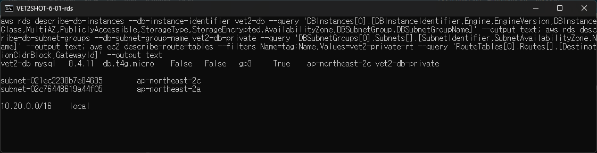

첫 줄은 차례로 이름, 엔진, 버전, 인스턴스, Multi-AZ(`False`), 공개 접속(`False`), 저장 공간(gp3), 암호화(`True`), 영역(2c), 서브넷 그룹이다. 서브넷 그룹에는 2a, 2c 의 사설 서브넷이 있고, 그 라우팅 표의 경로는 `10.20.0.0/16 local` 하나뿐이다 (인터넷 게이트웨이로 가는 길이 없다).

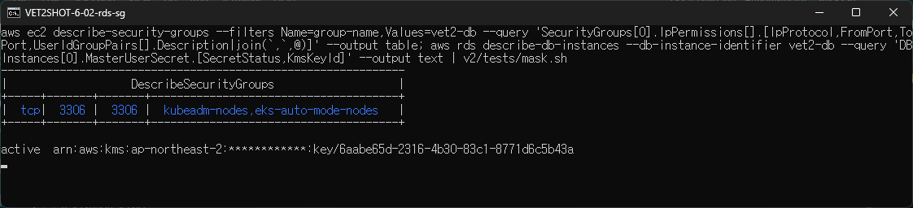

RDS 보안 그룹 `vet2-db` 의 들어오는 규칙은 TCP 3306 한 줄이고, 출처는 kubeadm 노드 보안 그룹과 EKS 클러스터 보안 그룹(설명 `kubeadm-nodes`, `eks-auto-mode-nodes`) 둘뿐이다. 아래 줄은 관리자 비밀번호가 Secrets Manager 에 `active` 로 있고 KMS 키로 암호화돼 있다는 뜻이다 (계정 번호는 가렸다).

파일: [rds.yaml](../infra/rds.yaml) (스택 `vet2-rds`), [network.yaml](../infra/network.yaml) (사설 서브넷), [components/rds](../k8s/components/rds/kustomization.yaml), [overlays/kubeadm-rds](../k8s/overlays/kubeadm-rds/kustomization.yaml), [overlays/eks-rds](../k8s/overlays/eks-rds/kustomization.yaml), [rds-secret.sh](../k8s/rds-secret.sh), [rds-check.sh](../tests/rds-check.sh).

```bash
v2/infra/stacks.sh up network && v2/infra/stacks.sh up rds
# 클러스터마다
v2/k8s/secrets.sh -n vet2-rds && v2/k8s/rds-secret.sh -n vet2-rds
v2/k8s/apply.sh kubeadm-rds        # EKS 는 eks-rds
kubectl -n vet2-rds wait --for=condition=complete job/db-init
v2/tests/rds-check.sh http://<워커 공인 IP>:30081      # EKS 는 http://<ALB 2 주소>
```

각 결정은 단계별 문서와 같은 형식이다: **증상 → 원인 → 판단 기준 → 후보와 탈락 이유 → 고른 방법 → 확인.** ○ 채움, △ 일부·조건부, × 못 채움. 근거는 측정(직접 해 봄), 동작(문서·정해진 동작), 추론(재지 않고 따져 봄).

### 2.2 R-1. 왜 DB 를 클러스터 밖으로 옮기나

**증상.** 필수 구성의 DB(StatefulSet + 볼륨)는 Pod 를 바꿔도 데이터가 남는다. 하지만 ③④에서 운영해 보니 DB 가 **어느 노드, 어느 가용 영역에 묶이는 것**이 문제였다.

- kubeadm: DB 가 있는 워커1 을 멈추자 `mysql-0` 이 `Terminating` 인 채 멈췄다. 188초 동안 DB 요청 313건이 실패했고, 워커1 이 돌아온 뒤 41초에야 회복했다 ([③ K-11](3-쿠버네티스-전환.md)).
- EKS: EBS 는 한 영역에만 붙는다. 남은 노드가 다른 영역이면 DB 가 옮겨 가지 못해 사람이 옮겼고(35초 끊김), DB 를 지키려는 표시 때문에 노드가 24시간 지워지지 않았다 ([④ E-4](4-EKS-전환.md)).

**원인.** DB 는 이 시스템에서 유일하게 상태(예약 데이터)를 가진 부품이고 하나뿐이다. 클러스터 안에 두면 데이터가 노드의 디스크나 영역의 볼륨에 묶이고, 그 노드나 영역의 사정이 그대로 DB 의 사정이 된다.

**판단 기준.**

1. **데이터 유지**: DB 를 다시 시작하거나 앱 Pod 를 바꿔도 예약이 남는다
2. **노드 장애**: 워커 하나가 갑자기 죽어도 DB 요청이 그 노드를 기다리지 않는다
3. **같은 방식**: kubeadm 과 EKS 에서 같은 방법. 환경마다 볼륨 드라이버와 예외 처리를 따로 두지 않는다
4. **운영 부담**: 백업, 패치, 장애 조치를 직접 만들지 않는다
5. **비용**: 실습 예산 안 (시간당 수 센트)
6. **소스 수정 없음**: 앱은 DB 주소만 바꾼다

**후보와 탈락 이유.**

| 후보 | 1 데이터 | 2 노드 장애 | 3 같은 방식 | 4 운영 | 5 비용 | 6 소스 | 판정 |
|---|---|---|---|---|---|---|---|
| StatefulSet + 워커 디스크 볼륨 (③ 필수 구성) | ○ (측정) | × 워커1 정지 시 DB 멈춤, 313건 실패 (측정) | × EKS 에서는 쓸 수 없다 | △ 백업 직접 | ○ | ○ | 필수 과제로는 충분, 기준 2·3 미달 |
| StatefulSet + EBS (④ 필수 구성) | ○ (측정) | △ 계획된 교체는 37초에 옮겨 감 (측정). 갑작스런 장애는 StatefulSet 이 기다린다 (동작) | × kubeadm 에는 EBS 드라이버 설치가 필요 (동작) | × 영역에 묶여 사람이 옮김, 노드 24시간 (측정) | ○ | ○ | 기준 3·4 미달 |
| MySQL 여러 대로 복제 (오퍼레이터) | ○ | ○ (추론) | ○ (추론) | × 오퍼레이터·장애 조치·백업을 직접 (추론) | △ Pod·노드 2 ~ 3배 (추론) | ○ | 기준 4 미달 |
| RDS Multi-AZ | ○ | ○ | ○ | ○ 영역 장애에 자동 전환 (동작) | × 대기 인스턴스까지 2배 (동작) | ○ | 기준 5 미달. 템플릿 값 하나로 바꿀 수 있게 둠 |
| **RDS 단일 AZ** | ○ (측정, 2.7) | ○ (측정, 2.7) | ○ 같은 component 를 두 클러스터가 씀 | ○ 백업·패치는 AWS. 대신 R-2, R-3 이 새로 생김 | △ 시간당 0.025달러 (측정: 요금표) | ○ | **채택** |

**한계.** 단일 AZ 라 RDS 가 있는 영역이 통째로 죽으면 DB 가 멈춘다 (재 보지 않음). 다시 시작하는 동안은 여전히 끊긴다 (2.7: 13.4초). 두 클러스터가 같은 DB 를 쓰므로 한쪽의 예약이 다른 쪽에도 보인다.

### 2.3 R-2. RDS 는 빈 DB 다. 스키마·시드·계정을 넣을 곳이 없다

**증상.** 클러스터 안 MySQL 은 db 이미지가 처음 뜰 때 스스로 스키마 4개, 시드, 서비스 계정 3개를 만들었다 (② C-8). RDS 는 그 이미지로 뜨지 않으므로 빈 MySQL 이다. 그대로 두면 서비스는 로그인부터 실패한다.

**판단 기준.**

1. RDS 를 인터넷에 열지 않는다 (사설 서브넷)
2. 초기화 순서를 한 곳에만 둔다. ①의 `db-init.sh`, ②의 db 이미지와 같은 내용
3. 여러 번 실행돼도 안전하다 (두 클러스터가 같은 RDS 를 쓴다)
4. 관리자 비밀번호가 명령줄·파일·화면에 남지 않는다
5. 소스를 고치지 않는다

**후보와 탈락 이유.**

| 후보 | 1 비공개 | 2 한 곳 | 3 반복 안전 | 4 비밀번호 | 5 소스 | 판정 |
|---|---|---|---|---|---|---|
| 이 PC 에서 RDS 로 직접 | × 공개 접속을 열어야 한다 | ○ | △ | △ | ○ | 탈락 |
| 관리용 EC2(점프 서버)에서 | ○ | ○ | △ 사람이 순서를 지켜야 한다 | △ | ○ | 탈락 — 자원이 하나 더 생기고 손 작업 (추론) |
| 앱 Pod 마다 `initContainer` | ○ | ○ | × 6개 Pod 가 동시에 초기화를 시작해 부딪친다 (추론) | ○ | ○ | 탈락 |
| CloudFormation 사용자 지정 리소스 (Lambda) | ○ | × SQL 과 시드 생성기(Node)를 Lambda 에 따로 넣어야 한다 | ○ | ○ | ○ | 탈락 (추론) |
| 앱의 마이그레이션 도구 (Flyway 등) | ○ | ○ | ○ | ○ | × 앱에 의존성과 설정을 더해야 한다 | 탈락 |
| **쿠버네티스 Job 이 db 이미지의 초기화 스크립트를 RDS 를 향해 실행** | ○ 클러스터 안에서 접속 | ○ 같은 파일 (`v2/docker/db/10-init.sh`) | ○ 끝났으면 아무것도 안 하고, 중간에 멈춘 DB 는 거부 | ○ Secret 을 환경 변수로 | ○ | **채택** |

**고른 방법.** Job `db-init` ([db-init.yaml](../k8s/components/rds/db-init.yaml)).

- db 이미지(1.1.0)의 초기화 스크립트를 두 방식으로 쓸 수 있게 했다. 주소(`DB_ADMIN_HOST`)를 주면 그 서버를 향해 클라이언트로만 돈다. 주지 않으면 전처럼 MySQL 진입 스크립트 안에서 돈다 (필수 구성의 `mysql-0` 이 이 방식이다).
- 다시 돌면 "마지막 단계(권한)까지 끝났는가"를 먼저 본다. 끝났으면 성공으로 끝나고, `vet_` 스키마가 있는데 끝나지 않았으면 이어 하지 않고 실패한다. 이어 하면 반쯤 된 DB 위에 시드가 두 번 들어갈 수 있다 (추론).
- 끝난 Job 은 1시간 뒤 지워진다 (`ttlSecondsAfterFinished`). Job 의 내용은 바꿀 수 없어서, 남아 있으면 이미지를 바꿔 다시 적용할 때 거부된다 (동작).

**확인.**

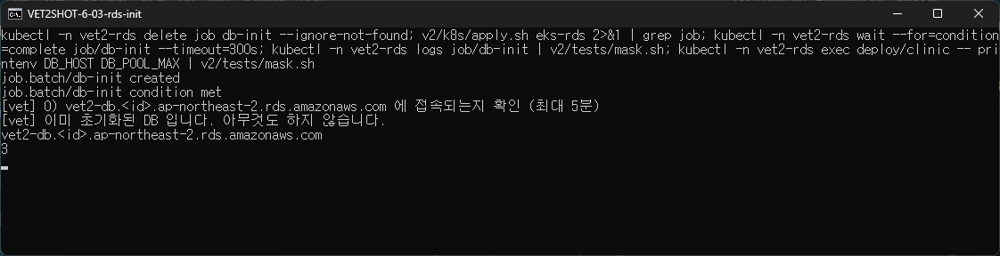

EKS 에서 Job 을 지우고 다시 만들었다 (2026-11-25). RDS 는 이미 초기화돼 있으므로 "이미 초기화된 DB" 로 끝났다(`condition met`). 아래 두 줄은 clinic Pod 의 `DB_HOST`(RDS 주소, 인스턴스 부분을 가림)와 `DB_POOL_MAX=3` (2.4) 이다.

처음 초기화할 때의 출력 (2026-11-24, 캡처 없음):

```
[kubeadm, 처음]  Job 끝까지 34초
[vet] 0) vet2-db.<id>.ap-northeast-2.rds.amazonaws.com 에 접속되는지 확인 (최대 5분)
[vet] 1) 스키마 4개와 서비스 계정 3개
[vet] 2) 테이블과 시드 (vet_load)
[vet] 3) 서비스별 스키마로 옮기고 권한 주기
[vet] 초기화 끝

[EKS, 같은 RDS 에 두 번째]  Job 끝까지 33초
[vet] 이미 초기화된 DB 입니다. 아무것도 하지 않습니다.
```

올리기 전에 이 PC 에서 빈 MySQL 컨테이너를 상대로 두 번 돌려 같은 결과(28초 초기화, 두 번째는 건너뜀)를 봤다. 같은 이미지를 MySQL 서버로 띄우는 원래 방식도 그대로 초기화를 마치는 것을 확인했다.

### 2.4 R-3. RDS 의 연결 한도(60)를 넘어 연결이 거절된다

**증상.** 두 클러스터를 RDS 에 붙인 뒤 관리자로 접속하자 거절됐다.

```
ERROR 1040 (08004): Too many connections
```

```
| max_connections                   | 60 |      ← 클러스터 안 MySQL 은 151
| Max_used_connections              | 61 |
| Connection_errors_max_connections | 9  |      ← 한도 때문에 거절된 연결
```

같은 무렵 EKS 에서 다시 배포하는 동안 3건, 업데이트·롤백 중 1건이 실패했다 (전에는 0건). 서비스 로그에는 `Communications link failure` 만 남아, 그 실패가 모두 연결 한도 때문인지는 확인하지 못했다.

**원인.**

- `db.t4g.micro` 의 연결 한도는 메모리로 정해져 60 이다 (측정: `@@max_connections`).
- 서비스의 연결 풀(HikariCP)은 최대 개수만큼 연결을 늘 열어 둔다. 공용 설정 `msa/common/.../vet-common.yml` 이 `maximum-pool-size` 와 `minimum-idle` 을 같은 값(`DB_POOL_MAX`, 기본 10, ③에서는 5)으로 정한다.
- 클러스터마다 서비스 3개 × 복제본 2 × 5 = 30, 두 클러스터면 60. 다시 배포할 때 Pod 가 하나씩 더 뜨면 넘는다. RDS 자신의 관리 연결(`rdsadmin` 2개)도 있다.

**판단 기준.**

1. 두 클러스터가 동시에 배포해도 한도를 넘지 않는다. 관리 접속을 위해 20% 는 비워 둔다 (48 이하)
2. 배포·장애 측정에서 실패한 요청이 늘지 않는다
3. 비용이 늘지 않는다
4. 소스를 고치지 않는다

**후보와 탈락 이유.**

| 후보 | 1 한도 | 2 실패 | 3 비용 | 4 소스 | 판정 |
|---|---|---|---|---|---|
| 그대로 (연결 5, micro) | × 평소 60, 배포 중 70 / 60. 거절 9번 (측정) | × EKS 배포 중 실패 3건 (측정) | ○ | ○ | 탈락 |
| 파라미터로 `max_connections` 를 올린다 | ○ | △ 1GiB 메모리에 연결을 늘리면 메모리가 모자랄 수 있다 (추론) | ○ | ○ | 탈락 |
| `db.t4g.small` 로 키운다 | ○ 메모리 2배라 한도도 약 2배 (동작: 계산식) | ○ (추론) | × 시간당 0.025 → 0.051달러 (측정: 요금표) | ○ | 탈락 |
| RDS Proxy 로 연결을 모은다 | ○ (동작) | ○ (추론) | × 따로 요금이 붙는다 (동작) | ○ | 탈락 |
| 한쪽 클러스터만 RDS 를 쓴다 | ○ | ○ | ○ | ○ | 탈락 — 두 환경 모두 RDS 로 보이는 것이 목표 |
| **서비스당 연결 수 5 → 3 (`DB_POOL_MAX`)** | ○ 클러스터마다 18, 배포 중 21. 둘이 동시에 배포해도 42 (계산) | ○ 아래 확인 | ○ | ○ 설정값만 | **채택** |

**확인.** 두 클러스터에서 **동시에** 다시 배포, 업데이트·롤백, Pod 삭제를 돌렸다 (258초).

| | kubeadm | EKS |
|---|---|---|
| 다시 배포 | 0 / 5,879 | 0 / 6,072 (전에 3건) |
| 업데이트·롤백 | 0 / 3,224 | 0 / 4,221 (전에 1건) |
| web Pod 삭제 | 1 / 934 (소켓 끊김, ③ O-4) | 0 / 1,069 |
| reservation Pod 삭제 | 0 / 65 | 0 / 365 |

```
측정 전   Connection_errors_max_connections 9   Threads_connected 15
측정 뒤   Connection_errors_max_connections 9   Threads_connected 33     ← 새로 거절된 연결 없음
```

지금의 연결 상태 (2026-11-25, RDS 를 다시 시작한 뒤라 누적 값은 0 부터 다시 센 것이다):

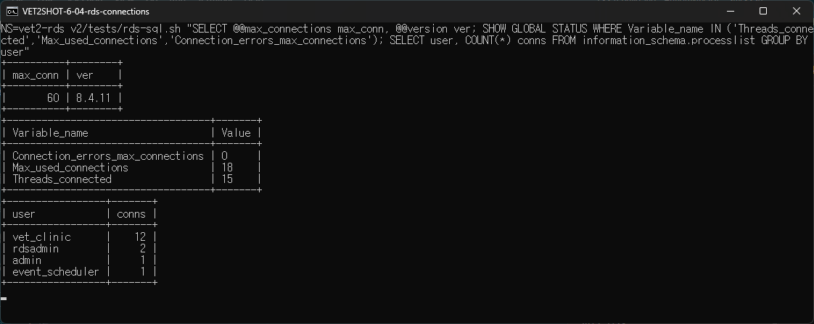

한도 60, 재시작 뒤 거절된 연결 0, 가장 많을 때 18. 이 순간에는 `vet_clinic` 만 12개(clinic Pod 4개 × 3)를 쥐고 있고 auth, reservation 의 연결은 보이지 않는다. 연결 풀은 최소 개수를 최대와 같게 두므로 늘 3개씩 있어야 하는데, 왜 두 서비스의 연결이 없는지는 확인하지 못했다 (다시 연결은 요청이 오면 된다. 6-05, 6-06 의 시나리오가 통과했다).

**한계.** 동시 5개 요청으로는 서비스당 연결 3개로 충분했다. 동시 사용자가 훨씬 많아지면 연결을 기다리는 시간이 생길 것이다 (재 보지 않음). 그때는 인스턴스를 키우는 쪽이 맞다.

### 2.5 비밀번호: RDS 관리자는 Secrets Manager

| 비밀 | 어디에 | 누가 쓰나 |
|---|---|---|
| RDS 관리자(admin) | RDS 가 만들어 **Secrets Manager** 에 둔다. 템플릿·명령줄·스택 기록에 없다. [rds-secret.sh](../k8s/rds-secret.sh) 가 읽어 Secret `vet-rds-admin` 으로 넣는다 | Job `db-init` 만 |
| 서비스 계정 3개, Redis | `v2/_run/secrets.env` (Git 밖) → Secret `vet-db`, `vet-redis` | 앱 |

**판단 기준**: ① Git·템플릿·명령줄에 값이 없다 ② 관리자 권한은 초기화에만 쓴다 ③ 따로 설치할 것이 적다.

| 후보 | ① | ② | ③ | 판정 |
|---|---|---|---|---|
| 관리자 비밀번호를 템플릿 매개변수(`NoEcho`)로 | △ 명령줄로 넘겨야 한다 (동작) | ○ | ○ | 탈락 |
| **RDS 가 만들고 Secrets Manager 에 보관 (`ManageMasterUserPassword`)** | ○ | ○ | ○ | **채택** |
| Pod 가 Secrets Manager 를 직접 읽음 (EKS Pod Identity + CSI 드라이버) | ○ | ○ | × kubeadm 에는 Pod Identity 가 없고, CSI 드라이버 설치가 필요 (동작) | 탈락 — 두 클러스터에 같은 방법을 쓰지 못한다 |

**한계.** 관리자 비밀번호는 **7일마다 자동으로 바뀐다** (측정: `RotationEnabled True, 7일`). 클러스터에 옮겨 둔 `vet-rds-admin` 은 바뀌지 않으므로, 초기화 Job 을 다시 돌리기 전에 `rds-secret.sh` 를 다시 실행한다. 앱은 이 비밀번호를 쓰지 않아 영향이 없다.

### 2.6 R-4. EKS 노드의 보안 그룹은 Auto Mode 가 만든다

**증상.** RDS 의 보안 그룹은 3306 을 누구에게서 받을지 정해야 한다. kubeadm 은 노드 보안 그룹(`vet2-nodes`)을 직접 만들었으니 그것을 적으면 된다. EKS Auto Mode 의 노드는 그런 그룹이 없다.

**원인.** Auto Mode 노드에 붙는 보안 그룹은 EKS 가 만든 **클러스터 보안 그룹**이다 (2026-11-24 기록, 캡처 없음).

```
$ aws eks describe-cluster --name vet2-eks --query 'cluster.resourcesVpcConfig.clusterSecurityGroupId'
sg-01039d7958cd514a2
노드 i-0735af8ff72a8f10b  보안 그룹: sg-01039d7958cd514a2
노드 i-0fa7c74aa78e1be35  보안 그룹: sg-01039d7958cd514a2
```

**판단 기준.** ① RDS 에 닿을 수 있는 것을 클러스터 노드로만 좁힌다 ② 노드가 바뀌어도 다시 손대지 않는다 ③ 스택으로 관리되고, 손으로 적는 ID 가 없다 ④ Auto Mode 의 기본 설정을 바꾸지 않는다.

| 후보 | ① 좁음 | ② 노드 교체 | ③ 스택 | ④ 기본 그대로 | 판정 |
|---|---|---|---|---|---|
| VPC 전체(10.20.0.0/16)를 연다 | × ALB 를 포함해 VPC 안 모든 것이 닿는다 | ○ | ○ | ○ | 탈락 |
| 노드 IP 를 하나씩 | ○ | × 노드가 바뀔 때마다 (동작) | × | ○ | 탈락 |
| 노드용 보안 그룹을 만들어 Auto Mode NodeClass 에 지정 | ○ | ○ | △ NodeClass 는 스택 밖 | × 기본 NodeClass 를 바꾸거나 새로 만든다 (동작) | 탈락 |
| Pod 마다 보안 그룹 | ○ 가장 좁다 | ○ | △ | × 설정이 늘고 Auto Mode 에서 따로 확인해야 한다 (추론) | 탈락 |
| **클러스터 보안 그룹을 EKS 스택이 내보내고, RDS 스택이 받는다** | ○ | ○ 새 노드에도 같은 그룹 (측정) | ○ `vet2-EksClusterSg` | ○ | **채택** |

그래서 스택을 만드는 순서가 eks → rds 이고, 지울 때는 rds 를 먼저 지워야 eks 가 지워진다 (`stacks.sh` 가 이 순서를 지킨다).

### 2.7 측정 (2026-11-25, 사설 서브넷의 RDS)

**시나리오 테스트** — EKS (ALB 2):

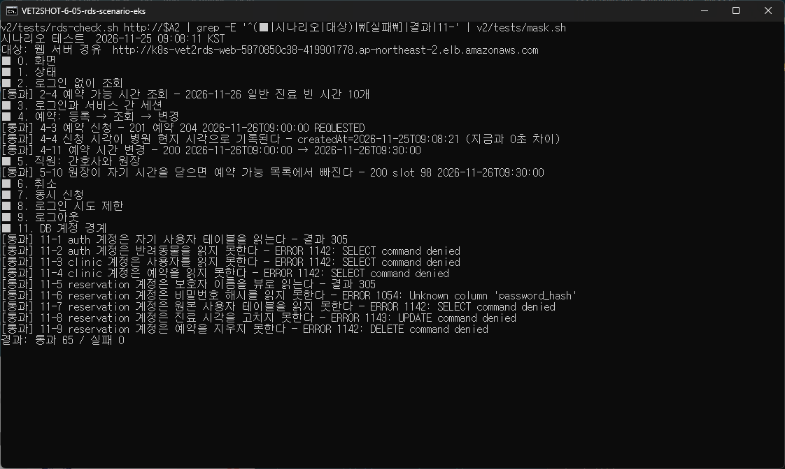

kubeadm (NodePort 30081):

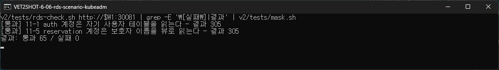

두 클러스터 모두 **65 / 65**. kubeadm 쪽은 실패 줄과 결과만 골라 보였다 (`결과 305` 가 든 두 줄도 걸렸다).

**RDS 재시작 뒤 데이터 유지** — EKS 의 RDS 구성에서 `aws rds reboot-db-instance`:

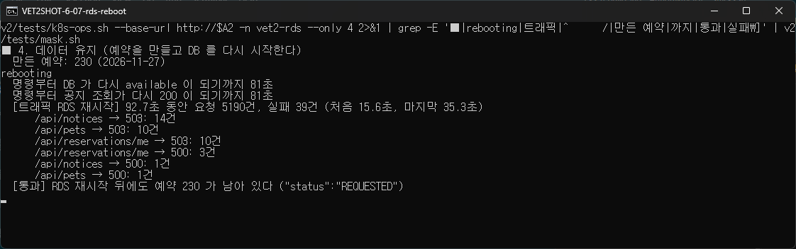

| 본 것 | 값 |
|---|---|
| 예약 230 | 재시작 뒤에도 남아 있다 |
| 요청이 실패한 구간 | 15.6초 ~ 35.3초 (약 20초). 약 5,200건 중 39건 (503 34건, 500 5건) |
| RDS 상태가 다시 `available` | 81초. **요청은 35초부터 이미 성공했다** |

DB 를 쓰지 않는 요청(화면, 상태)은 그동안에도 성공했다. 500 이 섞이는 것은 소스의 동작이다 (③ O-2).

**Pod 를 모두 바꿔도 데이터 유지** — 앱 Pod 8개를 한꺼번에 지웠다:

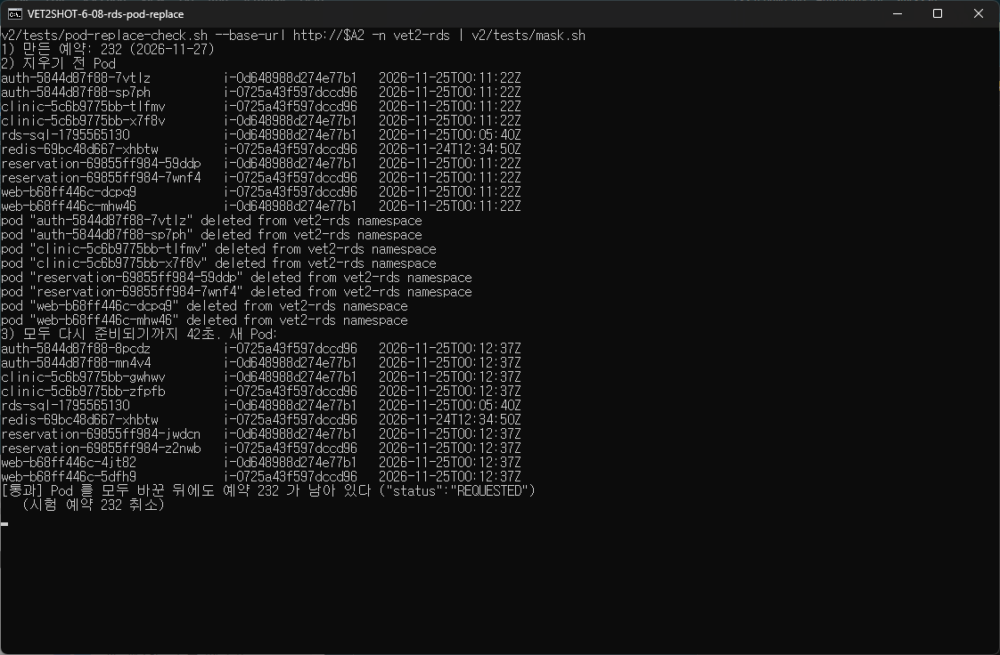

42초 뒤 모두 다시 준비됐고 예약 232 가 남아 있다. 필수 구성(④ 5.5)의 288초와 다른 것은 MySQL 을 함께 지우지 않았기 때문이다 (DB 는 클러스터 밖에 있다).

**이전 기록 (2026-11-24, 퍼블릭 서브넷 시절, 캡처 없음)** — 필수 구성과 RDS 구성을 같은 클러스터에 함께 띄운 상태에서:

| 클러스터 | 필수 구성 (`vet2`, 클러스터 안 MySQL) | RDS 구성 (`vet2-rds`) |
|---|---|---|
| kubeadm | 65 / 65 (NodePort 30080) | 65 / 65 (NodePort 30081) |
| EKS | 65 / 65 (ALB 1) | 65 / 65 (ALB 2) |

DB 계정 경계(11번)는 RDS 에 서비스 계정으로 직접 접속해 확인한다. "못 한다" 9개는 로그인한 뒤 **권한 때문에** 막혀야 통과한다.

```
[통과] 11-2 auth 계정은 반려동물을 읽지 못한다 — ERROR 1142: SELECT command denied
[통과] 11-6 reservation 계정은 비밀번호 해시를 읽지 못한다 — ERROR 1054: Unknown column 'password_hash'
[통과] 11-8 reservation 계정은 진료 시각을 고치지 못한다 — ERROR 1143: UPDATE command denied
```

**DB 재시작 뒤 데이터 유지** — EKS 에서 `aws rds reboot-db-instance`, 같은 시간에 kubeadm 에도 요청을 보냈다:

```
rebooting
  명령부터 DB 가 다시 available 이 되기까지 67초
  명령부터 공지 조회가 다시 200 이 되기까지 68초
[트래픽 RDS 재시작] 78.4초 동안 요청 3843건, 실패 28건 (처음 11.9초, 마지막 25.4초)
[트래픽 kubeadm (같은 시간)] 83.0초 동안 요청 4004건, 실패 28건 (처음 15.7초, 마지막 29.1초)
  [통과] RDS 재시작 뒤에도 예약 205 가 남아 있다 ("status":"REQUESTED")
```

DB 를 쓰는 요청이 약 13.5초 실패했고, 두 클러스터가 같은 건수만큼 실패했다. **RDS 의 상태값은 실제보다 40초 가까이 늦다.** 요청은 25초에 이미 성공했지만 `available` 은 67초였다.

**DB 가 있던 노드를 멈췄을 때 (2026-11-25)** — kubeadm 의 워커1(`mysql-0` 이 있는 노드)을 강제로 멈추고, 필수 구성(30080)과 RDS 구성(30081)에 **같은 시간에** 요청을 보냈다 ([node-down.sh](../tests/node-down.sh)).

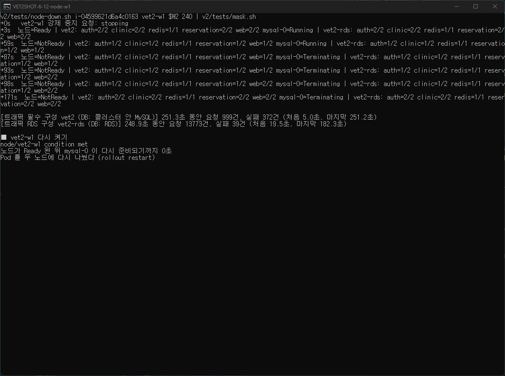

| | 필수 구성 `vet2` (클러스터 안 MySQL) | RDS 구성 `vet2-rds` |
|---|---|---|
| 앱 Pod | +171초에 모두 2/2 | +171초에 모두 2/2 |
| DB | `mysql-0` 이 끝까지 `Terminating` (죽은 노드에 묶인 볼륨) | 영향 없음 (클러스터 밖) |
| 실패한 요청 | **약 1,000건 중 372건**, 마지막 실패가 측정 끝(251초)까지 이어짐 | **약 13,800건 중 39건**, 마지막 실패 182.9초 |

필수 구성은 요청 수 자체가 적다. DB 를 쓰는 요청이 응답을 기다리다 늦게 실패해서 같은 시간에 보낸 요청이 적다.
RDS 구성의 실패 39건은 죽은 노드에 있던 앱 Pod 와 Redis 로 간 요청이다. 노드를 다시 켠 뒤 `mysql-0` 은 워커1 에서 다시 떴다 (시작 시각 00:18:54Z). 캡처의 "다시 준비되기까지 0초"는 옛 Pod 의 상태를 읽은 것이라 믿지 않는다.

이전 기록 (2026-11-24, 그때 RDS 구성은 `vet2` 에 있었다, 캡처 없음):

```
+0s    워커1 강제 중지 요청
+55s   노드1=NotReady | auth=1/2 clinic=1/2 redis=0/1 reservation=1/2 web=1/2
+91s   노드1=NotReady | auth=1/2 clinic=1/2 redis=1/1 reservation=1/2 web=2/2
+123s  노드1=NotReady | auth=2/2 clinic=2/2 redis=1/1 reservation=2/2 web=2/2
[트래픽] 147.4초 동안 요청 2906건, 실패 115건 (처음 6.4초, 마지막 107.5초)
```

필수 구성에서 같은 워커를 멈췄을 때는 DB 가 그 노드가 돌아올 때까지 멈췄다 (③ K-11). RDS 에서는 DB 요청이 멈추는 구간이 없고, 남은 실패는 죽은 노드의 앱 Pod 와 Redis 로 간 것이다.

**측정 도구에서 고친 것.** 처음 RDS 재시작 측정은 명령 5초 뒤의 200 을 "복구"로 보고, DB 가 아직 내려가 있을 때 예약을 확인해 "예약이 없다"고 냈다. RDS 에 직접 물어 예약이 남아 있음을 확인했고, 상태가 `available` 이 될 때까지 기다린 뒤 확인하게 고쳤다. DB 계정 경계 검사가 로그인 실패(ERROR 1045)도 "막힘"으로 세던 것도 고쳤다.

### 2.8 R-5. RDS 를 사설 서브넷으로 옮김

**증상.** 처음에는 RDS 를 노드와 같은 퍼블릭 서브넷에 두고 공인 IP 만 없앴다(`PubliclyAccessible: false`). 과제 명세의 RDS 구성은 "사설 서브넷 · 보안 그룹"이다. 퍼블릭 서브넷은 인터넷 게이트웨이로 가는 경로가 있어, 설정 하나(`PubliclyAccessible`)만 바뀌어도 밖에서 닿을 수 있게 된다.

**판단 기준.** ① 설정 하나가 바뀌어도 인터넷과 오갈 수 없다 ② NAT 같은 시간 과금 자원을 늘리지 않는다 ③ 노드(퍼블릭 서브넷)에서는 그대로 닿는다.

| 후보 | ① | ② | ③ | 판정 |
|---|---|---|---|---|
| 퍼블릭 서브넷 + `PubliclyAccessible: false` (처음) | × 경로는 있다 (동작) | ○ | ○ | 탈락 |
| 사설 서브넷 + NAT 게이트웨이 | ○ | × NAT 는 시간당 과금 (동작). RDS 는 밖으로 나갈 일이 없다 | ○ | 탈락 |
| **사설 서브넷, 라우팅 표에 VPC 안(local) 경로만** | ○ | ○ | ○ 같은 VPC 라 local 경로로 닿는다 | **채택** |

**고른 방법.** network 스택에 사설 서브넷 2개(10.20.11.0/24 2a, 10.20.12.0/24 2c)와 경로가 `local` 하나뿐인 라우팅 표를 더하고, RDS 의 서브넷 그룹을 그쪽으로 바꿨다. RDS 의 이름(`vet2-db`)을 고정해 두어서 CloudFormation 이 자리에서 바꾸지 못하므로, RDS 스택을 지우고 다시 만들었다 (지우기 122초, 만들기 580초). 데이터는 모두 시험용이라 초기화 Job 이 다시 넣었다.

옮긴 뒤의 상태는 2.1 의 캡처(6-01)다: 공개 접속 `False`, 서브넷 그룹 `vet2-db-private`, 라우팅 경로는 `local` 하나.

**확인** (2026-11-24, 캡처 없음. 2026-11-25 에 다시 잰 것은 2.7).

```
[kubeadm-rds]  Job 8초:  [vet] 초기화 끝
[eks-rds]      Job 10초: [vet] 이미 초기화된 DB 입니다. 아무것도 하지 않습니다.
kubeadm-rds (NodePort 30081)  결과: 통과 65 / 실패 0
eks-rds (ALB 2)               결과: 통과 65 / 실패 0
```

RDS 재시작 (EKS 에서 명령, 같은 시간에 kubeadm 에도 요청):

```
  만든 예약: 202 (2026-11-26)
rebooting
  명령부터 DB 가 다시 available 이 되기까지 67초
  명령부터 공지 조회가 다시 200 이 되기까지 68초
  [트래픽 RDS 재시작] 78.3초 동안 요청 3786건, 실패 31건 (처음 9.0초, 마지막 27.3초)
      /api/notices → 503: 10건   /api/pets → 503: 8건   /api/reservations/me → 503: 8건   500: 5건
  [통과] RDS 재시작 뒤에도 예약 202 가 남아 있다 ("status":"REQUESTED")
[트래픽 kubeadm-rds (같은 시간)] 82.8초 동안 요청 4011건, 실패 29건 (처음 12.7초, 마지막 26.5초)
```

앱 Pod 는 RDS 를 다시 만든 뒤 모두 다시 배포했고(`rollout restart`), 그 뒤의 시나리오 테스트가 위의 65 / 65 다. 500 이 섞이는 것은 소스의 동작이다 (③ O-2).

## 3. Kustomize

**판단 기준**: ① 환경마다 다른 것만 따로 둔다 ② 비밀과 계정 번호를 Git 에 적지 않는다 ③ 따로 설치할 것이 없다 (`kubectl` 에 들어 있다) ④ 같은 조각을 여러 환경이 함께 쓴다.

| 후보 | ① | ② | ③ | ④ | 판정 |
|---|---|---|---|---|---|
| 환경마다 YAML 을 통째로 복사 | × 고칠 곳이 환경 수만큼 | ○ | ○ | × | 탈락 |
| Helm | ○ values 로 | ○ | × 설치 (동작) | ○ | 탈락 — 이번에는 하지 않았다 |
| **Kustomize (base + overlay + component)** | ○ | ○ 자리표시(`ECR_REGISTRY`, `MY_CIDR`, `RDS_HOST`)를 `apply.sh` 가 채움 | ○ | ○ component | **채택** |

```
v2/k8s/
├── base/                 web, auth, clinic, reservation, redis, PDB, 설정 (DB 없음)
├── mysql/                클러스터 안 MySQL (StatefulSet + 볼륨) — 필수 구성
├── components/rds/       RDS 조각 (초기화 Job, DB_HOST, DB_POOL_MAX) — kind: Component
└── overlays/
    ├── local/            이 PC: LoadBalancer :28080, 로컬 이미지, mysql/
    ├── kubeadm/          NodePort 30080, ECR, mysql/ + 볼륨 vet2-local
    ├── eks/              Ingress(ALB), 노드·영역 분산, mysql/ + 볼륨 vet2-ebs
    ├── kubeadm-rds/      NodePort 30081, ECR, components/rds
    └── eks-rds/          Ingress(ALB), 노드·영역 분산, components/rds
```

| overlay | 네임스페이스 | 밖으로 | DB | 볼륨 | 그 밖 |
|---|---|---|---|---|---|
| local | vet2 | LoadBalancer 28080 | mysql/ | 기본 `standard` | 로컬 이미지 |
| kubeadm | vet2 | NodePort 30080 | mysql/ | `vet2-local` (워커1 디스크) | |
| eks | vet2 | ALB | mysql/ | `vet2-ebs` (EBS gp3) | `minDomains`, 영역 분산, mysql·redis 정리 예외 |
| kubeadm-rds | vet2-rds | NodePort 30081 | RDS | 없음 | 연결 수 3 |
| eks-rds | vet2-rds | ALB | RDS | 없음 | 연결 수 3, 영역 분산, redis 정리 예외 |

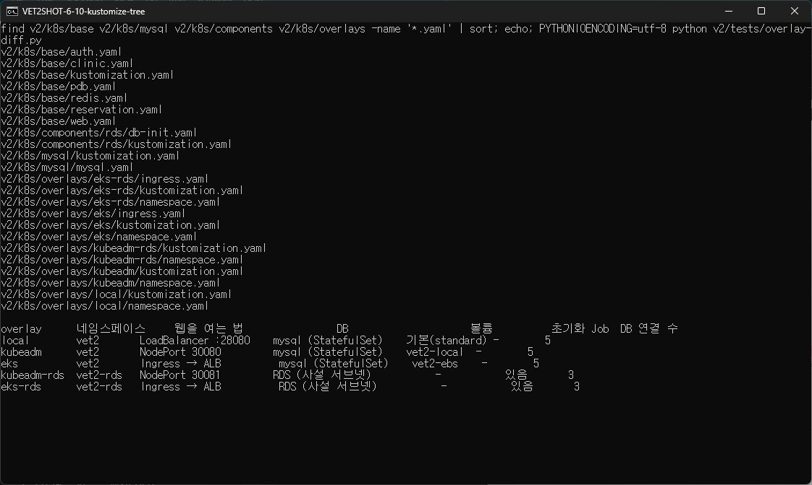

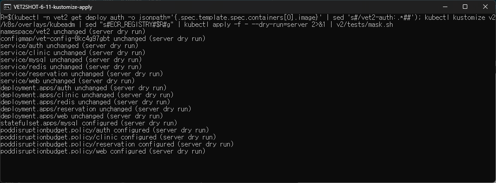

`kubectl kustomize` 결과에 ECR 주소를 채워 서버에 미리 적용(`--dry-run=server`)해 보았다. 앱의 Deployment·Service 는 모두 `unchanged` — 클러스터에 떠 있는 것과 Git 의 매니페스트가 같다. StatefulSet 과 PDB 가 `configured` 로 나오는 것은 처음 적용할 때와 기록용 주석(`last-applied-configuration`)이 다르기 때문으로 보인다 (확인하지 않았다).

이 PC 의 클러스터는 자리표시가 없어 `kubectl apply -k v2/k8s/overlays/local` 로 그대로 적용한다. AWS 쪽은 `v2/k8s/apply.sh <overlay>` 가 `kubectl kustomize` 결과에 실제 값을 채워 `kubectl apply -f -` 로 넘긴다. 적용 결과는 ③ 6.1, ④ 6.1, 이 문서 2.7 의 시나리오 테스트다.

## 4. PodDisruptionBudget — 노드를 비울 때 복제본 지키기

web 과 서비스 3개에 `minAvailable: 1` 을 두었다 ([pdb.yaml](../k8s/base/pdb.yaml)). 노드 정비(`kubectl drain`)로 Pod 를 내보낼 때 복제본이 하나는 남게 한다.

**확인** (kubeadm, [pdb-check.sh](../tests/pdb-check.sh)). 두 워커를 모두 cordon 해 새 Pod 를 놓을 곳을 없앤 뒤:

1. 워커2 의 앱 Pod 8개를 내보냈다. 각 앱은 워커1 의 하나만 남았고 `ALLOWED` 가 0 이 됐다.
2. 워커1 의 auth 를 내보내려 하자 PDB 가 거부했다 (`Cannot evict pod as it would violate the pod's disruption budget`). 20초 동안 다시 시도하다 멈췄고 auth 는 2개(두 네임스페이스에 하나씩) 그대로 Running 이었다.
3. uncordon 하고 다시 배포해 원래대로 돌렸다.

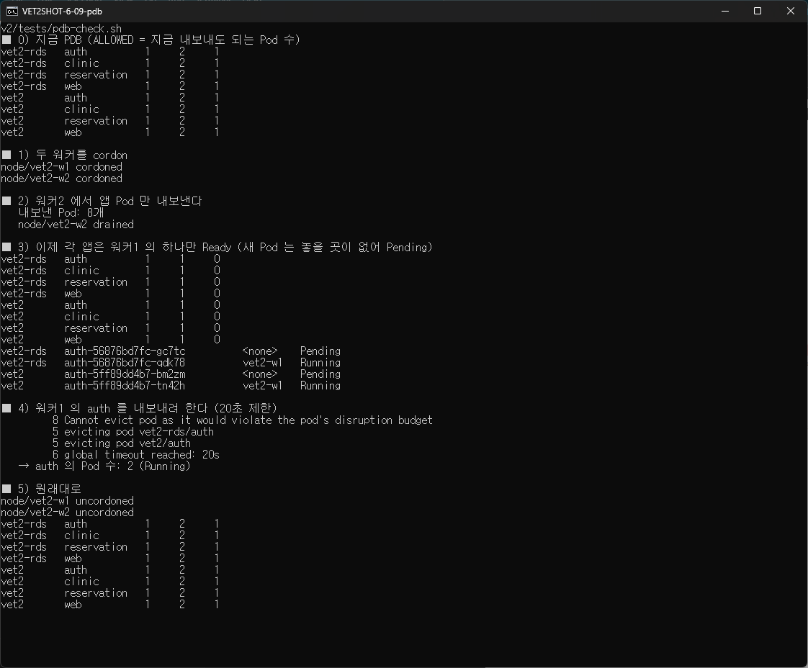

**한계.** PDB 는 drain 처럼 "내보내기"를 요청하는 작업만 막는다. 노드가 갑자기 죽는 것(③ 6.4)은 막지 못한다. 워커가 2대뿐이라 둘 다 비우는 정비는 PDB 때문에 끝나지 않는다 — 노드를 하나 더 두거나 한 대씩 정비해야 한다.
